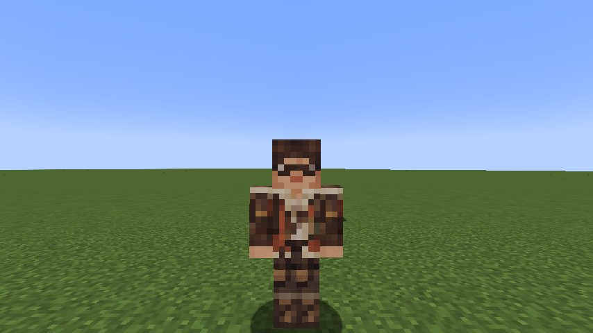
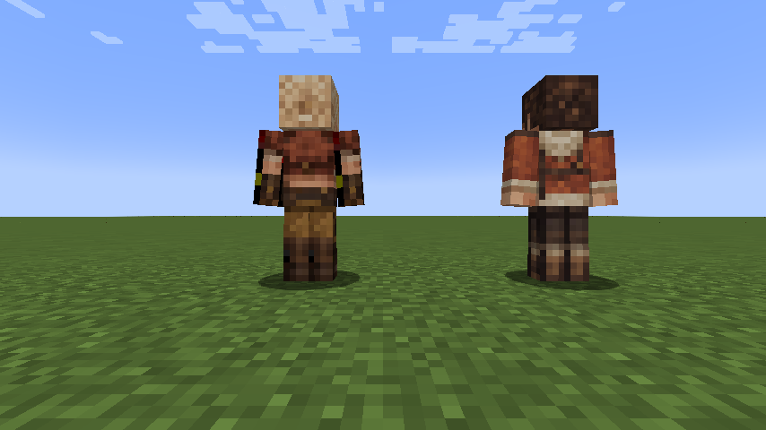

# Changelog

## 0.32.0 — Heavenly Restriction

- Add Fettered Human as a native reincarnation choice with four evolutions: Tempered Vessel, Unshackled, Heavenly Restricted and Heavenbreaker. Fixed base-EP and training milestones use native evolution requirements.
- Add the intrinsic Unique Chained: ownership-based magical-growth/skill restrictions, 100× aura capacity and converted natural regeneration; a martial combat toggle; mastered one-tier defense degradation and dodge bypass; in-slot projectile/general evasion.
- Pay native configured Resistance/Nullification acquisition costs with current aura while preserving native free grants.
- Track actual reincarnation roots and native derived grants. Keep Battlewills and Resistance/Nullification acquisition available. Add operator certification for known inheritance in older saves.
- Add Severance Rush, an instant 16-block teleport with separate 3-block path and 4-block arrival hits, costing 2% current aura. Its square-root resource formula is Battlewill damage.
- Add original pixel icons, a procedural broken-chain teleport wake, race/skill wiki articles and native integration tests.

## 0.31.0 — Eschaton and Aion spectacle pass

- Establish an anime visual direction for Eschaton and Aion: filled blade smears, curled wave crests, tapered spatial tears, saturated light plumes and distinct local impact bursts.
- Strengthen Eschaton’s execution windup/recoil and extend the apocalypse animation through its actual buildup and release. Place scripture, wave ribs, exchange vessel and regalia at their respective attack positions. Keep golden safe openings readable.
- Give Aion torn gold/violet spatial seams, inward-folding gravitational petals and a three-dimensional checkpoint clock. Reinforce the twenty singularities’ trails, photon rims and individual detonations while retaining stable disk orientation and native homing paths.
- Add separate straight-alpha light materials and four original masks while preserving legacy additive optics. Primary geometry remains visible with reduced particles; optional flares fade near the camera.
- Publish native motion previews, updated formation photos, editable assets and the refreshed offline wiki. Damage, costs, cooldowns, targeting, progression and boss phase rules are unchanged. Other skill families await review of this direction.

## 0.30.0 — The Last Myth

- Add Eschaton, the Last Myth: an Origin Sovereign with exactly one billion native EP, 1M HP, 4M SHP, four resource bossbars and three fatal forms. Native Infinite Regeneration takes priority over revival.
- Add boss-exclusive Godly Demiurge with eight paid, independently timed arts, plus actual Aion/Thoth auxiliary casts and the complete native defense package.
- Add destructible Genesis Seals that drain finite resources, open golden refuges and interrupt the apocalypse with a stagger opening.
- Add original Blockbench/GeckoLib boss, seal, ten effect rigs and two item models, smooth tapered crescents and custom celestial optics.
- Add Last Convergence survival ritual, native multiplayer arena, final-kill loot, one-time Crown legacy and fragment rematch/recovery recipes.
- Add complete boss, race and skill wiki articles with per-ability damage types, encounter strategy and rewards. Preserve existing content and the stable wildhunt namespace.

## 0.29.1 — Smooth model silhouettes

- Replace 73 segmented ring structures with continuous beveled annuli, smooth circumferential normals and luminous inlays, attached to the existing animated bones. Gates, conductors, orreries, meridians and Ananke’s crown use the same path. Janus’s frame and aperture now share their center and opening height.
- Replace stepped crystal/gem bodies and blunt weapon tips with true facets; curve foliage, petals, water crests and wing feathers. Bevel grimoire covers, codices, selected armor and accessory packs. Remove cuboid shells from Oil Lash’s continuous tube.
- Cache custom surface vertices at three distance levels; omit editor preview cubes from the exported runtime geometry. Preserve native lighting, glow masks and Ananke’s confirmed hit overlay.
- Refresh the native visual gallery and offline wiki. Gameplay values, targeting, progression and phase behavior are unchanged.

## 0.29.0 — Authored models and animated world visuals

- Add 69 original, editable Blockbench projects and export them through the official editor/GeckoLib plugin: 62 effect rigs, two impact variants, Ananke, two NPC equipment rigs and two ritual item models.
- Integrate GeckoLib appearance/loop animation, selective emissive materials, translucent crystal/glass and field layouts that preserve the size of individual books, trees and mirrors. Keep custom beams, trails, fluids, exact warnings and black-hole optics where appropriate; add stable warm/cool accretion-side coloration.
- Replace Ananke’s Java model with layered armor, six articulated feather wings, head tracking, flight/ritual animations, phase crown details and a revival ascent. Preserve confirmed HP/SHP damage flashes and regeneration-first combat lives.
- Add animated travel/smithing equipment to Alma and Gemma while retaining native bodies, skins, held equipment, poses and subordinate support. Model the Writ of Last Dawn and Dawn Testament in 3D.
- Add asset-graph validation, artist/export documentation and native visual previews. Require GeckoLib 4.9.3 (4.x). Combat balance, damage, targeting, cooldowns, costs and progression are unchanged.

## 0.28.0 — Exhaustion-based phases and confirmed damage feedback

- Replace percentage-health phase gates with fatal-defeat revivals. Funded, eligible Infinite Regeneration gets native death-prevention priority. Once it cannot prevent death, the first two defeats advance one phase and refill HP, SHP, magicules and aura to their current caps; the final defeat ends the encounter.
- Cancel old rites and auxiliary attack plans at revival, preserve learned supports and native cooldowns, save the current phase, and keep final rewards/progression exclusive to the real death. Operator kill remains direct.
- Restore Minecraft red model feedback for confirmed HP/SHP losses despite Pain Nullification. Preserve native immunity, avoid flashing on nullified/dodged attacks, and synchronize the brief visual window independently of immediate healing.
- Add native phase, regeneration-priority, resource, SHP-death, reward, persistence and hit-feedback checks. Make asynchronous visual fixtures wait for their native state. Update the gameplay wiki and release editions.

## 0.27.0 — Ananke native regeneration and full defenses

- Remove Unwritten Renewal, its channel, costs, cooldown, bossbar mode and custom effect. Replace Self-Regeneration with mastered, enabled native Infinite Regeneration.
- Grant and activate all 44 native defenses: every resistance and every nullification. The complete mastered boss package now contains 53 skills. Retain native magicule-funded recovery, healing limits, configuration and bypass rules.
- Migrate existing bosses without resetting resources or movement cooldowns, remove the former gradual regeneration and discard the retired recovery state. Observe phase thresholds before native regeneration heals wounds.
- Update native activation/registry, regeneration, migration and bypass tests, gameplay documentation and release files.

## 0.26.0 — Ananke support and tactics

- Consolidate Ananke skill activation into its stored native instances; remove duplicate profile skill initialization and repair existing 0.25 saves once without refilling wounds/resources or duplicating modifiers. Add Light, Darkness and Spatial Resistance for an eighteen-skill mastered package.
- Add Unwritten Renewal: a visible, interruptible, magicule-funded HP/SHP recovery sequence with a damage delay, windup, four bounded pulses and a persisted cooldown. Preserve native healing suppression, severance and actual-healing refunds.
- Make Moira selection range-aware and out-of-range activations free. Add a paid, collision-checked spatial gap closer between casts with a ten-second cooldown. Release movement after damaging frames while cosmetic tails finish, and clean those tails on interruption/reset/removal.
- Preserve Moira/Thoth damage, health, EP and Godly ownership rules. Add native support, migration, defense, endgame-hit, recovery economy/interruption and tactical regressions. Update the gameplay wiki, validation and release editions.

## 0.25.0 — The First Myth

- Add Ananke, the Unwritten End: a 30M-EP Eclipse Seraph with real 48,000 HP, 120,000 native SHP, two native tracking bossbars placed clear of Tensura’s player HUD, six articulated wings and three combat phases. Keep its health-range exception local to this entity; external health modifiers still apply.
- Add the boss-intrinsic Ultimate Moira, Lord of Finality, with four native paid/cooldown modes: a locked aura-slash fan, individually warned Light starfalls, a once-per-victim hollow Darkness wave, and a Space blast with a real gold refuge annulus. No EP damage scaling or incoming damage cap.
- Give Ananke a fifteen-skill mastered package, including Thoth, native perception, gradual Self-Regeneration and resistances. Use paid Thoth support, Astral Library and Spellbreak in later phases. Preserve shared Godly ownership traits; allow Countermand to interrupt Ultimate Moira. Keep native negative-mastery learning records unmastered.
- Add a survival lodestone ritual, original item art and model atlas, spawn egg, player-kill trophy/loot, challenge advancement, native boss tags and native IArenaBoss support. Add operator summon and non-overwriting arena-profile setup commands. Apply arena eligibility to auxiliary Myths spells as well as Moira.
- Persist native resources and wounds; cancel pending rites on reload, death, interruption or removal. Reset a fully abandoned encounter after ten seconds. Add focused native regression coverage, implementation research, per-ability damage-type wiki articles, captured media and release editions.

## 0.24.0

- Replace Lugh’s percentage mastery and attack-speed bonuses with flat +49 native learning/mastery gain and 50% shorter cooldown recovery for other skills. Exclude every Lugh mode, preserve +35% movement and 240-MP/s upkeep, and remove both gain modifiers on cleanup.
- Rename Skill Appraisal to Skill Bank. A normal press directly opens the free Pride-style bank; crouching is optional. Preserve bank entries, bindings, selected Art, source parameters and native save data.
- Move technique scanning into All-Skilled: automatically collect actual damaging techniques used within 64 blocks while funded and enabled. Refresh stable skill/mode entries without changing bindings, preserve the storage bound, and throttle scan optics independently of capture.
- Add native tests for point gains, automatic range/toggle rules, native cooldown recovery, the Lugh exclusion and lifecycle cleanup. Update individual gameplay pages, UI labels and release editions.

## 0.23.0

- Make each of Genesis Verdict’s twenty black holes deal its own native Space-elemental hit. Scope hurt-cooldown bypass to these individual collision sources, preserving ordinary attacks, native skill metadata, defenses and the 9,600 / 12,000 raw budgets.
- Require an eligible aimed mob/player before payment, cooldown or Horizon consumption. Continuously home through final approach without the previous lock or formation tether; freeze only completed detonation positions. Halve flight durations and stagger individual impacts from 1.6 to 3.5 seconds.
- Rebuild the accretion optics around the Interstellar/Gargantua production reference: broad striated disks with stable world planes, lensed rear arcs, restrained emission and dark silhouettes. Add original optical-burst art and much larger layered collision effects, keeping damage radii explicit.
- Update native regression coverage, animation research, gameplay documentation, captured media and release editions.

## 0.22.0

- Replace Aion’s Genesis Verdict with twenty suspended miniature black holes that fly along distinct seeded cubic curves and explode in five four-hole salvos. Track an aimed enemy within a bounded tether, then freeze each salvo’s aim six ticks before impact; retain cursor placement when no enemy is acquired.
- Add anticipation, velocity-driven volume-preserving squash/stretch, layered accretion disks, projected photon rings, curved trails, implosion flashes and expanding shock fronts. Share one synchronized cast clock and seed across all clients; keep all twenty holes at reduced particle settings.
- Preserve the 28K-MP / 45-second economy and 9,600 / 12,000 total raw damage budgets. Aggregate each salvo’s four overlapping blasts into one native hit per recipient, preserving hit immunity, mastery, damage typing and owner/PvP protections. Event Horizon still empowers the finisher.
- Add native trajectory, target-lock, economy, damage-timing and cleanup checks, animation research notes, gameplay media and refreshed wiki editions.

## 0.21.0

- Skill Appraisal now accumulates a persistent Lugh technique library instead of replacing an equipped art. Record source modes separately, refresh known techniques by stable ID, and preserve the old three-entry loadout on migration.
- Shift + Skill Appraisal opens a Pride-style native panel with search, scrolling list, source icons and detailed damage/type/form/range parameters. Opening, selecting and binding are free even during cooldown and at zero MP.
- Bind library entries explicitly to Art I/II/III. Reconstructed Art uses the active binding; Grand Synthesis freezes all three bindings when cast. Existing crouch cycling remains a free shortcut. Server validation accepts only learned record IDs and valid slots.
- Update the Lugh article, generated GitHub Wiki edition, styled wiki and offline bundle. Combat budgets, Countermand and shared Godly traits retain their existing rules.

## 0.20.0 — External Unique calibration and funded Grove healing

- Apply the native Tensura / Mysticism / Nightmares Unique audit with individual damage and aura-cost adjustments across all eight Uniques. Make the largest cuts to repeatable attacks and compact detonation; keep the more constrained tether burst stronger relative to its former budget. Reduce Current's drenched bonus to 25%.
- Change Living Grove from fixed-cost team recovery to a 600-aura placement plus aura for every HP/SHP restored to each recipient. Rates improve from 40/60 AP per HP/SHP to 30/40 with mastery. Partial funding is shared proportionally; full pools cost nothing and unused/canceled/reduced HP healing refunds its reservation. Native healing suppression and regeneration exceptions remain in effect.
- Preserve the kits' targeting, movement, native barriers, reflection, fields and distinctive mechanics, with the existing combination Ultimate/Godly budgets and classification traits. Add native Musician/Healer comparisons and healing economy/regression coverage. Update individual wiki pages, release editions and balance documentation.

## 0.19.0 — Unique and Godly balance

- Balance all eight Unique kits against the revised combination Ultimates: stronger fixed attacks and fields, higher aura budgets, improved Verdant sustain, and stronger Threadweaver / Rune Smith / Verdant / Mirrorbound utility passives. Remove the extra 0.90 damage penalty from the four playable apex Uniques. Keep their cooldowns, shapes, target rules and distinct mechanics.
- Raise Aion's channel, gravity-core and Verdict damage; price its initial casts for Godly strength while preserving free upward-only Causal Reversal returns. Raise Thoth's seven-element attacks without changing their durations, timing, elements or unlimited 2:1 Mana Crucible.
- Raise Lugh's bounded reconstruction range and origin arts, adjust Synthesis's per-art multiplier and costs, and upgrade saved archives without discarding their observed techniques or selection. Keep existing shared Godly traits, native hit handling, strongest ordinary elemental source and EP-independent damage.
- Update individual skill pages, damage information, mechanics, generated wiki editions and the release bundle. Add native damage/economy/cadence/save-upgrade coverage; preserve the approved Ultimate kits and visuals.

## 0.18.0 — Lugh and Ultimate reconstruction

- Add Lugh, God of Skills: a persistent three-entry technique archive with three immediately usable origin arts, bounded native-source reconstruction in Blade/Lance/Crown forms, a specific six-second non-Godly technique seal and a warned three-art Grand Synthesis. Add All-Skilled and the shared Godly classification traits. Ascension combines a mastered Ultimate and Threadweaver at the existing true-awakening/12M gate.
- Rework Vritra with stronger plasma/fuses, a storm-created second firing angle and a storm-consuming finisher. Rework Demeter with stronger orchard support, one-use Perennial Seeds instead of its active barrier, and allied healing on empowered harvest. Rework Janus with 48-block/30-second gates, inexpensive recasts, opposite-gate snares and warned Edict cuts.
- Add Anansi (Threadweaver + Rune Smith) with bounded anchors, crossing threads, momentum-preserving anchor exchange and a triangular two-phase finisher. Add Aegir (Scarlet Deluge + Mirrorbound) with three-angle water refraction, projectile redirection and an expanding once-per-victim tidal rim.
- Reference released Nightmares code/defaults and version-labelled Mysticism documentation for role, damage-type, resource and utility budgets. Increase Ultimate combat costs and passives, attach native level-1 resistance penetration, retain native hit immunity and strongest-source elemental bonuses, and keep EP out of damage formulas. Research and version caveats are recorded separately from gameplay articles.
- Extend native synthesis/ascension menus to five Ultimates and three Godly destinations, retaining their native layout and server validation. Preserve existing registry IDs, learned instances, presets, mastery and remaining cooldowns. Add original icons and distinct animated geometry; bound constructs and clear marker/attack leases on lifecycle cleanup.
- Add 20 native tests for progression, actual source observation, archive persistence/selection, native sealing, form geometry/timing, trap networks, refraction, expanding waves, ally rescue partial penetration and cross-dimension cleanup. Update the individual wiki articles, damage directory, generated editions and offline bundle.

## 0.17.0 — Shared Godly classification passives

- Move Aion’s +35% damage against non-Godly owners and native resistance/nullification bypass into always-active Godly ownership traits. Aion, Thoth and datapack-classified Godly skills qualify; multiple skills never stack the bonus. No toggle, upkeep or equipped mode is required.
- Scope penetration to damage attributable to the Godly owner, including ordinary melee, projectiles, skills and spells. Remove Aion’s target-wide defense/status suppression; other attackers and environmental damage no longer benefit. Preserve learned defenses and saved toggles. Aion retains recovering barriers and proximity movement/projectile slowing.
- Add Magic Interference immunity keyed to the originating skill’s Godly classification, rather than the caster’s other skills. Preserve Godly-origin interference and unrelated status rules; cleanse ordinary interference acquired before Godly ownership.
- Extend native combat/effect integration tests and update the individual skill articles, classification reference, ability index, in-game descriptions and generated/offline wiki editions.

## 0.16.0 — Thoth’s seven-element spectrum

- Expand Lexicon of Ruin and Astral Library to Fire, Water, Lightning, Earth, Wind, Light and Space, matching Thoth’s passive. Water represents the shared Water/Ice slot; no separate Ice, Darkness or Gravity phase is added. Other skills retain their Ice damage.
- Keep Lexicon’s 70-tick visual, original opening/last-strike times (12/52 ticks), costs, cooldown, area and target cap. Fit seven chapters into that window with 6–7 ticks between strikes, using 375 raw damage per chapter and preserving native hit immunity.
- Keep Library’s 200-tick duration, ten-tick opening delay, cost, cooldown, range and three-target cap. Fire every five ticks, with 160 raw damage per bolt. Recasts start at Fire. The three books take turns and receive the actual server volley for their tint, preventing client timing drift.
- Share element order, native damage sources, circle variants, colours and timing between combat and rendering. Add element-specific flame, water, lightning, earth, wind, light and space silhouettes to Lexicon and Library impacts. Extend only spell-ray styles to the full spectrum.
- Add native execution tests for complete source order, exact timing, bolt/book styles, cancellation/duration, native hit-immunity balance and retained Ice damage in Demeter. Harden the out-of-range baseline and pre-existing Mirror projectile fixtures, and check both spatial and UUID indexes before treating recipients as ready. Update the damage index, current skill article and both wiki editions.

## 0.15.0 — Skill visual overhaul

- Rework all eight Unique kits, Vritra, Demeter, Janus and Aion with original textured geometry, animated inscriptions and individual silhouettes. Thoth retains its recent rendering and held Mana Crucible behavior.
- Add branching Railbolt filaments and ion collars, Thunder Step speed tunnels, caustic water crests and a raised vortex, molten tentacles, owned oil surfaces with dark/violet flame cores, and veined ice.
- Build braided silk, inscribed rune circuitry, curved groves and briars, refracted beams, faceted orbiting mirrors, layered thunderclouds, warned volcanic eruptions, crystal orchards, architectural gates and timed spatial cuts.
- Give Aion astronomical clockwork, a clean dark gravity core, accretion optics and a dimensional hourglass. Add brief healing wisps to successful aura regeneration and paired helices to Concordance.
- Batch each visual’s materials, reduce detail at distance, respect native particle settings for decoration, and replace dense Railbolt server-particle traffic with a single synced visual per segment.
- Preserve damage, costs, cooldowns, progression, target selection, warning timings and quiet water/ice toggles. Bound oil surfaces with refreshed owner leases and retire replaced/expired pools; track actual NPC recipients for moving wards. Lift missed oil surfaces onto nearby ground without moving their damage centers, and keep local beam muzzles outside the camera.
- Add five native visual lifecycle/ownership/regeneration/ground-projection tests and update the individual articles, visual gallery and offline/GitHub Wiki exports. Full validation is recorded in `VALIDATION-0.15.0.md`.

## 0.14.1 — Held Mana Crucible

- Mana Crucible now channels through the native assigned skill key. Convert 2 aura into 1 magicule at 5% of maximum magicules per second, transferred every server tick. No activation payment, cooldown, duration limit or total transfer cap; actual aura reserves and maximum magicule capacity still bound each transfer.
- Stop on release, depletion, full magicules, suppression or lifecycle cleanup. The original crucible effect follows the owner throughout the hold and is removed when it ends.
- Duplicate callbacks cannot transfer twice per tick. Mastery requires successful sustained conversion, preventing free tap-spam rewards. Old saved Crucible cooldowns are cleared, and Thoth ascension keeps inherited cooldowns only on its other arts.
- Updated native descriptions and the wiki; per-ability damage remains unchanged.

## 0.14.0 — Skill identity, power and spellcraft

- Raised the fixed raw damage of all eight Uniques and all three combination Ultimates; shortened combat cooldowns, strengthened allied grove/orchard healing and extended Mirror Aegis to six seconds. Resource costs, mastery scaling, rank rules and EP-independent damage remain intact.
- Removed incidental passive shields from Mirrorbound, Demeter, Janus and Thoth. Silvered Soul gains light power/attack speed, Evergreen Sanctuary gains spiritual recovery/stability, Threshold Dominion gains spatial power/attack speed, and Arcane Sovereignty gains stronger chanting. Existing owned shield modifiers are cleaned on login and refresh without touching other sources.
- Retained Water Veil and Colossus Carapace's native recovering barriers, Demeter's dedicated active team ward and Aion's causality defense. Crystal Bulwark now lends 500 Multilayer capacity and 50 Physical/Magic Barrier for eight seconds.
- Native elemental attributes use the strongest positive ordinary modifier across flat/base/total operations, rather than stacking different sources. Innate base values, penalties and Thoth's Godly elemental multiplier remain. Non-elemental attributes and Aion's separate Godly damage bonus are unaffected.
- Added client interpolation for moving art entities and animated endpoint vectors. Water waves advance and sweep every server tick instead of alternating ticks. Library bolts originate at the corresponding animated book and synchronize their elemental color.
- Rebuilt all four Thoth arts with original 1,024px inscription seals, emissive layered geometry, animated textured grimoires, continuous trails, softly fading motes and separate chapter eruptions. Standard Minecraft rendering; no shader dependency. Original textures can be regenerated with `scripts/prepare-thoth-effects.py`.
- Updated individual wiki abilities, combat source rules, passive roles and screenshots. Release history stays in this document.
- Validation: 95 required native GameTests and 11 JUnit tests; real-client checks of Thoth's four arts. See `VALIDATION-0.14.0.md`.

## 0.13.0 — Combination skills and fixed progression gates

- Secondary evolution uses `secondaryRaceEP + secondaryEvolutionEPStep × stage`; neither current EP nor selection EP changes its requirements. Convergence uses the fixed completed-stage gates and native lineage requirements, ignoring old selection/evolution EP snapshots.
- Added four rollable Unique Skills: Threadweaver, Rune Smith, Verdant Keeper and Mirrorbound. Their mechanics are silk leashes, armed runes, allied healing/roots, and light splitting/projectile reflection respectively.
- Replaced the four original Ultimates with three two-Unique synthesis recipes: Storm Crown + Black Flame → Vritra; Verdant Keeper + Frostbound Colossus → Demeter; Threadweaver + Mirrorbound → Janus. Any race can synthesize at 2M base EP when both ingredients are mastered.
- Added Thoth, God of Magic: three-chapter elemental Lexicon, Spellbreak disruption/drain, 2:1 aura-to-magicule conversion, autonomous mobile Astral Library and Arcane Sovereignty. Ascend a mastered combination Ultimate and mastered Rune Smith at true awakening / 12M base EP. Native Ultimate classification plus the Godly tag is retained.
- Added Synthesis to the native Ultimate skill page and Aion/Thoth destination selection to native Godly Ascension. Replacement preserves all nine presets and carries the longest remaining source cooldown. The native Ultimate page title fits its new header control.
- Existing Raijin/Agni migrate to Vritra; Varuna/Ymir migrate to Demeter. Mastery fractions and cooldowns merge without downgrading an owned destination. Retired IDs remain decode-only and cannot cast, toggle, roll or appear in the playable Ultimate list. Their old passive/barrier modifiers are removed.
- Added eight centered original 64×64 icons, procedural silk/runes/briars/mirrors/plasma/trees/portals/open-book effects, and native elemental magic circles. Gates preserve player momentum and send native movement synchronization.
- Reorganized the gameplay wiki around the new recipes, with 142 articles and 50 indexed active/passive/racial entries. Every new ability includes its native damage type, costs, cooldowns and targeting limits; release history remains here.
- Validation: 90 native GameTests, 11 JUnit tests, real-client synthesis/ascension/gate checks and responsive wiki verification. See `VALIDATION-0.13.0.md`.

## 0.12.0

- Add shared smooth steering for Worldline Sever’s server damage ray and local preview. Use solid-block collision on both sides so water and lava no longer stop the server ray.
- Make Causal Reversal preserve any current HP, SHP, aura or magicules above the saved checkpoint, for both manual and automatic returns.
- Audit native secondary evolution branches and Daemon naming requirements. Show native weighted contributions and the added EP gate in a live checklist, preserving native alternatives and UI scroll/search/confirmation state.
- Clarify that receiving a native name satisfies “Be named”; mass-naming other entities does not. Verify Daemon Lord and Devil Lord evolution with real native naming.
- Change Concordance Pulse to restore 50% maximum HP and SHP without a fixed healing-amount cap, retaining its aura cost, cooldown and knockback.
- Update the gameplay wiki, all 105 fusion articles, exports and release bundle.

## 0.11.0

- Render the caster’s Worldline Sever directly from local aim every frame; update server aim every held tick. Damage remains server-authoritative.
- Increase Event Horizon’s living-target pull by 25%.
- Extend Unbroken Continuum to suppress nearby enemy Resistance/Nullification defenses against all damage and status sources without modifying their saved toggles. Slow hostile/unowned projectiles by proximity without compounding the speed reduction.
- Make Causal Reversal’s return free and automatic at timeout. Snapshot aura/magicules after the cast payment, restore within current caps, and recover in place if the timed-out anchor is blocked. Armed checkpoints survive temporary suppression; lifecycle cancellation never refunds resources.
- Derive Convergent Awakening EP from 125% of the highest preceding native/secondary evolution EP gate, retaining a configurable 10M minimum.
- Move the native selected-tab frame to the active Secondary Race/Awakening tab.
- Update gameplay reference, all 105 fusion requirements and offline/GitHub Wiki exports.

## Wiki organization for 0.10.0

- Reorganize 137 articles into shared Skills, Races, Otherworlders and Reference navigation, with skill-tier breadcrumbs and ancestry-based race links.
- Add individual recovery Extra Skill articles and a complete index of 37 active/passive ability variants, each with explicit damage type or non-damaging classification.
- Distinguish direct fire elemental hits from native Black Burn's black-flame source, and classify Water Veil retaliation, NPC loadouts and utility actions.
- Rebuild the styled edition, GitHub Wiki mirror and offline bundle. Gameplay code and the mod JAR remain unchanged.

## 0.10.0

- Restore native-sized icon buttons for all seven skill categories, including Godly, and fit their blue background to the grid.
- Move secondary race and convergence navigation into the unused native right-side tabs; remove the added Evolution header tabs.
- Show independent lineages as Primary/Secondary in native Status with bounded scrolling and hover text.
- Replace added secondary ancestry EP weights with a flat 10% native growth bonus, inherited by fused profiles.
- Require 2.5M additional base EP per secondary evolution, measured cumulatively from selection; preserve native requirements and existing stages.
- Turn Worldline Sever into an aimed six-second channel: 220 damage per half second, 800 magicules to start and 400 per additional pulse; cooldown begins on ending.
- Expand Event Horizon pull to 24 blocks while keeping its damaging core at 10 blocks and show both areas.
- Switch Aion active and passive costs to magicules. Add 35% damage against non-Godly owners, attack-scoped resistance/nullification degradation, and a temporary proximity slowing aura.
- Refresh gameplay articles, all 105 fused growth examples, mirrored GitHub wiki pages, screenshots and offline bundle.

This page records **Tensura Myths version history**, including gameplay changes, compatibility notes, and visual corrections.

## 0.9.0 — Native progression menus and Aion rework

- Restored all six original skill category buttons and positions. Godly is a native-styled button labeled only “Godly”.
- Replaced the separate Myths panel with native Evolution pages for Secondary and Awaken, plus a native skill-selection Ascension page. Preserved native navigation, character preview, search, scrolling and presets.
- Worldline Sever becomes an 80-block eight-target cleave with 900 opening damage and two 300-damage echoes; cooldown falls to four seconds.
- Event Horizon becomes a ten-block, ten-second gravity domain dealing 120 damage per second and curving hostile projectiles toward its core.
- Reversal gains recorded SHP recovery, a twenty-second checkpoint window and a shorter return cooldown.
- Verdict can be cast independently; consuming Horizon empowers its final strike and expands the area. Three warned pulses replace the previous low-damage burst.
- Added solid gravity cores, accretion bands, clockwork anchors, fracture fronts, thicker cleaves and native Gravity / Space / Recovery circles. Passive barriers rise to 45 physical / 45 magic and 1,200 multilayer, with funded recovery and ownership-safe cleanup retained.

## 0.8.0 — Tensura Myths

- Rebranded the addon while preserving its `wildhunt` registry namespace and all previous content.
- Added Godly as an additional skill classification and a seventh native skill category, retaining Ultimate compatibility.
- Added Aion, God of Causality: spatial piercing ray, placed gravity field, safe personal HP/position rewind, three-pulse field collapse, and a recovering native barrier passive. Damage uses mastery rather than EP.
- Added server-authoritative Duo selection, native secondary evolution, half-strength shared racial attributes, inherited reactions and ticks, and a separate configurable press/hold/release racial key binding.
- Native kill EP gains add half the secondary base ancestry's weights to the current primary's weights.
- Added Convergent Awakening requiring both final evolutions, True Hero/True Demon Lord and 10M base EP by default. Registered all 105 native ancestral pairs with individual names, icons and EP profiles. Awakening grants a configurable one-time 25% base energy increase.
- Added a progression screen, player commands, configurable server gates, native Ultimate/Godly tags, and save/death persistence.
- Expanded both wiki editions with Godly, Aion, Duo progression and individual pages for every fused race.
- Isolated the existing long-range Railbolt GameTest from neighboring fixtures; gameplay range and targeting are unchanged.

## 0.7.2 — Alma front hairline

- Corrected Alma's front hairline: replaced the deep triangular exposed forehead with a short, even fringe and a narrow forehead.
- Reused ManasCore's native race/skill registrars directly to prevent a constructor-time registry lookup failure.
- Changed only the upper half of her front head texture. Her glasses, eyes, nose, mouth, remaining head faces, outfit, and Gemma's complete skin are preserved from 0.7.1.

## 0.7.1 — Otherworlder hair corrections

- Replaced Gemma's side, top and back head textures to remove the black cutout artifact.
- Reworked Alma's hair into a coherent swept-back style with a low bun.
- Preserved both existing front faces, outfits and equipment pixels exactly.
- The skin packer now rejects transparent head-face tiles rather than forcing cutouts opaque.

## 0.7.0

- Railbolt ricochets ignore blocks after the initial block-clipped shot. Horns and portrait gutters are corrected; each icon is isolated and centered.
- Thunder Step reaches 16/24 blocks, keeps player momentum, and has 5/4 second cooldowns.
- All art hits, fields, counters and signatures receive a 10% damage reduction. Physical/magic barrier bonuses fall 10%. Native multilayer barriers recover after ten seconds without a hit while funded and enabled; retoggling cannot bypass recovery.
- Water and ice toggles stop emitting constant custom particles. Crushing Current gets a curled water mesh; Undertow gets rotating spiral geometry and crosshair placement within 24/36 blocks.
- Hunter HP bonuses become +100/+500/+1,000; SHP +400/+3,200/+6,600, benchmarked against Enlightened Human/Human Saint/Divine Human.
- Three race-granted aura regeneration Extra Skills preserve the native 2:1 aura/magicule EP gain split.
- Alma and Gemma join the native otherworlder distribution as Awakened Hunters, with seven character-fitting Tensura abilities each, native humanoid AI and bundled original skins based on online visual references.

## 0.6.0 — Aim, shield HUD and hunter vitality

- Thunder Step now follows vertical aim as well as horizontal direction, retaining body collision and build-height checks.
- Extended Railbolt’s hop distance from eight to twelve blocks.
- Added real native Multilayer Barrier capacities to the water/ice passives so Tensura’s shield HUD counter appears. Native damage, magicule costs and break rules apply; upkeep does not repair a broken shield.
- Increased hunter HP bonuses to +40 / +100 / +200 and added +20 / +60 / +120 native SHP.
- Existing hunters receive the updated caps on login; existing enabled passives receive their initial HUD barrier without a reroll.

## 0.5.0 — Direct combat and toggleable passives

- Removed Storm charge, oil stacks, rime stacks and EP damage scaling.
- Made Railbolt ricochet sequentially; replaced Fulgurite Array with collision-checked Thunder Step.
- Removed the last buff mode from all eight skills; added native toggleable passives with ongoing aura upkeep.
- Replaced absorption hearts with native physical and magic barriers.
- Added rendered tentacles for Oil Lash and faceted ice geometry.
- Replaced Jin Dahaad’s fissure/rime/ward/frostfront kit with Avalanche Crash, Glacial Prison, Colossus Carapace and Ymir’s telegraphed Heavenfall Glacier.
- Preserved race gates, reincarnation rolls, learned skills, mastery, boss history and the centered portraits.

## 0.4.0 — Distinct arts and wiki

- Centered all eight existing portraits with consistent transparent padding.
- Replaced shared attack/field behavior with charge-and-rods lightning, a travelling tidal wave and reactive veil, owned oil-pool ignition and melee coating, and ice fissures with finite projectile wards.
- Gave each Ultimate a signature behavior: targeted judgments, alternating tides, a burning pool network, or an expanding frostfront.
- Integrated native Tensura particles and animated elemental magic circles.
- Added this linked wiki and offline visual edition.

## 0.3.0 — Combat and presentation corrections

Corrected seconds-versus-ticks cooldowns, missing skill names and slow domain timing. Added damage progression, original monster portraits, combo mechanics and native skill-rank damage metadata.

## 0.2.0 — Reincarnation and distinct bosses

Removed ordinary hunts and skill trials. Added one/three/five distinct boss gates and rollable reincarnation Uniques.

## 0.1.0 — Initial prototype

Added the human hunter branch and the eight skill registrations. Its ordinary-hunt/trial design was superseded. Old hunt totals are not converted into boss credit.

## Upgrade and save migration notes

Version 0.7.0 refreshes race vitality on login, grants missing racial regeneration skills, and leaves current HP/SHP unchanged. Barrier cooldowns and surviving shield state remain saved.

Version 0.5.0 introduced the mode migration and keeps learned skills, mastery and distinct boss history. It removes old transient combat timers and resources, drops the old buff mode, and moves the former fourth Ultimate mode into the third active slot while preserving/capping its cooldown. Equipped presets migrate with the mode list. When upgrading from pre-0.5.0 combat, legacy toggle passives start off; no skill reroll is needed. A matching still-active legacy Water Veil absorption effect is cleared during migration. Version 0.6.0 added native HUD barriers to already-enabled passives on login and refreshes hunter HP/SHP modifiers; existing toggle state, mastery and boss history remain intact.

## Development references

### Hunter vitality balancing

Tensura 2.0.1.3 defaults give Enlightened Human +80 HP/+300 SHP at 100K EP, Human Saint +480/+3,000 at 400K EP plus four boss kills, and Divine Human +980/+6,000 at 2M EP. Hunters keep the same EP gates but require distinct boss types (and mastery at the final stage). Their bonuses stay near this curve, with a modest premium for those constraints. Sovereign's 1,020 base total HP stays below Minecraft's default 1,024 attribute cap.

### Alma — Front hairline correction in 0.7.2

Alma's front hairline now uses a short, even fringe above a narrow forehead. The large triangular gap on the front is removed. This correction changes only the top four pixel rows of the front head face; her glasses, eyes, nose, mouth, other head faces and outfit are preserved.

### Alma — Skin correction in 0.7.1

The top, side and rear head textures now use a separate opaque atlas. This removes Gemma's black patch and gives Alma a coherent swept-back hairstyle. The existing front faces, clothing and equipment pixels are preserved.

### Alma — Visual reference and skin provenance

Appearance reference: [Monster Hunter Wilds Alma page](https://monsterhunterwilds.wiki.fextralife.com/Alma). Common skin libraries blocked automated downloads during development, so this is an **original generated and UV-packed interpretation**, not a downloaded community skin or a ripped game texture. The character reference images are not redistributed in this repository. Source art and reproducible nearest-neighbor UV packing are in `art/` and `scripts/prepare-skins.py`.

### Gemma — Skin correction in 0.7.1

The top, side and rear head textures now use a separate opaque atlas. This removes Gemma's black patch and gives Alma a coherent swept-back hairstyle. The existing front faces, clothing and equipment pixels are preserved.

### Gemma — Visual reference and skin provenance

Appearance reference: [Monster Hunter Wilds Gemma page](https://monsterhunterwilds.wiki.fextralife.com/Gemma). Common skin libraries blocked automated downloads during development, so this is an **original generated and UV-packed interpretation**, not a downloaded community skin or a ripped game texture. The character reference images are not redistributed in this repository. Source art and reproducible nearest-neighbor UV packing are in `art/` and `scripts/prepare-skins.py`.
