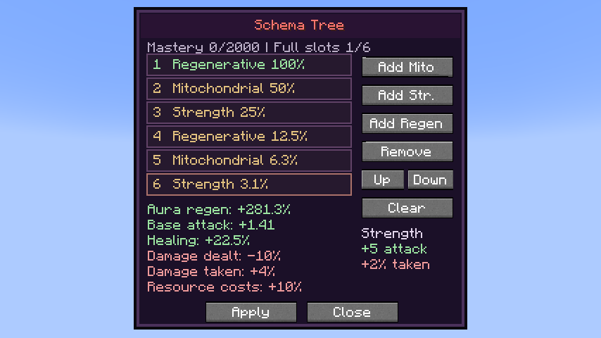
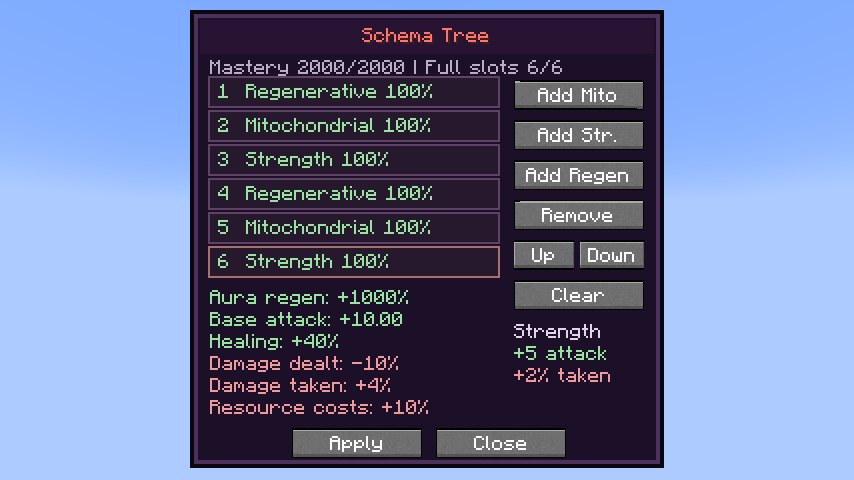

# 0.35.10 / standalone 1.1.11 — Regenerative Build

Schema adds a third effect: **+20% HP/SHP healing received** and **+5% aura/magicule costs** per stack. It shares all six occupied-slot weights with Mitochondrial and Strength. Six Regenerative effects give +39.375% healing at zero mastery or +120% at full mastery; the cost penalty stays +30%. Chained/Unbound boost only the positive bonus once.

## Recovery and payments

A server-side HP writer hook covers native `heal()` and direct health restores exactly once. A separate native SHP writer covers direct spiritual recovery and natural spiritual regeneration. Decreases remain unchanged. Native healing events can still cancel healing, and Schema’s extra recovery respects effective health limits, including Severance. Explicit native over-cap writes are preserved without Schema creating further over-healing. A cached active flag avoids touching skill storage during entity construction; actual recovery trains through the existing shared one-increment-per-second limit.

The surcharge changes native aura/MP payment arguments before affordability checks, at the paying overload only. Consuming overloads charge the adjusted bill and return shortfalls in the caller’s original units. Native regeneration and shield callers divide shortfalls by their original per-point price, so this normalization preserves partial funding and prevents an empty reserve from producing negative recovery. Reserved minima are retained. The addon’s direct dash, Counter and Chained acquisition bills are covered, without increasing the offensive formula’s base payment. Aura regeneration budgets allow for the added bill. Full Myths accounts for it in Mana Crucible’s aura conversion budget and Grove’s reservation/refund accounting. Free actions, hostile drains and resource/stat edits are not taxed.

Saved IDs 1 and 2 remain unchanged; Regenerative uses ID 3. Server validation rejects unknown IDs and stale writes. The native Build screen has Add Regen and six live totals, while retaining the existing fitted panel.

## Validation

The final **381 full-mod native GameTests**, **145 standalone native GameTests** and **54 exact-pack integration GameTests** passed. The full production build’s **11 JUnit tests** also passed: **591 automated checks** in total. The suites cover prior gameplay plus 24 Schema cases and two Myths-specific payment/refund cases. New coverage includes mixed weights/serialization, healing/direct HP/SHP recovery, cancellation and caps, atomic payments and consuming overloads, hostile drains and creative behavior, Chained scaling, direct dash/Counter payments, toggle/forget cleanup and recovery training.

The exact Neo Otherworld client fixture uses all three Add buttons, Up/Down and real Apply packets. Its three-effect build is `[Regenerative, Mitochondrial, Strength, Regenerative, Mitochondrial, Strength]`. Initial factors are **1.225× healing**, **3.8125× aura recovery** and **+1.40625 attack**; full mastery gives **1.4× healing**, **11× aura recovery** and **+10 attack**. Both retain **0.9× outgoing damage**, **1.04× incoming damage** and **1.1× resource costs**. It also checks actual HP/SHP restoration, aura/MP payments, draft cancellation, reopening and toggle-off cleanup.

[Player guide](../wiki/pages/Schema.md) · [Client fixture](../standalone/heavenly-restriction/docs/review-schema/README.md).

The full **263-project client review passed**. A nominal 10-aura / 10-magicule payment withdrew **11 of each**, `heal(2)` restored **2.45 HP**, and a direct 10-SHP restore recovered **12.25 SHP** in the initial mixed tree. Native menu save/reorder/draft/reopen/cleanup checks passed. Both screenshots were visually reviewed; all six slots, three Add choices and six totals fit the panel.

Both normal production builds, independent packaging/asset/mixin audit, exclusion of optional review fixtures, release hashes and the offline wiki bundle passed. All tests and the real-client review use disposable worlds.
