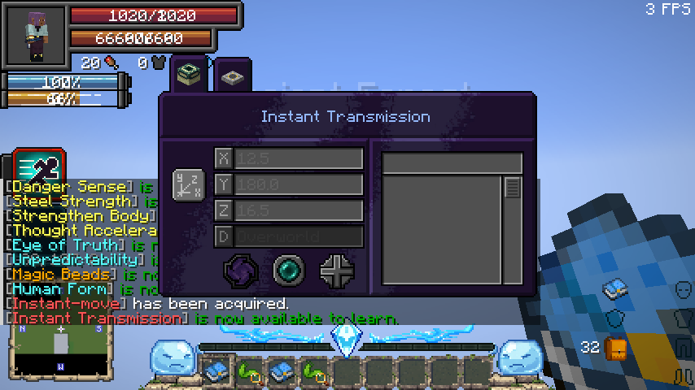
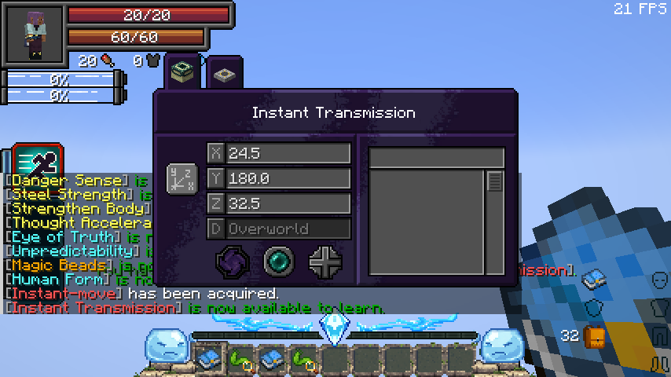

# 0.35.7 / standalone 1.1.8 validation — Instant Transmission

All **517 checks passed**: **355 full-mod native GameTests**, **121 standalone native GameTests**, **30 Neo Otherworld integration GameTests**, and **11 JUnit tests**. The final production builds passed. The exact-pack real client also completed both delayed and mastered casts through Tensura’s native coordinate screen.

## Progression and native integration

`wildhunt:instant_transmission` and `heavenlyrestriction:instant_transmission` are native Battlewills, with 400 mastery, native Instant Move artwork, one active mode and a Battlewill tag. Mastering a permanent, independent Instant Move reveals a normal learning instance; login and periodic discovery backfill existing masters without resetting an existing entry. Temporary, detached and sub-instance parents cannot unlock permanent progression. Chained permits the evolution and supplies its native Battlewill mastery bonus.

The art implements Tensura’s spatial-movement interface and opens the original coordinate screen. Its portal and dimension-travel capabilities return false. A narrowly scoped native request hook replaces the packet’s hard-coded MP payment only for this art; unrelated spatial skills retain their behavior. The server also rejects direct portal requests for this art.

## Cast behavior

Confirming valid coordinates pays **10 aura × 3D distance**, or **5 aura × distance at mastery**, once. Ordinary casts finish at **100 ticks**; mastered casts finish immediately. The server validates learned ownership, the current dimension, finite/world-border coordinates, native activation/teleport restrictions and the aura reserve. Duplicate requests during windup are rejected without another payment. The final teleport goes through Tensura’s native spatial event and movement path; other entities are never transported.

Pending charges retain their accepted target and quote while the player moves. Losing ownership, forgetting the art, interruption, death, logout or dimension change cancels the charge. Charges are runtime state and do not survive reconnects; accepted startup costs are not refunded. Native event vetoes remain effective.

## Tests

Ten new native cases in each distribution verify classification/capabilities, real predecessor mastery, existing-world backfill and borrowed-parent rejection, mastered native packet cost and teleport, exact 99/100-tick timing and duplicate payment prevention, invalid/unfunded/unfinished/forged/cross-dimension requests, portal rejection, interruption/forgetting, a native teleport-event veto, and Chained training support. The same cases run in the exact Neo Otherworld suite.

Position-aware fake players model the real connection’s teleport update: NeoForge’s default fake packet listener intentionally ignores teleport packets. The independent real-client review confirms the actual screen/button/network path instead of relying on that fixture alone.

## Real client

The full **Neo Otherworld 1.1.3a** manifest and original overrides loaded on Tensura **2.0.1.4**, NeoForge **21.1.248** and GeckoLib **4.9.2**. A real player mastered Instant Move, received the learning entry, and used the native coordinate screen twice. A 20-block ordinary trip spent **200 aura** and waited for its charge; a mastered 20-block trip spent **100 aura** immediately. MP remained **700**. Natural regeneration was disabled only on the disposable review player so the payment measurements remained isolated.

Normal standalone tests/builds target Tensura **2.0.1.3** / NeoForge **21.1.209**. Opt-in review classes and downloaded third-party jars are excluded from release packages. The distribution audit checks both new mixins, registered class, resource tags and the absence of review fixtures. Wiki Markdown, native screen captures, HTML, GitHub export and the offline bundle are regenerated.

[Player guide](../wiki/pages/Instant-Transmission.md) · [Standalone validation](../standalone/heavenly-restriction/docs/VALIDATION-1.1.8.md) · [Review reproduction](../standalone/heavenly-restriction/docs/review-transmission/README.md).
