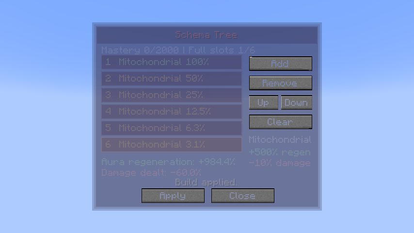
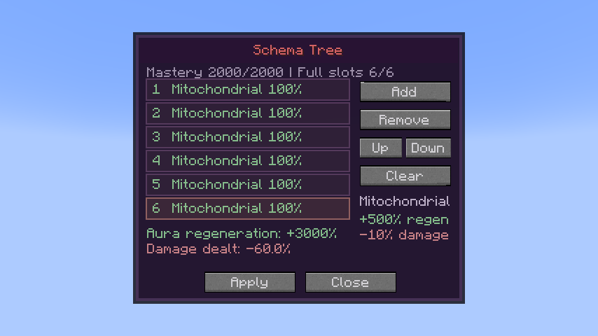

# 0.35.8 / standalone 1.1.9 validation — Schema

All listed tests and final production build/distribution checks passed.

Schema adds a native Battlewill with **1,000 learning points**, **2,000 mastery**, a toggleable six-effect build and a persistent Build screen. Validation covers both normal Tensura 2.0.1.3 / NeoForge 21.1.209 runtimes and the exact Neo Otherworld 1.1.3a configuration on Tensura 2.0.1.4 / NeoForge 21.1.248.

## Behavior

The tree is saved in its native skill-instance NBT. The network accepts exactly six bounded effect IDs and a build revision; the server checks learned ownership and computes every effect. Edits remain a draft until Apply, stale writes are rejected, and closing discards unapplied edits. Existing worlds receive a learning entry without replacing learned abilities or presets.

Mitochondrial Build adds +500% aura regeneration per positive weighted stack and a full additive −10% outgoing-damage penalty per stack. Full-strength slots increase at mastery 0, 400, 800, 1,200, 1,600 and 2,000. The remaining positive weights halve successively. Six stacks therefore give +984.375% regeneration at zero mastery and +3,000% at full mastery, with the same −60% damage drawback.

A single transient native regeneration modifier preserves other sources and is removed on disable/forget. The passive continues during rest. Native sleep recovery and Chained’s converted MP recovery are also supported; MP retention remains flat and aura remains capped. Chained/Unbound boosts only the positive bonus once, outside the generic modifier replay path. Mastery requires actual recovery and is limited to one native training increment per second.

The outgoing penalty runs in the skill damage-calculation stage, after native pre-calculation flat bonuses such as Aura Sword. Native direct SHP damage has its own penalty path because it skips ordinary damage callbacks. Weapon attack attributes are not independently reduced, avoiding double application on weapon-derived attacks.

## Checks

- **365 full-mod native GameTests** and **11 JUnit tests**.
- **131 standalone native GameTests**.
- **40 exact-pack integration GameTests**, retaining the original pack’s gameplay mods/configs and previous compatibility coverage.
- Ten new cases cover native learning/mastery, every full-strength milestone, full drawbacks, safe persistent builds, stale/invalid requests, idempotent toggle/refresh, natural and sleep recovery/caps, Chained scaling, converted recovery/retained MP, melee/projectile/direct-SHP penalties, native Aura Sword flat bonuses, and training restrictions. The damage fixture uses the registered native Aura Sword effect to remain compatible with the pack’s effect trackers; health comparisons allow normal float rounding.
- Both production builds, mixin/tag/icon packaging, release hashes and standalone isolation are audited. Optional review code is excluded from production JARs.

## Real client

The full Neo Otherworld client loaded its original 263-project manifest and overrides. The review player completed native Schema learning, opened Build, clicked Add six times and submitted Apply through the real network handler. The actual attribute became **10.84375×** at zero mastery and **31×** at mastery; damage remained **0.4×**. An unapplied Clear was discarded, reopening retained all six effects, and toggle-off returned regeneration to baseline.

Both captures and the exported 64-pixel icon were visually reviewed. The authoring master and deterministic ImageMagick export script are retained. Markdown, HTML, GitHub-Wiki exports and the offline bundle include the new ability’s damage type (**None**) and complete stacking tables. All tests use disposable worlds.

[Player guide](../wiki/pages/Schema.md) · [Standalone validation](../standalone/tensura-additional-additions/docs/VALIDATION-1.1.9.md) · [Client fixture](../standalone/tensura-additional-additions/docs/review-schema/README.md).
