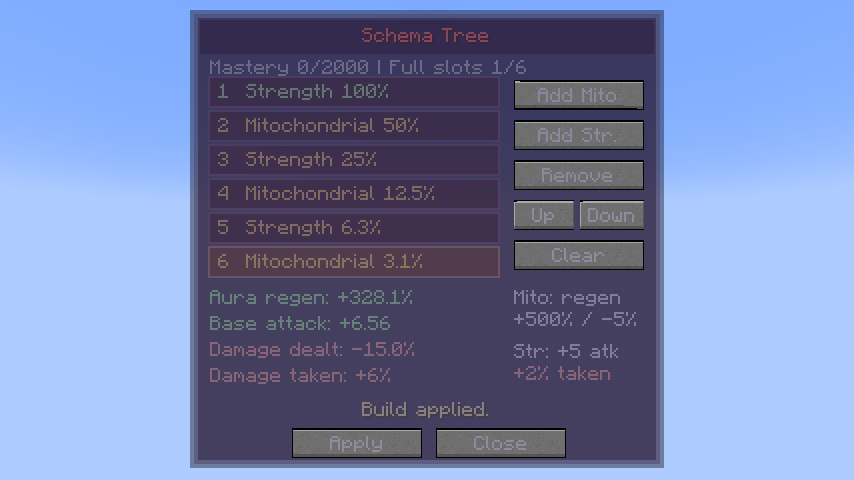
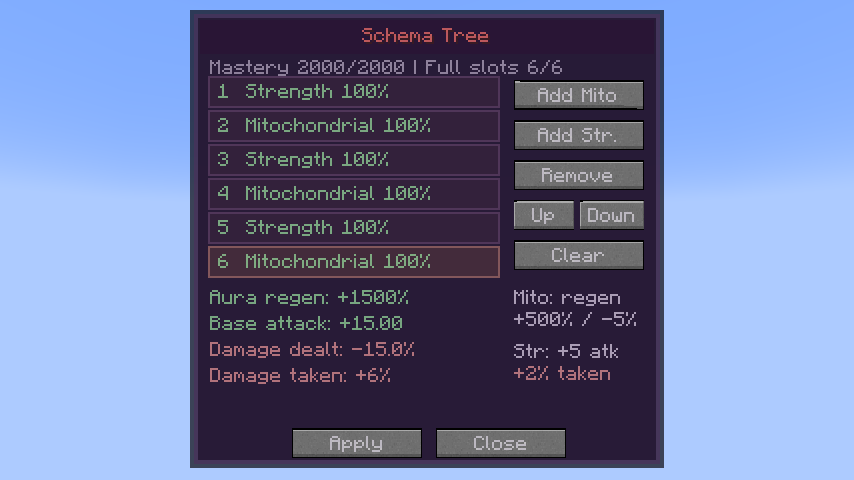

# 0.35.9 / standalone 1.1.10 validation — Schema builds

Mitochondrial Build now reduces outgoing damage by **5% per stack**. New **Strength Build** grants **+5 base attack damage** and **+2% damage taken** per stack. Both effects share six ordered slots and positive mastery weights; each drawback remains full strength.

## Implementation

Existing effect ID 1 and saved Mitochondrial trees are preserved. Strength uses ID 2. The bounded, revision-checked server save path accepts both effects, and skill serialization retains mixed order. Positive weights count all occupied slots across both effects, so changing their order changes the weighted benefits. Mastery milestones remain every 400 points, ending with six full slots at 2,000 mastery.

Strength uses one transient native attack-damage modifier, added to the weapon-inclusive stat. Repeated refreshes do not compound it. Toggle-off, removal from the applied tree and forgetting remove only Schema’s modifiers. Chained/Unbound’s positive Battlewill multiplier applies once; neither drawback is boosted.

Ordinary outgoing and incoming penalties run at lowest priority in `LivingDamageEvent.Pre`, after native effect bonuses and pack handlers. The exact Neo Otherworld pack skips native skill-calculation callbacks for some vanilla magic damage; the final damage hook also handles that path. Direct spiritual damage retains its separate native SHP wrapper. Successful Strength hits can train mastery even at full aura; training shares the existing one-increment-per-second limit with recovery.

## Validation

The final **370 full-mod native GameTests**, **136 standalone native GameTests** and **45 exact Neo Otherworld integration GameTests** passed, along with **11 JUnit tests** (**562 automated checks**). Native suites cover all prior gameplay regressions and fifteen Schema cases, including mixed order/serialization, native learning/mastery, six-stack values, real weapon attack stats, foreign-modifier preservation, Chained scaling, ordinary/projectile/magic/environmental/direct-SHP damage, recovery/caps and successful-hit training. The exact pack retains the original gameplay addons and overrides.

The real Neo Otherworld client review passed. It uses both Add choices, Up/Down and Apply through the actual packet handler. It checks all-Mitochondrial and mixed builds, mastery changes, unapplied-draft cancellation, persistence after reopening and toggle-off cleanup. Optional review fixtures are excluded from production JARs.

The wiki includes the two effects, updated penalties and mixed-build screenshots. Tests and client reviews use disposable worlds.

[Player guide](../wiki/pages/Schema.md) · [Client fixture](../standalone/heavenly-restriction/docs/review-schema/README.md).

The actual mixed tree `[Strength, Mitochondrial, Strength, Mitochondrial, Strength, Mitochondrial]` gave **4.28125× regeneration / +6.5625 attack** initially and **16× regeneration / +15 attack** mastered. Outgoing damage remained **0.85×** and incoming damage **1.06×**. Six Mitochondrial effects separately verified **10.84375× recovery / 0.7× damage**. Both Add choices, Up/Down, real Apply packets, draft cancellation, reopening and toggle-off were exercised. Captures were visually reviewed; all controls and four summary values fit the panel.

Both production builds, release hashes and the standalone isolation/asset audit are checked. The real client profile uses a clean build when switching from the opt-in server profile’s replacement test fixtures.
