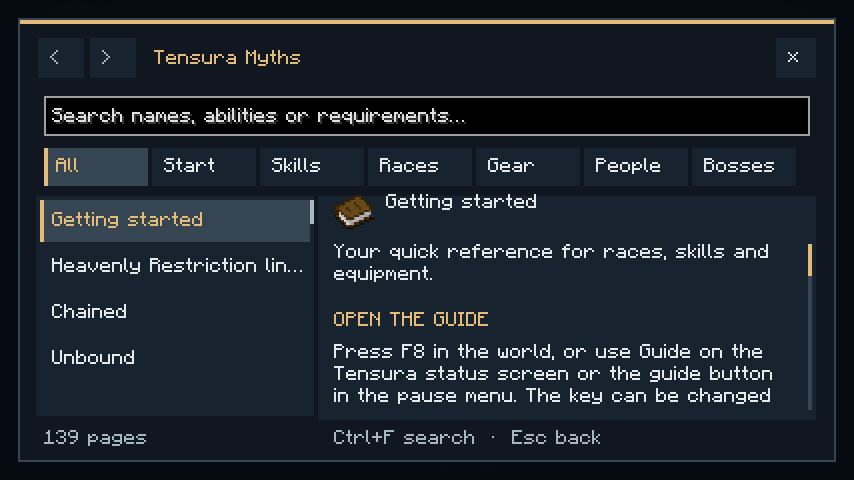
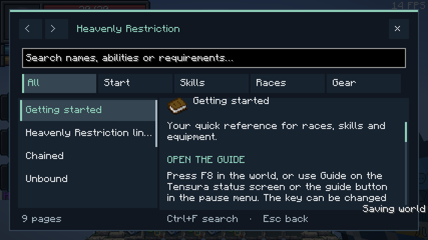
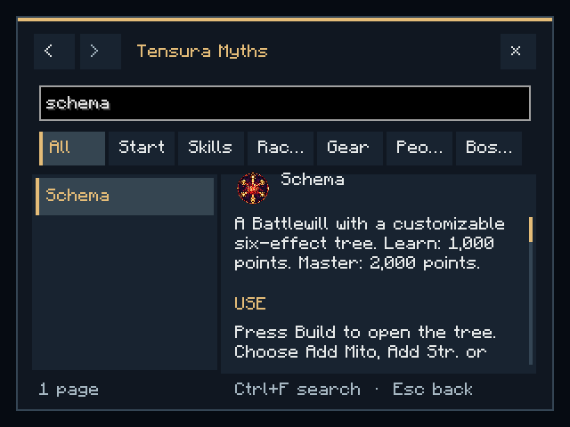

# 0.36.0 / standalone 1.2.0 — In-game guide

The new client-side guide bundles 139 Myths pages and nine standalone pages. Full Myths includes all 105 Convergent ancestry pairs; the standalone exposes only its own features. Core topics appear first, with title-ranked multiword/accent-insensitive search, category filters and related-page navigation.

F8 is configurable. Pause/status buttons and client commands provide alternatives. Screen state/history is local, opening the guide performs no server requests, and single-player pauses while reading. The previous screen is restored on close. The catalog reloads from bundled/resource-pack data when opened; invalid data produces a helpful recovery page instead of a crash.

Content is concise and gameplay-focused, using curated explanations and current wiki tables. The generator validates lineage table shape and link targets. Fixed gates, recovery grants and Godly bonuses were checked against the player guide/code. Default values are identified as defaults. Costs, damage types and requirements appear where relevant.

Normal builds run the catalog/search tests. Real-client fixtures check search, scrolling, history, empty states, related layout controls, small windows and parent restoration. The exact-pack world fixture additionally checks F8 and actual pause/status buttons. The screenshot review caught and fixed the default background covering the article; history button states also update immediately after navigation.

Both final real-client reviews passed. The full review uses the normal Myths client; the standalone world review retains the original 263-project Neo Otherworld client and confirms F8, pause/status buttons and parent restoration. Captures were visually reviewed. Optional review classes are excluded from production JARs. Tests use disposable client/world directories.

The Myths dedicated-server review passed **25 native GameTests** and the exact-pack server passed **55 integration GameTests**, confirming that the client-only UI is not loaded on dedicated servers. Normal production builds run **18 full-mod JUnit tests** and **7 standalone JUnit tests**; the new tests cover catalog validity, links, progression gates, normalized search, category/all-token behavior and core-topic ordering. Final packaging checks verify both catalogs and all three guide classes, dependency metadata, hashes and exclusion of optional fixtures.

Final normal builds, artifact hashes, catalog/class inclusion and the independent standalone distribution audit passed. Total: **105 automated checks**, plus both real-client GUI reviews.
