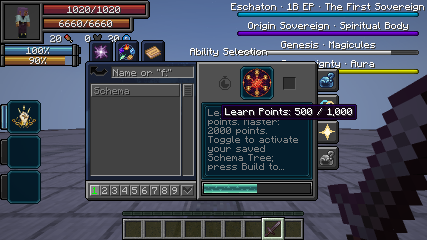
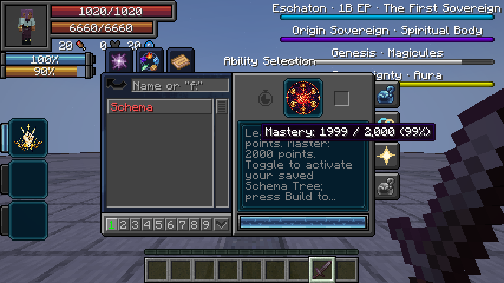

# 0.36.1 / standalone 1.2.2 — Schema learning requirements

Schema requires **1,000 learning points** and **2,000 mastery points** in both distributions. Chained/Unbound learning/mastery bonuses remain valid; the requirement counts points earned rather than button presses. Schema retains its shared 600-tick mastery interval. Existing saved learning, mastery and builds are preserved.

## Cause and fix

Tensura’s activation handler applied a failed-learning penalty with a hard minimum of the configured ordinary learning budget (100 points in the tested pack). A partially learned Schema could jump from roughly −990 to −100 on its first failure. A native-activation regression reproduced this exact −100 jump before the fix. Direct `addLearnPoint` tests missed it because they bypassed the activation handler’s failure penalty.

A Schema-only mixin applies its own −1,000 lower bound and normalizes learning completion for Tensura’s native failure odds. Other abilities retain their configured behavior. The client mixin corrects the native learning bar’s assumed 100-point range and shows explicit earned/required totals for both learning and mastery. This is client presentation only; the actual mastery cap remains 2,000.

## Server validation

- Tensura 2.0.1.3 / NeoForge 21.1.209: **28 focused Schema GameTests passed**.
- Neo Otherworld 1.1.3a, original pack configurations, Tensura 2.0.1.4 / NeoForge 21.1.248: **58 integration GameTests passed**.
- New tests exercise real `ACTIVATE_SKILL` callbacks, guaranteed native failed-learning penalties, Aura Slash and Schema learned in parallel, completion at point 1,000, incomplete mastery at 1,999, mastery at 2,000 and its cap.
- With increments fixed to one and failure penalties disabled, Aura Slash finishes after 100 points while Schema still needs 900. Schema stays unfinished at 999 and completes at 1,000.
- Previously learned/mastered skills are not reset; lost historical learning progress cannot be reliably reconstructed from saves.

The new native regressions live in `SchemaGameTests.java` in both projects; the exact-pack wrapper includes them in the optional pack suite. Review sources are excluded from normal release builds.

## Client presentation

The real Tensura 2.0.1.3 Battlewill screen passed seven Schema boundary cases (0/1000, 500/1000, 999/1000, 0/2000, 1000/2000, 1999/2000, 2000/2000) and the unchanged Aura Slash display. Unedited screenshots confirm an empty learning bar initially and a half-full bar at 500 points. The optional fixture uses detached skill instances and edits no player skills/stats. See [review instructions](review-schema-progress/README.md).

The exact Neo Otherworld client passed the same eight cases against Tensura 2.0.1.4, including the unchanged Aura Slash tooltip. Both mandatory client mixins applied successfully on the two supported Tensura versions. Normal clean builds passed **18 full-mod and 7 standalone JUnit tests**; production package audits passed. Total: **111 automated unit/integration checks**, plus **16 actual client display checks**. Production JARs exclude the optional client review code.
