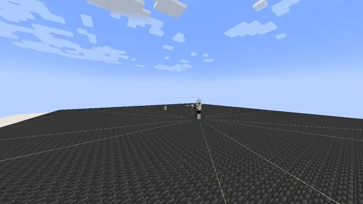
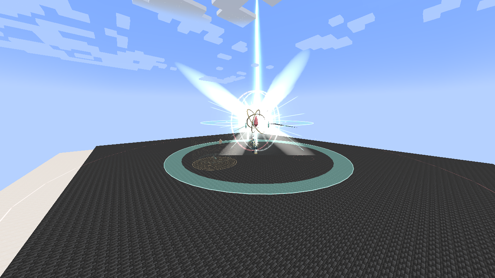
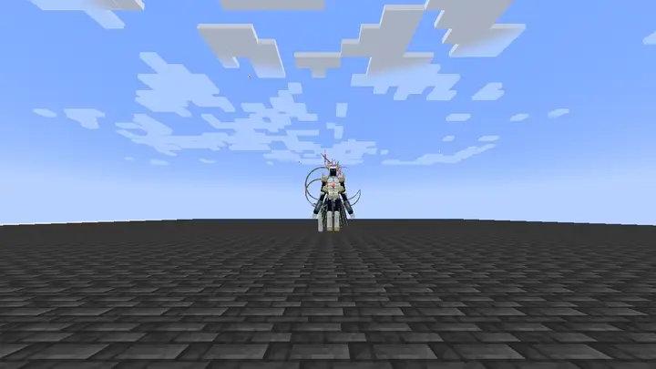
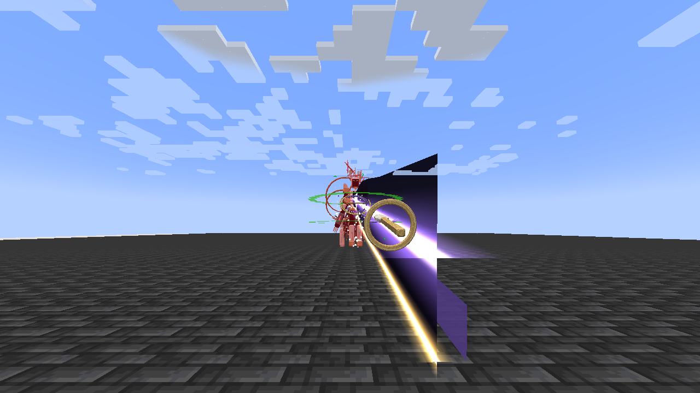
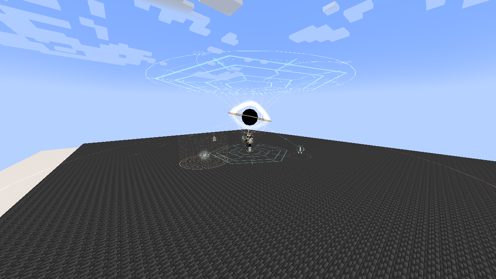
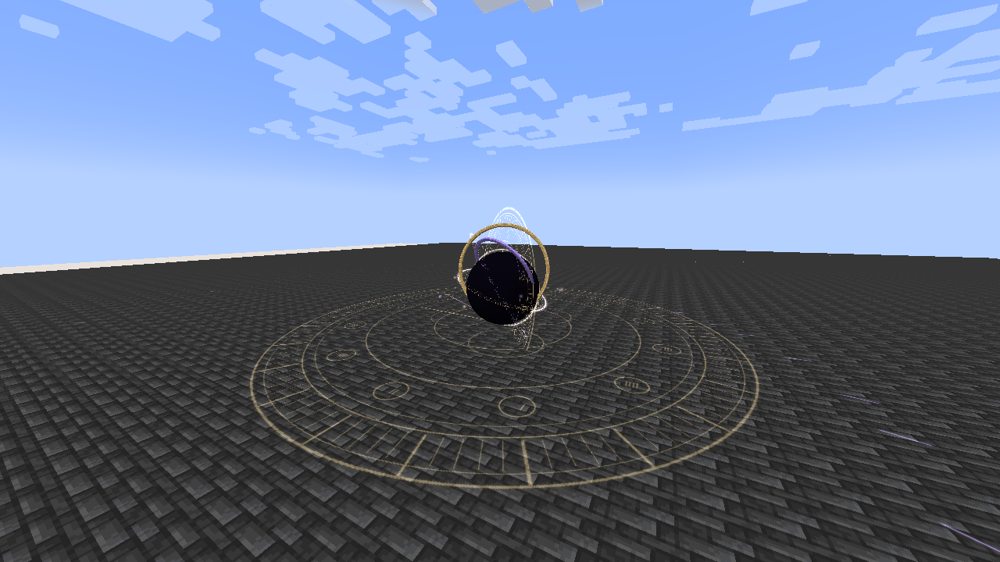
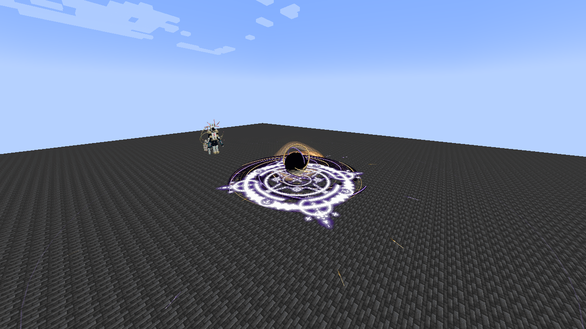

# Eschaton and Aion — visual review

This focused pass applies the selected **anime spectacle** direction to Eschaton and Aion. Other skill families retain their current visuals pending review.

[Watch the 720p native motion preview](../wiki/media/eschaton-aion-anime-preview.mp4) · [Download the review build](../releases/tensura-myths-0.31.0.jar) · [In-game gallery](../wiki/pages/Visual-Effects.md)

The reel shows Crownless Edge, Null Testament, World-Eater Wake, The End of All Myths, Worldline Sever, Event Horizon, Causal Reversal and Genesis Verdict. It cuts between real Minecraft casts; the waiting interval before the **20-second automatic return** is omitted and labeled. Event Horizon includes the player HUD. No shader pack, simulated render or post-production glow is used.

## Eschaton

Pearl/cyan blade smears now carry the cleaves, with a stronger torso windup and forearm recoil. Spatial corridors have continuous tapered tears between large scripture structures. The advancing fronts have smooth curled profiles and stop at the golden safe openings. Broad ribbons feed the world seed; its long buildup compresses before saturated plumes, a sharp nova and a broad pressure front.

## Aion

A gold/violet edge and dark spatial seam define Worldline Sever. Event Horizon folds six dark petals inward around its lensed center and clockwork. The checkpoint uses a three-dimensional hourglass and a distinct re-entry burst. Genesis Verdict keeps its twenty homing paths and stable accretion planes, with reinforced photon rims, speed trails and separate collision accents.

## Previous and current appearance

These are native arena photographs, captured at different animation phases and camera positions. Use the motion reel to judge timing and shape; this table compares visual language rather than identical frames or damage footprints.

| Family | Previous appearance | Current appearance |
| --- | --- | --- |
| Eschaton |  |  |
| Aion |  |  |

## Review conditions

The client runs Minecraft 1.21.1, NeoForge 21.1.209, Tensura 2.0.1.3 and GeckoLib 4.9.3. The disposable arena uses NoAI/invulnerable subjects where needed, creative player casts and a software-rendered X display. These clips demonstrate native rendering, not multiplayer balance or hardware performance. Audio was unavailable on the headless client.

The pass preserves server damage, resource costs, cooldowns, hit geometry, targeting and progression. Golden warnings and safe openings remain authoritative. Particle settings reduce optional decoration while primary silhouettes remain present by design. [Validation report](VALIDATION-0.31.0.md) · [Technical findings](research/ANIME_VISUAL_DIRECTION_0.31.0.md)
