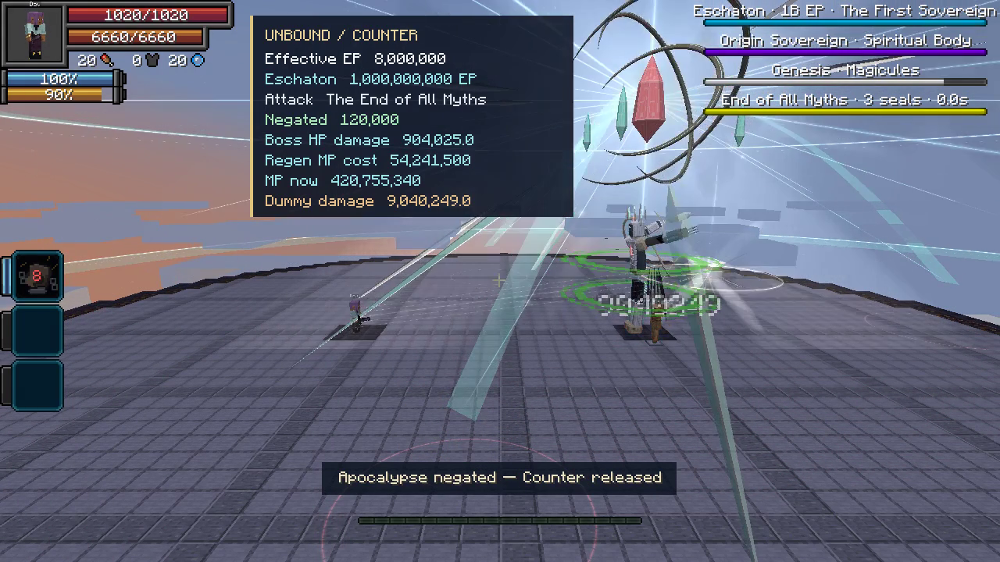

# Counter against Eschaton — 8M EP preview

[Watch or download the MP4](counter-eschaton-8m.mp4) · [Measured capture data](capture-metrics.json)

A **33-second, 1280×720, 60 FPS** capture from Tensura Myths **0.35.0**, with actual game audio, a labeled accelerated windup, a slow-motion replay, and an animated damage/regeneration breakdown. The animation uses the recorded values and native floating-point rounding.

The Heavenbreaker has **8,000,000 effective EP**, mastered **Unbound**, its combat toggle enabled, and **7,999,920 current aura** before Counter. Eschaton retains his **1,000,000,000 EP**, full skill package, native defenses and Infinite Regeneration. He casts the real **Demiurge: The End of All Myths**; the fixture does not inject a substitute incoming hit.

| Recorded event | Result |
| --- | ---: |
| Incoming apocalypse damage negated | 120,000 |
| Aura paid on entry, 10% current aura | 799,992 |
| Base Counter damage, native float | 1,205,366.5 |
| Physical damage multiplier | 5× |
| Native critical multiplier | 1.5× |
| Adjacent native training dummy, one Counter hit | 9,040,249 damage |
| Eschaton, one Counter hit after defenses | 904,025 HP damage |
| Eschaton HP after hit | 95,975 / 1,000,000 |
| HP restored by native Infinite Regeneration | 904,025 |
| Mastered Infinite Regeneration price | 60 magicules / HP |
| Magicules immediately before regeneration | 474,996,840 |
| Magicules immediately after regeneration | 420,755,340 |
| **Magicules consumed by regeneration** | **54,241,500** |
| Separate apocalypse casting cost | 25,000,000 magicules |
| Player HP / SHP before and after | 1,020 / 6,660, unchanged |

The return slash is **Physical**, `minecraft:mob_attack`. It receives the 5× Physical branch and one critical multiplier. The 8× Battlewill branch does not stack with it, and there is no direct EP damage multiplier.

The regeneration measurement is taken during the actual `InstantRegenerationEffect` healing call and checked against **904,025 × 60 = 54,241,500**. It excludes the apocalypse’s casting cost and unrelated ongoing skill upkeep.

This is a staged skill demonstration: Eschaton’s autonomous AI is disabled to time one native cast. The boss and dummy share a native scoreboard team, preventing Eschaton’s area attack from also damaging the dummy. The player remains hostile to both, so both receive the real Counter slash. No defensive skills, damage values or regeneration costs are reduced for the preview.

[Capture and animation sources](../../research/fixtures/counter-preview/README.md). The optional fixture is excluded from normal builds; this preview does not change gameplay or replace either release JAR.
