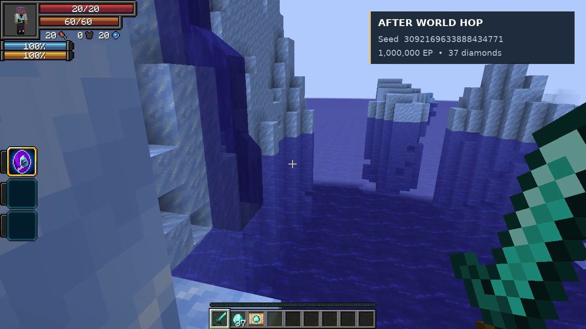

# Parallel World Jumper — World Hop preview

[Watch or download the MP4](world-hop.mp4) · [Measured capture data](capture-metrics.json)

A **37-second, 1280×720, 30 FPS** actual gameplay capture of **TensuraAdditionalAdditions 1.3.0**, recorded with its required dependencies on NeoForge 1.21.1 / Tensura 2.0.1.3. World Hop changes grassy terrain into an icy ocean landscape.

The native save/reload sequence is shown, with the accelerated portion clearly labelled **4.2× speed**. Idle capture/render warmup is omitted. Title, seed captions and the animated result card were added during editing. Game audio is recorded through OpenAL Soft.

| Captured value | Before | After |
| --- | --- | --- |
| World seed | 7611466232267607111 | 3092169633888434771 |
| Race | Human | Human |
| EP | 1,000,000 | 1,000,000 |
| Diamonds | 37 | 37 |
| Named diamond sword | World Hop Keepsake | Preserved |
| Saved progress and World Hop skill | Present | Preserved |
| Previous world | Original save | Still available |

The transition invokes the native skill activation path and uses the released world-hopping implementation. It was recorded in a copied disposable world. The [optional filming fixture and editing script](../../../standalone/heavenly-restriction/docs/preview-world-hop/README.md) are excluded from normal builds. The existing release JAR is unchanged.
