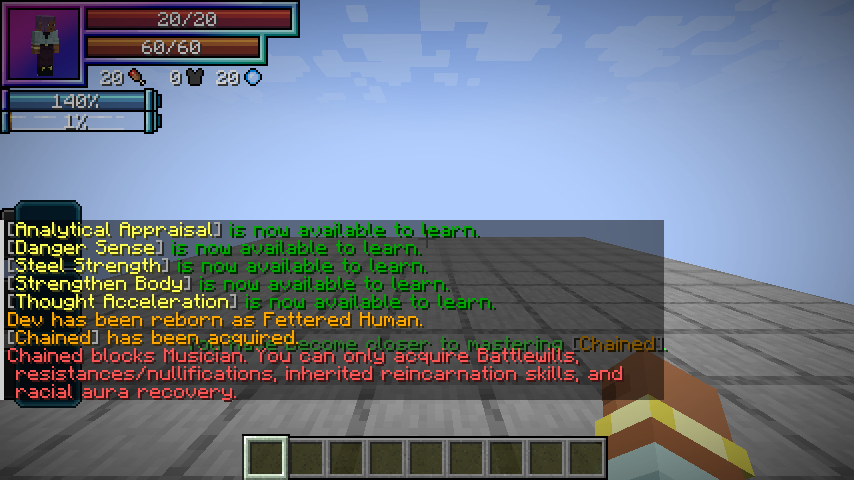

# Heavenly Restriction guide

[Addon home](../README.md)

## Reincarnation and evolution

Select **Fettered Human** in Tensura's native reincarnation race menu. It grants **Chained** separately from the normal reincarnation Unique roll. Subsequent evolutions retain the same skill/mastery and never regrant a forgotten Chained.

Starting base aura rolls **1,500–2,000**, starting base magicules **50–100**, for **1,550–2,100 starting EP** before other reincarnation rewards. Chained excludes the saved starting aura from its multiplier.

| Race | Fixed total EP | Mastered Battlewills | Chained mastery | HP / SHP racial bonus | Newly granted skill |
| --- | ---: | ---: | ---: | ---: | --- |
| Fettered Human | Starting selection | — | — | +0 / +0 | Chained |
| Tempered Vessel | 100,000 | 1 | 20% | +100 / +400 | — |
| Unshackled | 500,000 | 2 | 40% | +300 / +1,600 | Hunter's Recovery |
| Heavenly Restricted | 2,000,000 | 3 | 60% | +600 / +3,600 | Apex Renewal |
| Heavenbreaker | 8,000,000 | 4 | 100% | +1,000 / +6,600 | Sovereign Rebirth |

EP means effective maximum aura plus effective maximum magicules, as displayed in Status, including Chained's bonus capacity. Spending current energy does not lower it. All requirements must be met; thresholds do not scale with the player's current EP. Each evolution replaces the previous stage's attribute bonuses. Each stage also adds +4 attack, +7.5% base movement and +0.15 knockback resistance compared with the preceding one. Appearance and equipment stay human-like.

Native EP growth uses a **90% aura / 10% magicule** allocation before native gain modifiers, caps and Chained's restriction. The blocked magicule share is not redirected. Ordinary native races keep their normal growth split.

## Chained — Unique Skill

Registry ID: `heavenlyrestriction:chained`. Maximum mastery: **1,000**. Use Tensura's normal skill slots and toggles.

### Heavenly Restriction

**Passive — True. Damage type: None.**

Chained trades magical growth and unrestricted skill learning for greater aura capacity. While you own it:

- **5× aura growth:** later maximum-aura gains are multiplied by five; starting aura is unchanged.
- **No maximum-magicule gains:** keep your existing capacity, but it cannot increase. Current magicules remain usable; costs and losses still apply.
- **Regeneration conversion:** retain normal **1× magicule regeneration** and redirect only its bonus above 1× to aura. Lower rates keep their penalties, and normal sleep recovery stays with its resource.
- **Restricted learning:** Battlewills, resistances/nullifications, reincarnation skills and their derived grants, and the lineage’s aura-recovery skills remain available. Previously owned skills are retained.
- **Aura-paid resistances:** acquiring resistances/nullifications spends the configured cost in current aura instead of permanent magicule capacity. Free grants stay free.

Blocked acquisition shows a red **“Chained blocks [skill]”** message explaining the allowed categories. Repeated attempts for the same skill show at most one notice per second.



For example, reincarnating with **Martial Master** still allows **Heavenly Eye**. Chained’s bonus capacity counts toward total EP; it does not repeatedly refill current aura. Native limits still apply.

### Martial Supremacy

**Passive — Toggle. Damage type: None directly; enhances Physical and Battlewill damage.**

- +9 Battlewill learning and mastery points.
- +19 resistance/nullification learning points.
- **5× Battlewill damage**.
- **3× numerical Battlewill buff effectiveness**, excluding Aura Sword.
- **3× all outgoing Physical damage**.

Aura Sword retains its normal configured added damage; Chained does not triple that buff separately. Applicable outgoing Physical and Battlewill multipliers still affect its hits. Buff duration, ordinary learning costs and conversion rates retain native values. Repeated refreshes do not compound the buff. The Physical bonus covers your melee, physical projectiles, physical skills and native Physical-converted damage without changing the attack attribute. Physical Battlewill hits receive both bonuses for **15×** before other modifiers. Severance Rush is purely Physical and receives only the **3×** Physical bonus, even while Aura Sword or Ogre Guillotine is active. Non-Physical Battlewills retain **5×**; unrelated elemental/magical damage is not tripled.

### Broken Limit

**Passive — True — Mastered. Damage type: None directly.**

Your own hits lower **Resistance → none** and **Nullification → Resistance**, bypass numeric resistance attributes, and ignore dodge. Attributable status effects use the lower tier's immunity rules. This does not delete skills or erase native barriers. This remains active while you own mastered Chained, even with its toggle off and the skill unequipped. Forgetting Chained removes it. Martial Supremacy’s damage/training bonuses still require the toggle.

### Unerring Body

**Passive — In-slot. Damage type: None.**

While Chained is equipped in the active ability preset, gain **100% projectile dodge** and **25% dodge against other damage**. Explicit dodge bypass and invulnerability-bypassing damage still take priority. It works with the combat toggle disabled.

### Severance Rush

**Active — Press. Damage type: Physical (`minecraft:mob_attack`).**

Use while **grounded or in water**, like Martial Master. A **16-block eye-level aim ray** ignores fluids and stops just before the nearest aimed hostile mob or eligible player. Allies, off-axis enemies and targets behind blocks do not capture the aim. Block hits retain Martial Master’s adjacent-block landing; open-air aim uses your look direction relative to your feet, including slight upward angles. Air/enemy landings may back off by up to one block to make room; body clearance is checked without sweeping your feet through the ground. Unsafe, unloaded or out-of-bounds landings are rejected.

| Parameter | Value |
| --- | --- |
| Cost | 2% of current aura, paid once per successful press |
| Cooldown | 1 second |
| Path radius | 3 blocks |
| Arrival radius | 4 blocks |
| Path damage | 1.5 × √A |
| Arrival damage | 3 × √A |

**A** is aura actually paid. At 100,000 current aura, A = 2,000: approximately **67.08 path + 134.16 arrival damage**, or **201.25 + 402.49** with Martial Supremacy enabled, before native defenses and damage handling. A victim in both areas receives both hits despite ordinary hurt cooldown. Unavailable landings, airborne activation, cooldown or no usable aura cause no payment. Successful casts start a 1-second cooldown.


## Aura recovery — Extra Skills

**Passive — Toggle. Damage type: None for every tier.** Native racial learning grants/enables each new tier without permanent magicule acquisition costs. Earlier tiers remain learned; only the strongest enabled tier heals. Full applicable health costs nothing. Recovery is limited by available aura, funding HP before SHP.

| Skill | First granted | Effect | Aura cost |
| --- | --- | --- | --- |
| Hunter's Recovery | Unshackled | 4 HP/second; 8 mastered | 20 / HP |
| Apex Renewal | Heavenly Restricted | Missing HP each half second | 30 / HP; 20 mastered |
| Sovereign Rebirth | Heavenbreaker | Missing HP and SHP each half second | 30 / HP and 10 / SHP; 20 / 5 mastered |

Registry IDs: `heavenlyrestriction:hunters_recovery`, `heavenlyrestriction:apex_renewal`, `heavenlyrestriction:sovereign_rebirth`.

All recovery respects interaction suppression and severance maximum HP. The first two tiers respect ordinary healing suppression. Like native Infinite Regeneration, Sovereign Rebirth can heal through ordinary Curse, Frost and strong Black Burn; Infinite Imprisonment prevents it. It can fund survival of an ordinary fatal HP hit by paying 30 aura (20 mastered) to preserve 1 HP, then pays normal recovery costs. It cannot stop invulnerability-bypassing damage, barrier bypass of at least 1.75, complete severance, spiritual-health exhaustion, suppressed interactions or an unfunded hit.


## Air Sovereignty — Battlewill

**Active — Press. Damage type: None.** Registry ID: `heavenlyrestriction:air_sovereignty`. Maximum mastery: **400**.

Permanently master native **Air Flight** (also called **Air Float**) to unlock Air Sovereignty as a learnable entry in Tensura's Battlewill menu. Train it normally; the predecessor stays learned. Temporary, borrowed, detached and unmastered predecessors do not unlock it. Existing masters are discovered on login or a server tick.

Press to start or stop free flight using the same native flight flags as Gravity Manipulation. Move normally, jump to ascend, sneak to descend and release movement to hover. Releasing the skill key does not end flight.

Activation and each second actually flying cost the sum of Air Flight's configured aura and magicule costs, paid entirely in **aura**: **30 aura by default**. Stopping is free; idle/landed flight permission has no upkeep. No magicules, gravity damage or elemental bonus are involved. Chained's learning/mastery bonuses apply.

Depletion, interference, movement/area restrictions, forgetting the skill and respawn revoke this flight lease. Other valid native flight sources, equipment and creative flight are preserved. Saved enabled state cannot authorize free flight without the matching server lease.

## Inheritance support command

Operators can certify a known, already-owned reincarnation root:

```text
/heavenlyrestriction chained inherit <player> <skill_id>
```

Example: `/heavenlyrestriction chained inherit PlayerName tensura:martial_master`. Permission level 2 is required. This records provenance; it does not grant the skill. The standalone addon uses its own saved history and does not import Myths world data.
