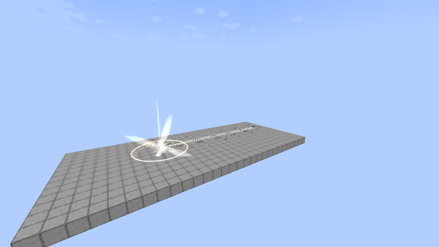
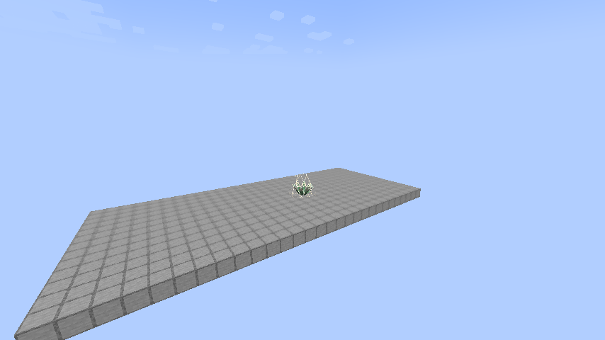

# Heavenly Restriction guide

[Addon home](../README.md)

## Reincarnation and evolution

Select **Fettered Human** (**Hard**) in Tensura's native reincarnation race menu. It grants **Chained** separately from the normal reincarnation Unique roll. Subsequent evolutions retain the same skill/mastery and never regrant a forgotten Chained.

Random reincarnation Uniques are filtered for Fettered Human: if any of a skill’s own abilities consumes magicules, it cannot roll. Target-skill stealing, copying and harvesting are also excluded; Pride is exempt. Aura-only and free skills that do not take target skills remain eligible; acquisition prices do not count. Existing skills remain. Both main and bonus rolls use this rule. See [blacklist configuration and native eligible skills](../../../docs/REINCARNATION-BLACKLIST.md).

Starting base aura rolls **1,500–2,000**, starting base magicules **50–100**, for **1,550–2,100 starting EP** before other reincarnation rewards. Chained excludes the saved starting aura from its multiplier.

| Race | Fixed total EP | Mastered Battlewills | Chained mastery | HP / SHP racial bonus | Newly granted skill |
| --- | ---: | ---: | ---: | ---: | --- |
| Fettered Human | Starting selection | — | — | +0 / +0 | Chained |
| Tempered Vessel | 100,000 | 1 | 20% | +100 / +400 | — |
| Unshackled | 500,000 | 2 | 40% | +300 / +1,600 | Hunter's Recovery |
| Heavenly Restricted | 2,000,000 | 3 | 60% | +600 / +3,600 | Apex Renewal |
| Heavenbreaker | 8,000,000 | 4 | 100% | +1,000 / +6,600 | Sovereign Rebirth |

EP means effective maximum aura plus effective maximum magicules, as displayed in Status, including Chained's bonus capacity. Spending current energy does not lower it. All requirements must be met; thresholds do not scale with the player's current EP. Each evolution replaces the previous stage's attribute bonuses. Each stage also adds +4 attack, +7.5% base movement and +0.15 knockback resistance compared with the preceding one. Appearance and equipment stay human-like.

Native EP growth uses a **90% aura / 10% magicule** allocation before native gain modifiers, caps and Chained's restriction. The blocked magicule share is not redirected. Positive native `ep max add` commands also use this split. With Chained, `tensura edit stat @s ep max add 1000` adds 900 raw aura capacity, yielding **4,500 effective aura capacity**; the 100-magicule share is blocked. The optional `true` argument retains native refilling of current reserves. Ordinary native races keep their normal growth split.

A reincarnated Creator can use its native menu to generate temporary skills under Chained or Unbound. Native timers, replacement, renewal and cooldowns remain; generated abilities retain their own resource costs. The roll blacklist does not filter Creator’s generation menu.

## Chained — Unique Skill

Registry ID: `heavenlyrestriction:chained`. Maximum mastery: **1,000**. Use Tensura's normal skill slots and toggles.

### Heavenly Restriction

**Passive — True. Damage type: None.**

Chained trades magical growth and unrestricted skill learning for greater aura capacity. While you own it:

- **5× aura growth:** later maximum-aura gains are multiplied by five; starting aura is unchanged.
- **No maximum-magicule gains:** keep your existing capacity, but it cannot increase. Current magicules remain usable; costs and losses still apply.
- **Regeneration conversion:** retain up to **1 magicule per second**; all remaining computed magicule regeneration becomes aura, including biome output, rate bonuses and sleep recovery. Conversion continues with full magicules; slower/zero rates are not boosted. Current magicules cannot exceed their effective maximum.
- **Restricted learning:** Battlewills, resistances/nullifications, reincarnation skills and their derived grants, and the lineage’s aura-recovery skills remain available. Previously owned skills are retained.
- **Aura-paid resistances:** acquiring resistances/nullifications spends the configured cost in current aura instead of permanent magicule capacity. Free grants stay free.

Unfinished skills remain visible in the native menu and can gain learning points. Chained blocks final acquisition, retaining the unfinished entry and showing **“Cannot acquire [skill].”** with the skill name in its native tier color. Repeated attempts for the same skill show at most one notice per second.

For example, reincarnating with **Martial Master** still allows **Heavenly Eye**. The saved birth roll remains unchanged. Permanent aura-capacity losses reduce its remaining exemption; later gains still receive 5×, even below the original birth amount. Chained’s bonus capacity counts toward total EP; it does not repeatedly refill current aura. Regeneration restores current reserves without adding maximum capacity or EP. Native limits still apply.

### Martial Supremacy

**Passive — Toggle. Damage type: None directly; enhances Physical and Battlewill damage.**

- +9 Battlewill learning and mastery points.
- +19 resistance/nullification learning points.
- **5× damage sourced from Battlewill abilities**, taking priority over Physical.
- **3× numerical Battlewill buff effectiveness**, excluding Aura Sword.
- **3× other outgoing Physical damage**; these damage bonuses do not stack.

Aura Sword retains its normal configured added damage; Chained does not triple that buff separately. Each hit then uses its applicable outgoing damage branch. Buff duration, ordinary learning costs and conversion rates retain native values. Repeated refreshes do not compound the buff. Damage takes one branch: a source carrying a Battlewill ability receives **5×**; otherwise Physical melee, projectiles, skills and converted damage receive **3×**. The attack attribute is unchanged. Aura Sword/Ogre Guillotine on ordinary melee does not change this source check. Severance Rush receives **3×**. Elemental Battlewills receive **5×**; unrelated elemental/magical damage receives neither.

A native diamond-sword Aura Slash deals **35 normally / 70 mastered**, before defenses and other modifiers. A controlled 7-damage ordinary hit plus Aura Sword’s native 7-damage increment gives **(7 + 7) × 3 = 42**, excluding racial attack bonuses and other modifiers.

### Broken Limit

**Passive — True — Mastered. Damage type: None directly.**

Your own hits lower **Resistance → none** and **Nullification → Resistance**, bypass numeric resistance attributes, and ignore dodge. Attributable status effects use the lower tier's immunity rules. This does not delete skills or erase native barriers. This remains active while you own mastered Chained, even with its toggle off and the skill unequipped. Forgetting Chained removes it. Martial Supremacy’s damage/training bonuses still require the toggle.

### Unerring Body

**Passive — In-slot. Damage type: None.**

While Chained is equipped in the active ability preset, gain **10% incoming damage reduction**, **100% projectile dodge** and **25% dodge against other damage**. Damage reduction follows Strengthen Body’s rules: invulnerability bypass and barrier bypass level 2 or greater ignore it. Explicit dodge bypass and invulnerability-bypassing damage still take priority. It works with the combat toggle disabled.

### Severance Rush

**Active — Press. Damage type: Physical (`minecraft:mob_attack`).**

Use while **on the ground, in midair or in water**. A **16-block eye-level aim ray** ignores fluids and stops just before the nearest aimed hostile mob or eligible player. Allies, off-axis enemies and targets behind blocks do not capture the aim. Block hits retain Martial Master’s adjacent-block landing; open-air aim uses your look direction relative to your feet, including slight upward angles. When a destination is obstructed, the dash can shorten to a clear forward landing and adjust to the actual height of slabs, raised blocks or nearby ground. Low canopies and ceilings are handled through body clearance and a clear eye path, without sweeping your feet through the ground. Short safe stops at nearby enemies or walls are allowed. Unsafe, unloaded or out-of-bounds destinations are avoided; if no safe landing exists, the cast is rejected.

| Parameter | Value |
| --- | --- |
| Cost | 2% of current aura, paid once per successful press |
| Cooldown | 1 second |
| Path radius | 3 blocks |
| Arrival radius | 4 blocks |
| Path damage | 1.5 × √A + W |
| Arrival damage | 3 × √A + W |

**A** is aura actually paid. At 100,000 current aura, A = 2,000: approximately **67.08 path + 134.16 arrival damage**, or **201.25 + 402.49** with Martial Supremacy enabled, before native defenses and damage handling. A victim in both areas receives both hits despite ordinary hurt cooldown. If no safe landing is available, or activation is airborne, on cooldown or without usable aura, no payment occurs. Successful casts start a 1-second cooldown.



## Weapon-bearing arts and body immunities

While Chained or Unbound is equipped in the active preset, Unerring Body prevents Fear, Slowness, Burden and native Haki effects/forced movement. Existing Fear/Slowness/Burden is cleansed on equip updates; these immunities work while the combat toggle is off.

Each dash path/arrival hit and Counter adds main-hand weapon damage to its aura-based formula before normal Physical modifiers. Item attribute modifiers, enchantment damage, successful vanilla post-hit effects and Tensura engraving callbacks apply. Unarmed casts add zero weapon damage. Counter uses the weapon held when it releases.

## Inverted Spear of Heaven

`heavenlyrestriction:inverted_spear_of_heaven` has the Hihiirokane Sword’s default **80 attack damage**, **1.6 attack speed** and **3,600 durability**. It is a fire-resistant Rare weapon with **Nullification I**. Each **ominous vault** reward has an independent **2% chance** to add one spear, preserving normal rewards. Ordinary vaults do not grant it. It is also in the Combat creative tab.

Its main-hand melee, dash and Counter hits shatter native physical, magical, multilayer and entity barriers, remove tagged/source-attributed skill status effects and prevent skill activation for **2 seconds / 40 ticks**. A new hit refreshes the visible debuff. It does not forget skills or clear unrelated potion effects; merely holding it does not empower unrelated spells.

## Unbound — Ultimate Skill

Registry ID: `heavenlyrestriction:unbound`. At **Heavenbreaker**, with **Chained fully mastered** and **True Demon Lord or True Hero** status, Chained automatically evolves into fully learned, mastered Unbound, even while unequipped or untoggled. Unbound appears in the native **Skills → Ultimate** menu. No activation or learning input is required. Chained is replaced; its completed mastery, toggle, presets, dash cooldown, magicule ceiling and aura exemption carry over. There is no extra EP threshold or payment.

Unbound retains all Heavenly Restriction vows and Severance Rush, with these upgrades:

| Passive | Ultimate strength |
| --- | --- |
| Martial Supremacy — Toggle | **8×** Battlewill ability damage; otherwise **5×** Physical damage; **4×** numeric Battlewill buffs except Aura Sword |
| Broken Limit — True, Mastered | Existing one-tier degradation and dodge bypass; **all player attacks critically hit**, using native critical multiplier, default **1.5×**, counted once |
| Unerring Body — In-slot | **30%** damage reduction; **100%** projectile dodge; **50%** other dodge |

Training bonuses remain +9 Battlewill learning/mastery and +19 resistance learning. Damage branches stay exclusive; Physical Battlewills do not receive both multipliers. All damage types remain the original attack’s type. Body reduction retains Strengthen Body’s invulnerability/barrier-bypass exceptions.

### Counter

**Active — Press. Damage type: Physical (`minecraft:mob_attack`).**

Enter a defensive stance for **3 seconds**, with movement speed **0**. Entry costs **10% current aura** and starts a **10-second cooldown**. The first eligible enemy hit, including a direct spiritual attack, is completely negated before dodge/HP/SHP damage, then releases a massive instantaneous slash toward the attacker that ignores blocks without destroying them. It extends at least 16 blocks and up to 4 blocks beyond the attacker, capped at **64 blocks**, with a **3-block hit radius** and one hit per enemy.

**Base damage = 10 × negated incoming damage + 6 × √(aura paid on entry) + W**. The incoming amount is measured before defenses. The slash receives Unbound’s Physical multiplier when toggled and its one native critical multiplier. With an empty main hand (W = 0), at 10,000 current aura and a 20-damage hit, base damage is **389.74**, or **2,923.02** with the toggle and default critical multiplier, before defenses and other modifiers.

Press again to cancel early for free, including during cooldown. Cancellation or timeout releases no slash and does not refund the entry cost; cooldown continues. Environmental/self/allied and operator/void damage do not trigger it. Death, logout, dimension changes, suppression and forgetting the skill clean up the stance. Client stance/cancellation state synchronizes.

## Aura recovery — Extra Skills

**Passive — Toggle. Damage type: None for every tier.** Native racial learning grants/enables each new tier without permanent magicule acquisition costs. Earlier tiers remain learned; only the strongest enabled tier heals. Full applicable health costs nothing. Recovery is limited by available aura, funding HP before SHP.

| Skill | First granted | Effect | Aura cost |
| --- | --- | --- | --- |
| Hunter's Recovery | Unshackled | 4 HP/second; 8 mastered | 20 / HP |
| Apex Renewal | Heavenly Restricted | Missing HP each half second | 30 / HP; 20 mastered |
| Sovereign Rebirth | Heavenbreaker | Missing HP and SHP each half second | 30 / HP and 10 / SHP; 20 / 5 mastered |

Registry IDs: `heavenlyrestriction:hunters_recovery`, `heavenlyrestriction:apex_renewal`, `heavenlyrestriction:sovereign_rebirth`.

All recovery respects interaction suppression and severance maximum HP. The first two tiers respect ordinary healing suppression. Like native Infinite Regeneration, Sovereign Rebirth can heal through ordinary Curse, Frost and strong Black Burn; Infinite Imprisonment prevents it. It can fund survival of an ordinary fatal HP hit by paying 30 aura (20 mastered) to preserve 1 HP, then pays normal recovery costs. It cannot stop invulnerability-bypassing damage, barrier bypass of at least 1.75, complete severance, spiritual-health exhaustion, suppressed interactions or an unfunded hit.



## Air Walk — Battlewill

**Active — Press. Damage type: None.** Registry ID: `heavenlyrestriction:air_sovereignty`. Maximum mastery: **400**.

Permanently master native **Air Flight** (also called **Air Float**) to unlock Air Walk as a learnable entry in Tensura's Battlewill menu. Train it normally; the predecessor stays learned. Temporary, borrowed, detached and unmastered predecessors do not unlock it. Existing masters are discovered on login or a server tick.

Press to start or stop free flight using the same native flight flags as Gravity Manipulation. Move normally, jump to ascend, sneak to descend and release movement to hover. Releasing the skill key does not end flight.

Activation and each second actually flying cost the sum of Air Flight's configured aura and magicule costs, paid entirely in **aura**: **30 aura by default**, halved to **15 aura when mastered**. Stopping is free; idle/landed flight permission has no upkeep. No magicules, gravity damage or elemental bonus are involved. Chained's learning/mastery bonuses apply.

Depletion, interference, movement/area restrictions, forgetting the skill and respawn revoke this flight lease. Other valid native flight sources, equipment and creative flight are preserved. Saved enabled state cannot authorize free flight without the matching server lease.

## Inheritance support command

Operators can certify a known, already-owned reincarnation root:

```text
/heavenlyrestriction chained inherit <player> <skill_id>
```

Example: `/heavenlyrestriction chained inherit PlayerName tensura:martial_master`. Permission level 2 is required. This records provenance; it does not grant the skill. The standalone addon uses its own saved history and does not import Myths world data.

## Modpack compatibility

Tensura Neo Otherworld **1.1.3a** uses Tensura **2.0.1.4**, ManasCore **4.0.0.2**, NeoForge **21.1.248** and GeckoLib **4.9.2**. Use standalone **1.1.6+**. Chained respects Mysticism’s Constant Energy and Constant Energy Debuff: its magicule-to-aura conversion pauses until the status ends.

Fettered Human excludes **29 of the pack’s 39 addon starting skills** for magicule costs or target-skill copying. The audit includes payments hidden inside abilities, not just their cost getters. Other races retain their pools; Pride’s exception and Creator inheritance remain. The server’s blacklist/allowlist settings still apply. [All addon skill classifications and reasons](compatibility/FETTERED-SKILLS.md).

[Compatibility report](compatibility/NEO-OTHERWORLD-1.1.3a.md).
