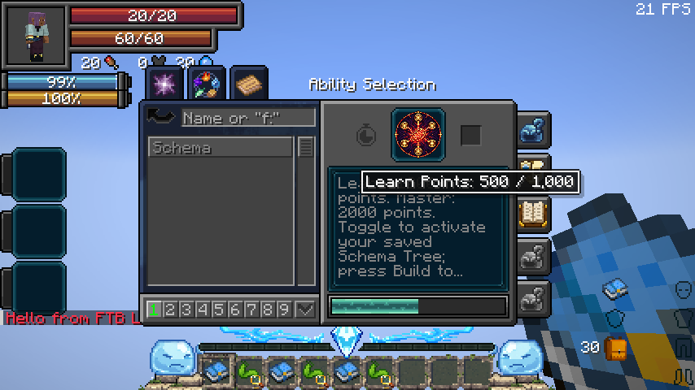
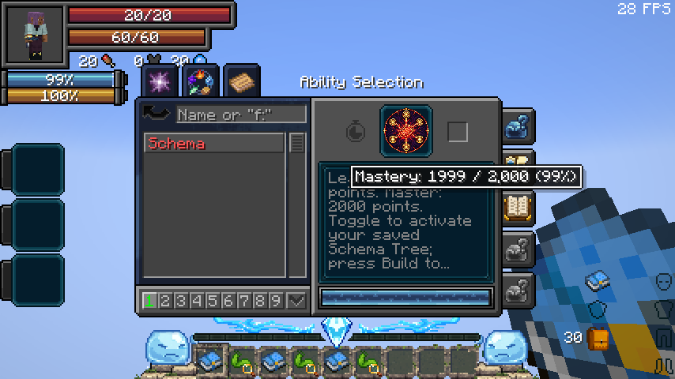

# 1.2.2 — Schema learning requirements

Fixes native failed-learning penalties collapsing Schema’s learning budget to 100 points. Schema requires 1,000 learning points and 2,000 mastery points; its native progress bar and tooltips now display the actual totals. Existing saved progress, the 30-second mastery interval, Chained/Unbound bonuses and registry IDs are retained.

The exact Neo Otherworld server passed 58 integration tests, including the native failure regression, parallel Aura Slash learning and exact learning/mastery completion boundaries. [Full validation and cause](../../../docs/VALIDATION-0.36.1.md).

The real Neo Otherworld Battlewill menu passed all seven Schema learning/mastery boundary cases and the unchanged Aura Slash case. A clean production build passed all seven JUnit tests; the distribution audit verified metadata, dependencies, both new mixins and the absence of review code.

