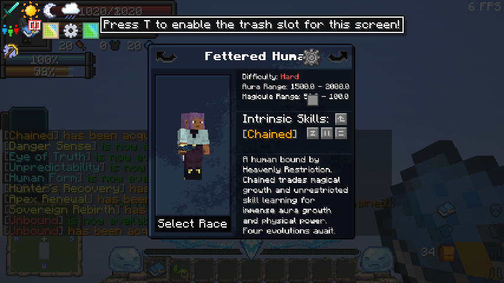
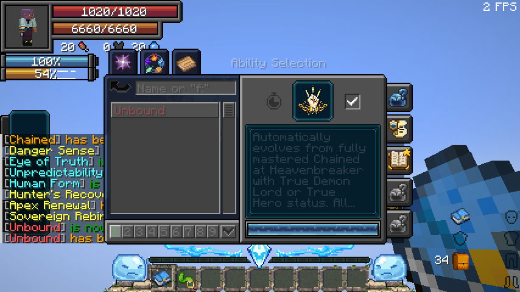

# Tensura Neo Otherworld 1.1.3a

Use **Tensura: Heavenly Restriction 1.1.6** with **Tensura Neo Otherworld Release-1.1.3a**.

[Download the standalone addon](../../../../releases/tensura-heavenly-restriction-1.1.6.jar) · [Pack release](https://www.curseforge.com/minecraft/modpacks/tensura-neo-otherworld/files/9340459) · [Exact 263-project lock](tensura-neo-otherworld-1.1.3a.lock.json)

## Install

Replace an older `tensura-heavenly-restriction-*.jar` in the pack’s `mods` folder with **1.1.6**. Keep a single standalone version installed. Update both client and server for multiplayer. The pack already provides the required libraries; its Tensura, ManasCore, NeoForge and GeckoLib versions can remain as shipped. Do not install Tensura Myths alongside the standalone.

Choose **Fettered Human** in the reincarnation menu. The pack also includes **Mysticism’s Restricted Human**: that is a separate race and skill system.

## Verified versions

| Component | Pack 1.1.3a |
| --- | --- |
| Minecraft | 1.21.1 |
| NeoForge | 21.1.248 |
| Tensura: Reincarnated | 2.0.1.4 — CurseForge file 9289888 |
| ManasCore | 4.0.0.2 |
| GeckoLib | 4.9.2 |
| Architectury | 13.0.8 |
| SmartBrainLib | 1.16.11 |
| TerraBlender | 4.1.0.8 |
| Neo Otherworld Compatibility Fix | 1.0.6.1 |
| Mysticism | 2.2.1 |
| SlimeThrone Extras | 2.1.2.1 |

## Changes in 1.1.6

The earlier standalone rejected Tensura 2.0.1.4 and required GeckoLib 4.9.3. The new metadata accepts the tested **Tensura 2.0.1.3–2.0.1.4** and **GeckoLib 4.9.2+ within major 4**. ManasCore remains pinned to the supported 4.0.0.2 modules. The ordinary development target remains Tensura 2.0.1.3 / NeoForge 21.1.209.

**Mysticism Constant Energy** and **Constant Energy Debuff** pause Chained’s converted natural regeneration. Recovery resumes when the effect ends. Optional entries in `heavenlyrestriction:pauses_energy_regeneration` avoid a hard dependency on Mysticism and let datapacks extend the pause policy.

**Reincarnation filtering** audits all **39 additional starting skills**. Optional skill-taking tags cover Imitator, All-Rounder, Total Reflection, Hidden Ruler and Satella. Explicit cost adapters catch Gardener’s inline crop/blessing charges, Subjugator’s EP-based Takeover payment, and Authority of Greed’s repeated Lionheart magicule penalty. The adapters read the installed addons’ current configuration; missing or incompatible cost metadata excludes the skill conservatively and logs the problem. Ordinary cost getters still inspect every mode, including mastered/toggled variants. Pride remains exempt from the skill-taking rule, and Creator remains eligible. See the [complete addon skill audit](FETTERED-SKILLS.md).

The blacklist applies when rolling Fettered Human’s reincarnation skills. Other races keep their existing pools. Allowlist/blacklist configuration and the two automatic-rule switches retain their existing priority.

The pack’s configs, progression, quests and existing compatibility patches are retained. Its own Mysticism restriction policy already limits that skill to Mysticism’s lineage; the addon does not override that policy.

## Validation

All **107 standalone native tests** and **16 pack integration tests** passed. The pack suite verifies the actual filtered reincarnation pool and all 39 addon classifications, plus EP growth, native learning, Creator, progression, weapon arts, spear/loot and regeneration locking. [Detailed validation](../VALIDATION-1.1.6.md).

## Client review

The full **263-project client manifest**, original overrides and isolated addon review were loaded together. The real player used both Chained and Unbound airborne teleports, each moving 16 blocks and paying the expected aura once. Automatic evolution completed, and the native menu displayed Fettered Human with Hard difficulty and its starting ranges, and Unbound in the Ultimate list.





## Server setup and test scope

A production NeoForge 21.1.248 server reached its ready state with the gameplay mods and pack configs plus the addon. The client download contains five visual/UI mods that fail on a dedicated server and were omitted from the dedicated test: FancyToasts, You Must Know This Notice, Drippy Loading Screen, Smart Particles and Particle Effects Reforged. These remain installed in the full client review. Use a proper server-side mod selection when creating a multiplayer server from the client archive.

The pack test actors receive FTB team records and funded native Mysticism soul energy, matching the login/integration data required for the tested native callbacks. Creator checks follow Tensura 2.0.1.4’s temporary unmastered creation and permanent mastered creation, including Chained inheritance.

The exact downloaded artifacts and SHA-256 hashes are recorded in the lock file. Third-party jars and pack overrides are not redistributed here. The review uses disposable worlds and does not modify an existing player save.

## Reproduce the isolated checks

This section is for development; installing the release JAR does not require it.

```sh
python3 scripts/fetch-runtime.py
python3 scripts/prepare-neo-otherworld.py /tmp/neo-otherworld-test
```

For the client review, supply an existing **disposable flat world** with `--world /path/to/world`; it is copied as `Restriction Validation`. The opt-in client fixture refuses to work in other world names.

Sinytra Connector’s development launcher needs the clean, mapped Minecraft JAR. After generating Minecraft artifacts, pass its path through `-PconnectorCleanPath=/path/to/clean-mapped-minecraft.jar`:

```sh
gradle runGameTestServer -PneoOtherworldDirectory=/tmp/neo-otherworld-test -PconnectorCleanPath=/path/to/clean-mapped-minecraft.jar -I docs/neo-otherworld-review/server.init.gradle
gradle runClient -PneoOtherworldDirectory=/tmp/neo-otherworld-test -PconnectorCleanPath=/path/to/clean-mapped-minecraft.jar -I docs/neo-otherworld-review/client.init.gradle
```

A graphical display is required for the client. The client fixture isolates Java’s writable home inside the test workspace for UI/cache mods. Review classes, their extra structure namespace and downloaded third-party dependencies are excluded from the normal production JAR. The existing independent distribution audit checks that exclusion.
