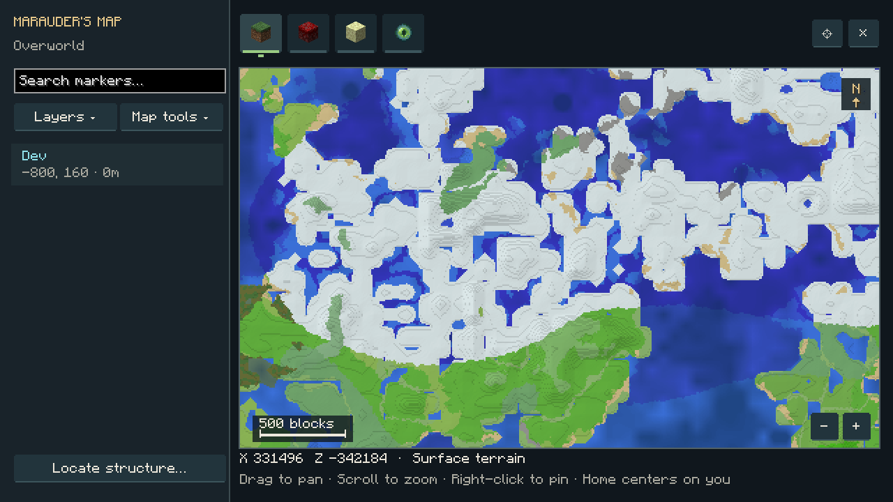
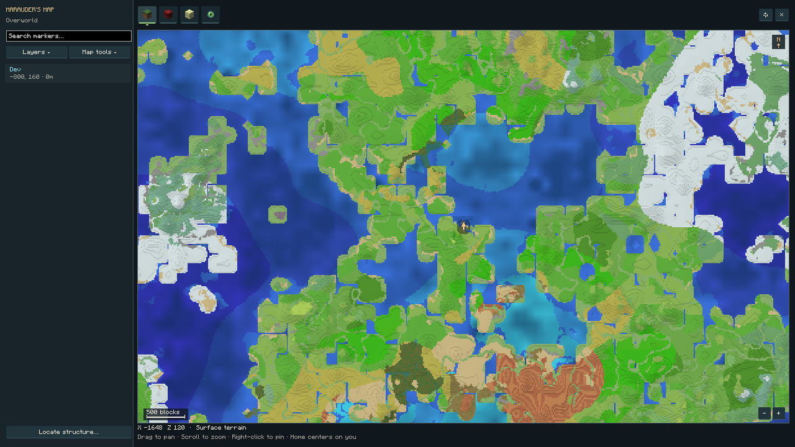

# 1.19.0 — Marauder’s Map performance and clarity

Research and implementation rationale: [map optimization research](MAP-OPTIMIZATION-RESEARCH.md). Public VoxelMap and SeedMapper source informed region reuse, layered previews, bounded caches and staged structure checks. No mapping-mod dependency or upstream implementation is bundled.

## Measured terrain performance

Single cold calls in the same disposable normal Overworld, using the same seed, coordinates near 300,000 / −310,000, generator and baseline dependencies. These timings compare progressive preview implementations, not identical pixel algorithms or a promise of the same speed on every computer.

| Stage | Previous implementation | 1.19.0 | Speedup |
| --- | ---: | ---: | ---: |
| Initial biome preview · step 1 | 1,071.9 ms | 7.3 ms | 146.8× |
| Initial biome preview · step 8 | 440.7 ms | 48.5 ms | 9.1× |
| Relief · step 1 | 6,144.3 ms | 626.8 ms | 9.8× |
| Relief · step 8 | 4,447.0 ms | 232.9 ms | 19.1× |

Warm relief calls took **10.3 ms at step 1** and **14.8 ms at step 8**, reusing native height samples. The final integrated client run filled a complete unexplored minimum-zoom viewport in **5.23 seconds**, completed relief in **12.85 seconds**, and retained all **194 tiles** when the map closed/reopened. Viewport times include networking, native work, rendering and update cadence; there is no historical whole-viewport timing for a direct comparison.

The previous coarse preview interpolated an 8×8 color grid; the replacement samples native biomes per 32×32 output tile and progressively refines screen density. Relief interpolates a much smaller cached native-height grid while keeping independent biome colors per output pixel. Exact recorded surfaces and zoomed-in native block detail remain separate. This is an intentional approximation/performance tradeoff for ungenerated terrain.

## Verification

- **301 required native GameTests passed** on Tensura 2.0.1.3 / NeoForge 21.1.209, including new persistence/confirmation/removal/seed-isolation checks for the spatial index and a regression asserting that a small pan retains completed survey tiles.
- **57 JVM tests passed**, including bounded LOD selection, a 65,536-marker randomized comparison with a full scan, index replacement/removal/dimension boundaries, and area-filtered mip pixel/alpha/subchunk-detail checks.
- The newer supported **Tensura 2.0.1.4 / NeoForge 21.1.248** API profile compiled and passed all 57 JVM tests. This is API coverage, not a full Neo Otherworld modpack runtime run.
- The normal-world client exercised the actual networked UI: all dimension tabs, shared exploration from a distant online review player without the skill, private pin actions, opaque dialogs, complete native/addon structure catalog, sorting/filtering and remembered cameras at GUI scales 2 and 4.
- The automatic-survey client found unexplored native/addon markers without Locate, panned and changed zoom, verified no distant region-file creation/full-chunk loading, then explicitly generated one start and matched its exact native type and bounding box. Saved native starts confirmed predictions.
- The performance client checked complete preview payloads, an unexplored whole viewport, retained textures on reopen, no distant full-chunk load, and actual recorded mip pixel readback against full-resolution data at minimum zoom, including GUI scales 1 and 2.

Review fixtures are opt-in and excluded from normal builds. The final release is built cleanly on the baseline dependency profile and passed the standalone distribution audit; no review classes, fixtures, test-only tags/presets, Myths classes or bundled dependency jars are present. Saved IDs, pins, world data, existing region PNGs and gameplay/skill values are unchanged. The 100,000-block viewed-map-center Locate behavior is preserved.

