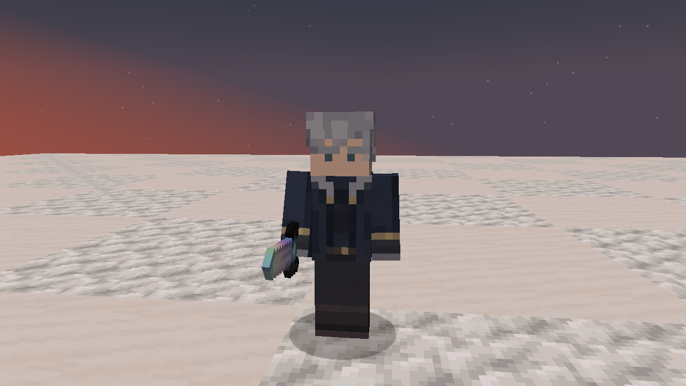
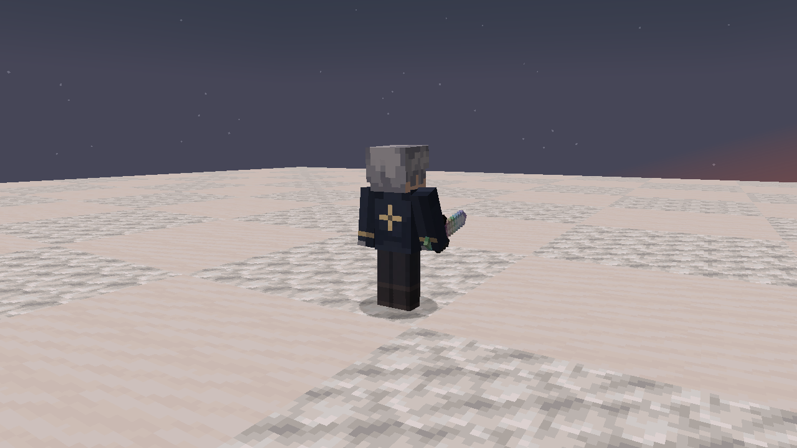

# 1.19.2 — Kael’s native-style skin

Kael’s skin now uses the same classic-arm 64×64 UV layout and pixel density as Tensura’s native otherworlders. Native Hinata, Kyoya and other bundled otherworlder textures were inspected for compact facial features, limited clothing shading and overlay use. The authored Kael art retains silver hair, small teal eyes, a navy coat, pale collar, antique-gold trim and a small compass on the coat back. Native reference textures are not redistributed.

The checked-in source art is registered to the exact player UV rectangles by `scripts/pack-wayfarer-skin.sh`, using nearest sampling and explicit face registration. Base UV faces are opaque, while unused space and selected outer regions remain transparent. Gold embroidery emission uses only eight registered texels and attenuated RGB so the native additive eyes render type does not wash out the cloth colors. The existing Python authoring entry point invokes the same packer; Gradle uses the checked-in PNGs.

The guarded normal-world skin review captured front, back and side views, the held Hihiirokane Sword and standard native player geometry. It confirmed initialization with **15M EP**, **10,000 HP** and **37,100 SHP**. There are no gameplay-code, stat, skill, AI, equipment, model-geometry or saved-data changes.

The clean production build passed **57 JVM tests**. The standalone distribution audit passed, including both skin textures at **64×64**, exact packed-resource bytes and exclusion of review fixtures. Pixel checks verify complete base-face opacity and that every emissive texel corresponds to the coat’s actual gold artwork.

