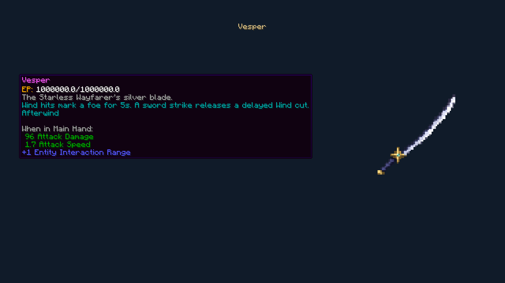
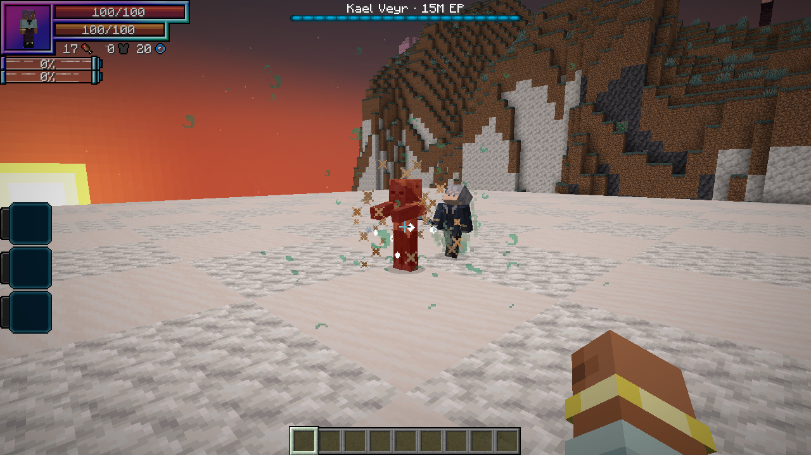

# 1.20.0 — Vesper

Vesper is Kael’s native Tensura sword with the original Afterwind engraving. The comparison was made against the actual `tensura_neb:night_rose` item in TenSura: Not Enough Bosses **2.0.0.3**, CurseForge file **8022509**. That addon is not required or bundled.

| Actual item stat | Night Rose | Vesper |
| --- | --- | --- |
| Damage, including 1 player base attack | 90 | 96 |
| Attack speed | 1.7 | 1.7 |
| Additional reach | 1 | 1 |
| Durability | 3,600 | 3,960 |

Night Rose’s constructor requests 9,000 durability, but its tiered superclass overwrites that request with the Hihiirokane tier’s 3,600. Runtime stacks, rather than that constructor literal, were used for comparison. Vesper’s damage is 6.7% higher and durability 10% higher. Its native gear profile uses a 1M minimum EP and Afterwind I instead of Night Rose’s Energy Steal II.

Afterwind observes completed damage transactions, including Tensura’s direct spiritual-health path. It requires actual HP/SHP/absorption loss to mark or consume a mark, deduplicates nested spiritual/regular calls, snapshots the raw attack attribute rather than an already-processed hit, and releases one delayed Wind hit through native defenses. Its own damage cannot re-arm it. Marks are bounded to 16 targets per wielder, with one pending cut and a shared three-second cooldown. Switching weapons, death, dimension changes and distance invalidate pending cuts.

New Kaels equip Vesper. Saved Kaels using the original Hihiirokane Sword migrate to Vesper with their enchantments and proportional wear preserved; custom replacement weapons are left alone. Migration preserves current HP, SHP, aura and magicules. Vesper uses the native guaranteed-equipment drop setting, retaining its wear and upgraded engravings. Player-owned otherworlders retain their native inventory-drop behavior. No duplicate sword is added to the loot table.

## Verification

- Native verification on Tensura **2.0.1.3 / NeoForge 21.1.209**, with the optional Not Enough Bosses reference: **305 existing regressions passed** in the full suite, and **all eight Vesper cases passed** in the focused rerun. Vesper coverage includes the actual comparison, delayed raw-attack scaling, immunity, expiry, cooldown/recursion, weapon switching, actual direct spiritual damage, level-II preservation, the full native death-loot transaction and saved-Kael migration. The loot-specific fixture invokes the transaction after the death-prevention boundary, checking one equipped sword with its upgraded engraving and wear; it does not disable or change Kael’s regeneration in production.
- The native SHP regression invokes `TensuraDamageHelper.directSpiritualHurt`; ordinary `LivingEntity.hurt` alone does not cover that separate native path. A dedicated wrapper observes both without double-committing nested hits.

See [review setup](review-vesper/README.md). Review profiles are opt-in and must be cleaned out before packaging.

The guarded real-client run passed without Not Enough Bosses installed. Kael held Vesper, fired his actual Wind Cutter and landed an actual native `doHurtTarget` sword attack; exactly one delayed Afterwind damage event followed. The native tooltip showed **96 Attack Damage**, **1.7 Attack Speed**, **+1 Entity Interaction Range**, and Afterwind. The combo uses a normal Husk target; a previous spiritual/high-EP review target rejected physical damage and correctly did not consume the mark.

The Tensura **2.0.1.4 / NeoForge 21.1.248** API profile compiled and passed **57 JVM tests**. This is API compatibility coverage; it does not replace a full Neo Otherworld modpack playtest.

The final clean baseline production build passed **57 JVM tests**, with no failures or skips. The distribution audit verified the release version, both hit wrappers, native data, the 64×64 sprite, 19 guide entries, and exclusion of review fixtures and bundled dependencies. The rebuilt wiki passed its link, media, addon-boundary and ability checks for **210 articles / 131 ability links**, with **211 GitHub Wiki export pages**.

