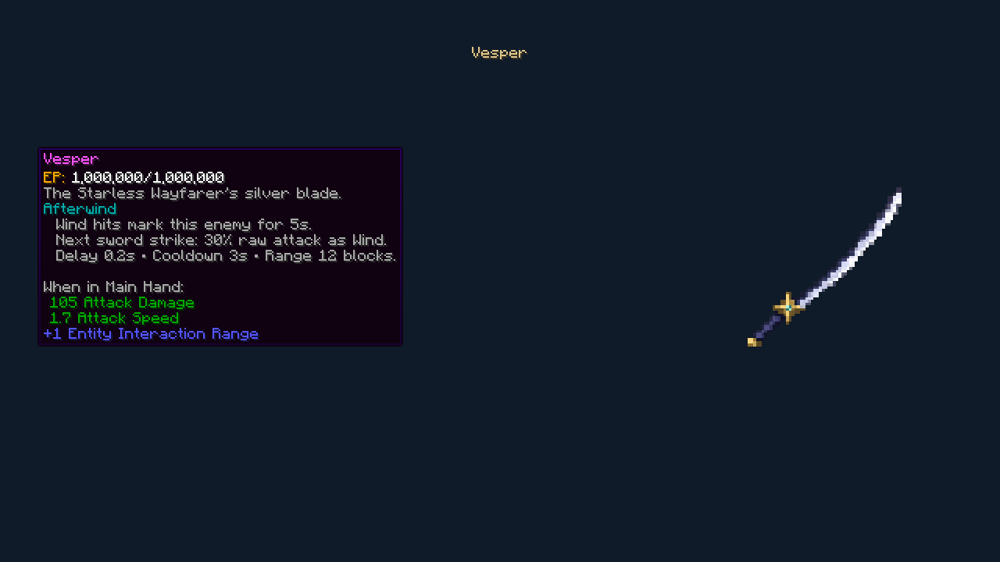
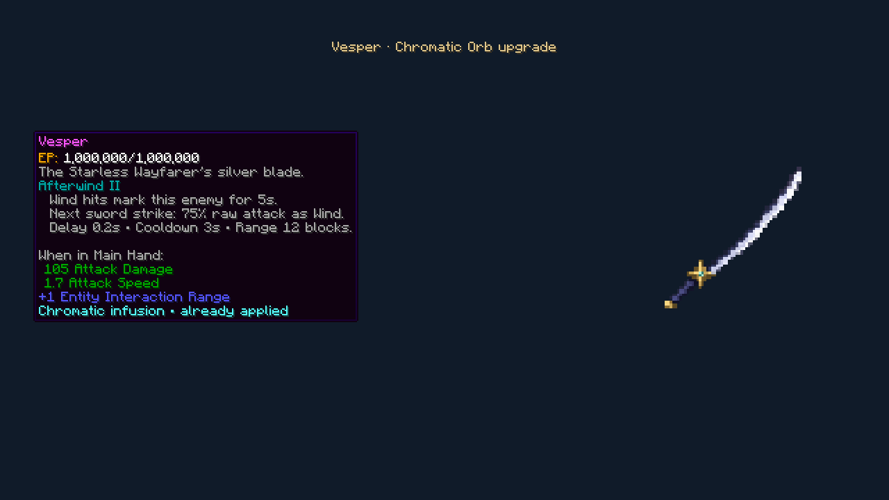

# 1.20.1 — Vesper balance and tooltip

Vesper's baseline attack damage increases from **96 to 105**. The native attack speed (**1.7**), extra reach (**+1**) and durability (**3,960**) are unchanged. Against the actual Night Rose reference item, Vesper now supplies 105 versus 90 damage, with the same speed/reach.

Afterwind I changes from **20% to 30%** of raw attack damage. The Chromatic Orb's over-cap Afterwind II changes from **25% to 75%**: 2.5 times level I's cut. The existing Wind-to-sword trigger, five-second mark, 0.2-second delay, three-second cooldown, native Wind defenses, recursion protection and raw-attribute snapshot remain intact.

The old tooltip put a fixed ability sentence above the engraving name and never explained the upgraded value. A client-only handler scoped to Vesper now inserts short, live effect lines below the existing native Afterwind heading. It reads the actual engraving level and shared damage/timing constants. Native enchantment names, Roman levels, attribute lines, hidden enchantment tooltips and other weapons are preserved. Vesper's existing native EP durability line uses grouped numbers without trailing `.0`, without adding a second EP line or changing the stored values.

No item, enchantment or component IDs change. Existing Vespers use the new item attributes and coefficients automatically; infused level-II engravings retain their level and one-use marker. No new world or replacement sword is required.

## Verification

- **Eight focused native GameTests passed** on Tensura 2.0.1.3 / NeoForge 21.1.209 with the optional Night Rose reference. The upgrade regression now uses the actual Chromatic Orb upgrade function, checks retained wear and Sharpness, and observes the delayed native damage at **75% of raw attack**. Level-I native damage is checked at 30%. Expiry, cooldown, immunity, SHP, loot and saved-Kael migration cases also pass.
- The guarded real-client run passed after a native Kael Wind Cutter → sword combo. Both normal and Orb-upgraded tooltips retained the native attribute block at **105 damage / 1.7 speed / +1 reach**, displayed **30% / 75%** below the correct native engraving heading, and showed exactly one grouped EP line. The upgraded tooltip also retained the Chromatic infusion marker.

The Tensura **2.0.1.4 / NeoForge 21.1.248** API profile compiled and passed **57 JVM tests**. This verifies the supported API profile, rather than claiming a full modpack runtime test.

The final clean baseline production build passed **57 JVM tests**, with zero failures, errors or skips. The standalone distribution audit passed, including the new client-only tooltip handler and exclusion of review fixtures. Wiki validation passed for **210 articles / 131 ability links**, and the **211-page GitHub Wiki export** and offline bundle include the updated item captures.
