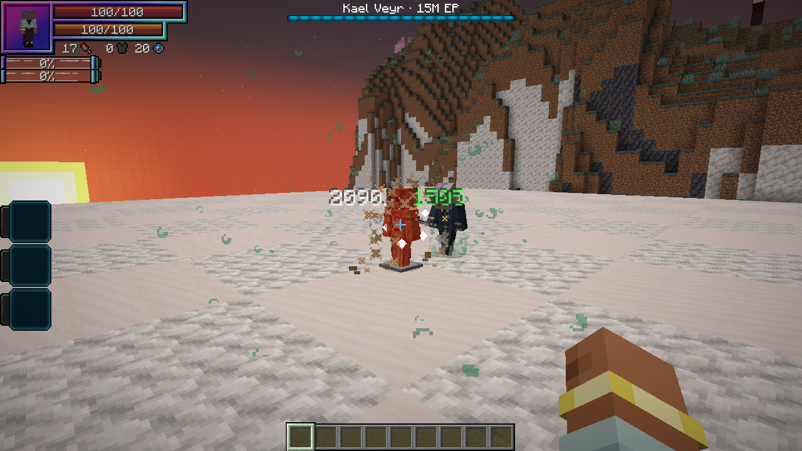
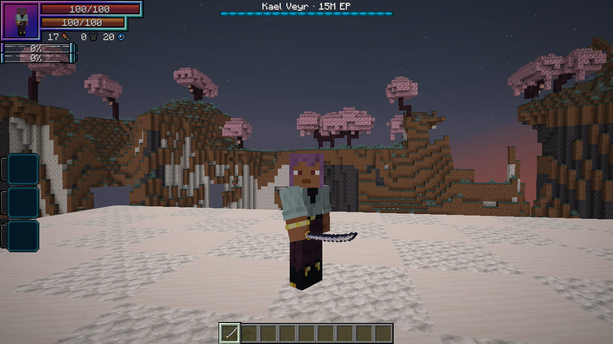

# 1.20.3 — Training-dummy Afterwind and held cutting edge

Tensura's native `TrainingDummyEntity.setHealth` records incoming damage in its damage ledger while retaining full HP. Afterwind previously required an HP/SHP/absorption decrease, so those accepted dummy hits never primed or consumed its mark.

Afterwind now also snapshots the native dummy's damage-record counter and timestamp. A fresh record with positive `lastDamageTaken` counts as accepted damage. Both fields are needed because the dummy restarts its counter after its short reporting window. Old damage records, zero/immune hits and healing cannot satisfy the check. Ordinary targets retain the existing HP/SHP/absorption rules, and the delayed cut still cannot re-arm itself.

Vesper's four held display transforms now roll the sword around its length to reverse the cutting edge. The blade axis, native held scale/translation and inventory artwork are retained. Both left/right first-person and third-person transform paths were checked, including a numeric comparison that the blade axis is preserved and its transverse edge direction reversed.

## Verification

- **11 focused native GameTests passed** on Tensura 2.0.1.3 / NeoForge 21.1.209. Three new regressions use the real native training dummy on its required block: accepted constant-HP damage and a real recorded aftercut, blocked/stale records, and a counter reset across reporting windows. Existing Wind/SHP, cooldown, immune-hit, Orb upgrade, loot and saved-Kael cases also pass.
- The guarded real-client profile now uses an actual Tensura training dummy rather than a Husk for Vesper. Kael's native Wind Cutter and native sword attack produced exactly one delayed Afterwind hit with the dummy still at full HP. Native damage attribution and both 30%/75% tooltip checks passed.
- First- and third-person captures were inspected for each main arm. The held model's cutting edge is reversed while inventory presentation remains intact.
- The Tensura **2.0.1.4 / NeoForge 21.1.248** API profile compiled and passed **57 JVM tests**. This is API coverage rather than a full Neo Otherworld runtime test.

The final clean baseline build passed **57 JVM tests**, with no failures, errors or skips. The distribution audit verified the release and excluded all review fixtures. Wiki validation passed for **210 articles / 131 ability links**, with **211 GitHub Wiki export pages** and updated combat/held captures in the offline bundle.
