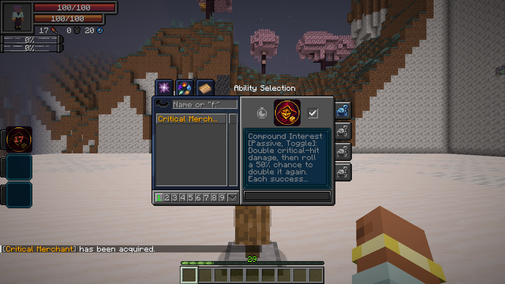
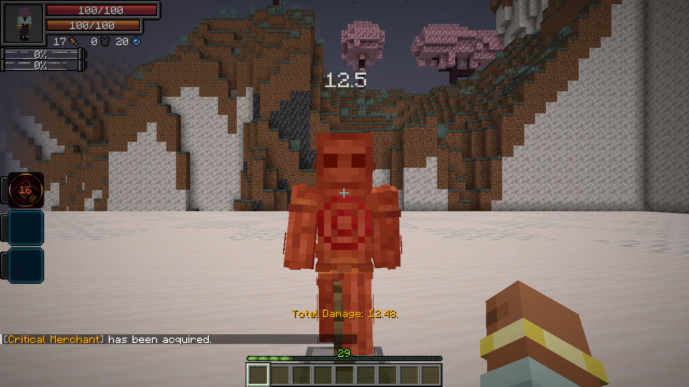

# 1.21.0 — Critical Merchant

Critical Merchant is a native Unique skill. Compound Interest is a free toggle: a critical receives one guaranteed doubling, followed by at most 100 independent 50% additional doubling rolls, stopping at the first failure. The maximum multiplier is `2^101`. Calculations use doubles and saturate only at the native positive float transport limit; invalid mitigation results cannot become maximum damage.

Guaranteed Profit spends a flat 1,000 magicules and starts a 20-second native cooldown. It refreshes ten guarantees, never stacks charges, and operates independently of the passive. Existing Schema resource-cost penalties still apply. Each damaged target consumes one guarantee; misses, immune targets and completely blocked hits refund it. Death or forgetting clears the stock.

Native melee criticals, mob criticals, owned projectiles and direct spiritual damage retain their original damage sources and defenses. Unbound retains exactly one base critical multiplier. Nested same-source spiritual/physical transactions share a reservation. Native dummy ledger changes and positive final damage count as accepted hits even when the target remains at full health or immediately regenerates.

The new skill uses the normal reincarnation Unique pool. Fettered Human's existing magicule-cost filter excludes it automatically. Existing IDs, worlds and character progression are retained.

## Verification

- 62 JVM tests pass, including the exact 100-roll boundary, stopping on failure, numeric safety and the updated twenty-entry in-game guide.
- Thirteen focused native Critical Merchant GameTests pass on Tensura 2.0.1.3 / NeoForge 21.1.209. Cases cover payment, cooldown/refresh, ten guarantees, immune/exception refunds, natural criticals, Unbound melee/projectiles, owned projectiles, direct spiritual damage, native mob criticals, the reincarnation filter, ordinary hits and immediate healing.
- The final full native suite passes all 329 required tests. An earlier run exhausted workspace storage, preventing a map-detail disk-cache callback; after stopping that disposable server and clearing its accumulated generated test world, the full suite passed without code changes.
- The Tensura 2.0.1.4 / NeoForge 21.1.248 API profile compiles and passes 62 JVM tests. This is API coverage, not a full Neo Otherworld modpack runtime test.
- A guarded real client run passes: actual 1,000-magicule payment, ten synchronized guarantees, native Unique menu/name/icon, a player melee critical on the native training dummy, and synchronized remaining stock of nine. Both captures were inspected.

The final clean baseline production build passes all 62 JVM tests without failures, errors or skips. The distribution audit confirms the new classes, native metadata, twenty guide entries, icon and Unique registration, and excludes all review fixtures. Wiki verification passes for 211 articles / 133 ability links, with 212 GitHub Wiki export pages and both client captures in the offline bundle. The JAR and offline bundle include SHA-256 checksums.
