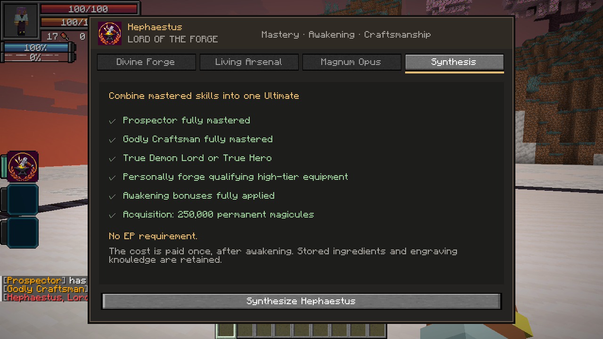
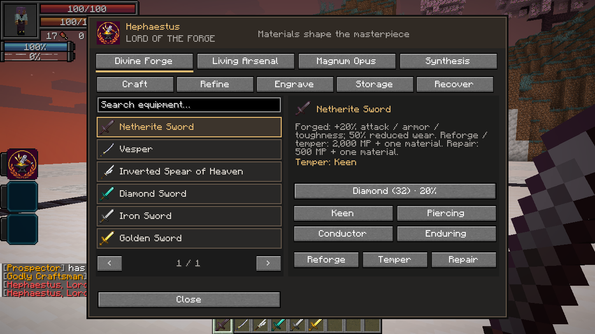
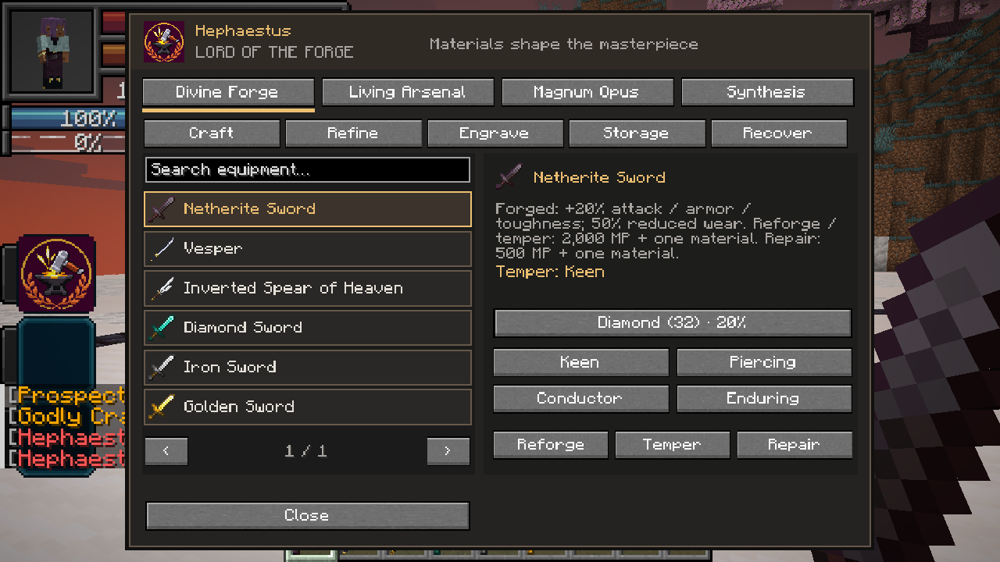
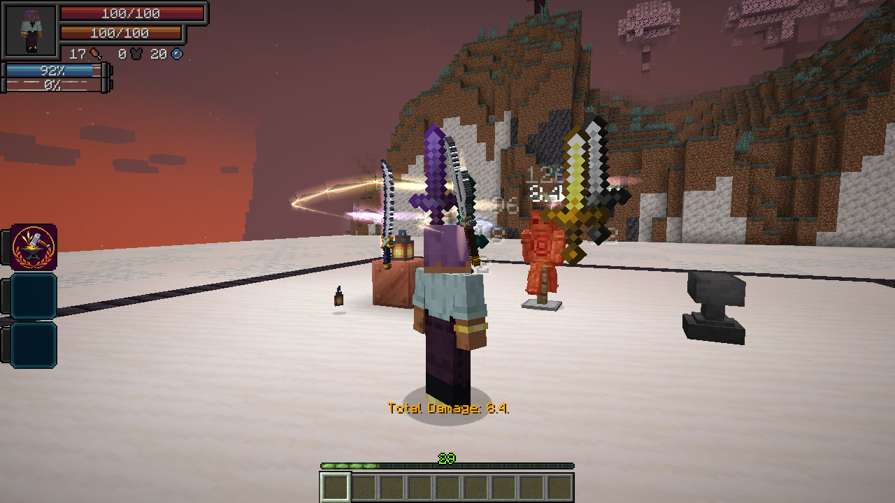

# 1.22.0 — Hephaestus, Lord of the Forge

Hephaestus is a native Ultimate synthesized from permanent, fully mastered Prospector and Godly Craftsman. It requires True Demon Lord or True Hero status and an actual personal craft/smithing result from the configurable qualifying-equipment tag. There is **no EP threshold**. The default acquisition bill is 250,000 permanent magicules, configurable and scaled by Tensura's normal skill-cost gamerule.

Tensura's awakening event occurs before its resource multiplier. Synthesis therefore waits for that call and harvest/sleep progression to finish, and charges only after a successful native unlock. Failure leaves the component skills and resources intact. The result starts learned and unmastered; both source stores, engraving knowledge and affected presets survive. The old Prospector ingredients can be recovered through the forge. Temporary component skills cannot be used to synthesize permanent ones.

The four abilities are Master of the Crucible, Divine Forge, Living Arsenal and Magnum Opus. Ordinary forging adds +20% item stats and reduces wear by 50%. Magnum Opus replaces those values with +50% / 75% for one designated work. A saved world ledger deactivates an earlier designation even outside loaded inventories; personal designation also travels with the character. Maximum durability and player resource capacities are unchanged. Ordinary fractional wear is carried forward, and native EP durability loss is reduced separately.

The forge uses real inventory materials and the native crafting, refining, engraving and storage menus. One replaceable temper can improve critical damage, partial armor penetration, elemental damage or wear reduction. Native engraving restrictions and Chromatic Orb history remain intact.

Living Arsenal removes up to six real weapons into persistent player escrow. Each performs curved autonomous slashes with its actual model, weapon/enchantment damage, native engraving callbacks and scoped offensive engraving attributes. Scoped changes restore the held weapon's attributes after the hit. Independent hit intervals allow each blade in a volley to land; normal defenses and regeneration still apply. Nullification and delayed Afterwind work with deployed weapons. Recall clears escrow before returning items, and handles death, logout, dimension changes and lost access; saved escrow survives a restart. Entity generation IDs prevent duplicate blades after a same-dimension teleport or tracking interruption.

The native Ultimate entry opens a server-authoritative synthesis/forge interface. Search, stable confirmations, native buttons, selected-tab indicators and scaled rendering keep both tested GUI sizes usable. The replacement icon is the original 64×64 hammer-and-anvil emblem.

## Verification

The guarded real-client run passes: native Ultimate activation opens synthesis; both component skills are replaced; exactly 250,000 permanent magicules are deducted once; the Ultimate starts learned and unmastered; real forge-menu tempering and masterpiece selection work; six weapons leave inventory, move out of formation, deal actual damage and return without duplication. Both GUI scales and the captures were inspected.

The full native regression suite passes **347 required tests** on Tensura 2.0.1.3 / NeoForge 21.1.209. Final refinements use NeoForge's armor-reduction modifier directly and preserve the normal acquisition price for other native skill systems. The synthesis transaction uses the native one-use cost exemption and then deducts its own bill once, after a successful grant. The focused tests check exact 20% reduction of armor mitigation and native price visibility alongside single-payment synthesis.

All **18 focused native tests pass after those final refinements**, including preservation of both source stores and no duplicate acquisition payment. The brief awakening guard is transient and uses the live server clock; a stored world's earlier time cannot leave synthesis locked after a world switch or restart.

The Tensura **2.0.1.4 / NeoForge 21.1.248** API profile compiles and passes **62 JVM tests**, with no failures, errors or skips. This checks API compatibility rather than running the full Neo Otherworld modpack.

The final **clean baseline production build** also passes all **62 JVM tests**. The distribution audit verifies native metadata, all forge classes and mixins, the 64×64 replacement icon, the Ultimate tag and twenty-one guide entries. Review classes, test structures, alternate profile resources and bundled dependencies are excluded from the release.

Wiki validation passes for **212 articles / 137 ability links**, with **213 GitHub Wiki export pages**. The offline bundle contains the replacement icon and seven inspected client captures. Release JAR and wiki bundle have SHA-256 checksums.

An older Kael loot-only fixture forced a drop while leaving its boss alive for two ticks, allowing normal equipment regeneration to alter its wear. The fixture now discards that already-processed victim immediately, matching accepted-death behavior while keeping the full native drop transaction and exact engraving/wear assertions.
