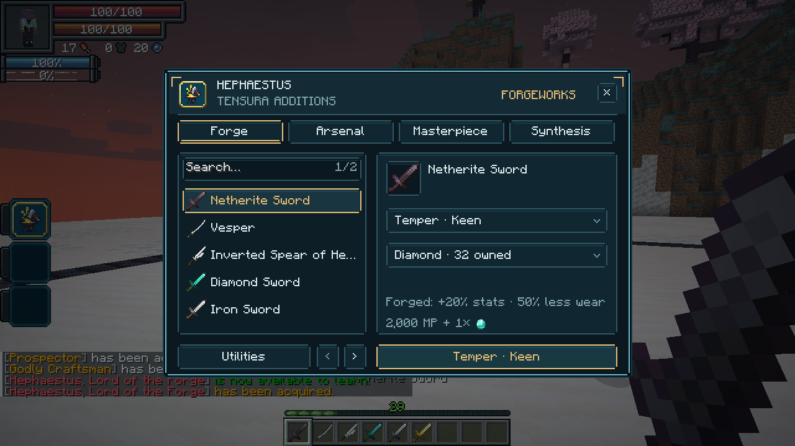
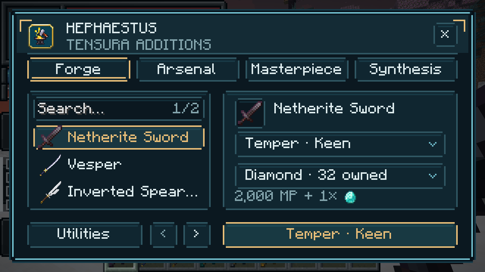
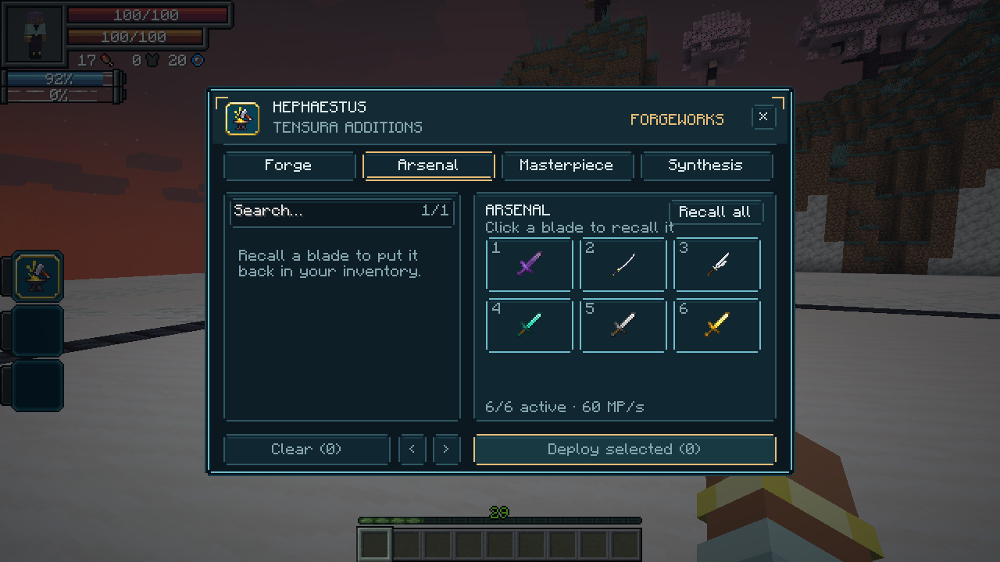
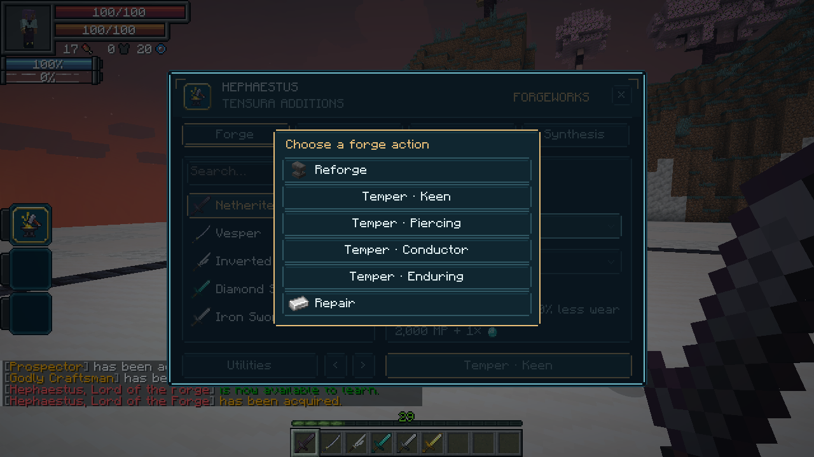

# 1.22.2 — The Additions workshop

The forge now has its own responsive layout rather than reusing Tensura's ability-selection texture. It retains Tensura's sharp cyan bevels and dark inset panels, with warm gold accents, the Hephaestus crest and Additions workshop branding. The four horizontal tabs are Forge, Arsenal, Masterpiece and Synthesis. Equipment stays in a dedicated searchable list, separate from action details and deployed weapons.

Forge has one combined action/temper selector, one material selector and one primary action. Utilities contains crafting, refining, engraving, storage and ingredient recovery. Arsenal has inventory checkboxes and a six-slot rack; click a deployed blade to recall it. Masterpiece and Synthesis use explicit confirmation dialogs. Server refreshes preserve choices and confirmations. Cost displays use server-calculated prices and material counts; disabled actions explain their missing requirement on hover.

Popover drawing uses an explicit layer above equipment models. Underlying controls and their tooltips are suppressed while a popup is open. Compact layouts reflow without scaling the text to fractional pixels. Header buttons, inventory rows, selectors, pagination, confirmations and rack controls remain within the viewport.

## Validation

The opt-in native client review exercises synthesis with the exact permanent-magicule debit, forge actions/material selection, utilities, masterpiece confirmation, six-weapon selection across pages, individual recall, incremental redeployment, autonomous strikes and complete item return. It checks widget bounds and overlapping interactive controls at normal GUI scales and a forced **320×180** GUI viewport. Screenshots cover the forge, selectors, utilities, confirmations and the compact forge/rack. This is a disposable test save, not a player's existing world.

The final client review passed the full sequence and viewport/overlap checks. The Tensura **2.0.1.4 / NeoForge 21.1.248** profile passed **64 JVM tests** and **24 focused native forge tests**. The clean baseline production build uses **Tensura 2.0.1.3 / NeoForge 21.1.209**. The final baseline build passed **64 JVM tests** and the distribution audit confirmed that only production code/assets and supported dependency metadata entered the JAR. This validates the two supported APIs, rather than running the entire Neo Otherworld modpack.

Gameplay rules, skill costs, item bonuses, arsenal damage/timing and saved equipment identities are retained. The server adds display metadata for current magicules, calculated costs and material icons; transactions still validate and charge exclusively on the server.
