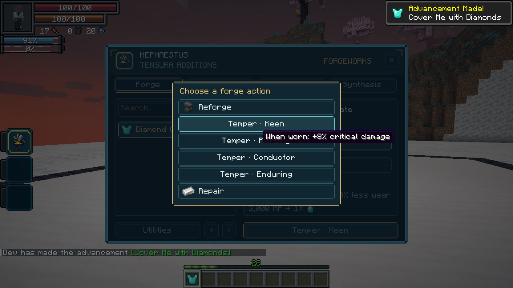
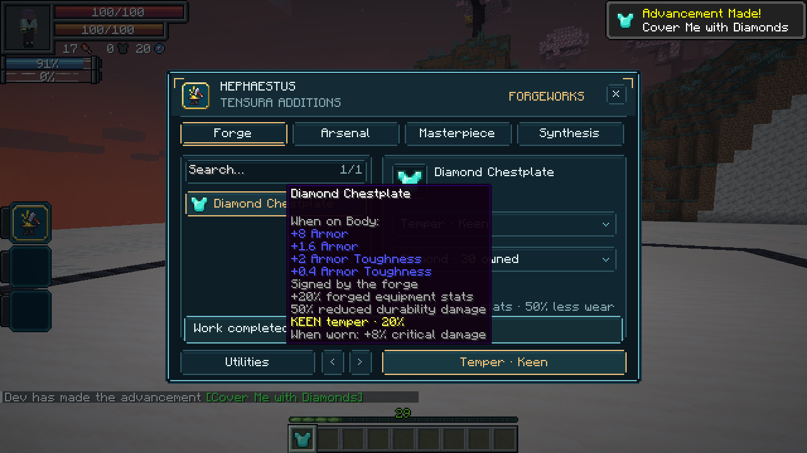

# 1.22.3 — Armor tempers

Worn armor now activates combat tempers. Each temper has one effect per item: Keen increases critical damage, Piercing ignores part of armor mitigation, Conductor reduces elemental damage taken, and Enduring reduces that item's wear. Weapon effects retain their existing roles; Conductor on a weapon remains an elemental damage bonus. Different armor pieces may carry different tempers.

Combat strength is weighted by slot: 15% helmet, 40% chestplate, 30% leggings and 15% boots. A matching set therefore contributes one material strength (10/20/30/35%), capped at 35%, rather than four multipliers. Offensive armor contributions add to the weapon's matching bonus. For example, a Diamond chestplate contributes 8% critical damage, 8% armor penetration or 8% elemental damage reduction, depending on its temper. Enduring uses the full material strength on that piece's wear instead of a slot weight.

Only forged armor in its actual equipment slot counts. Held, carried and incorrectly equipped pieces do not activate worn effects. Existing item tags remain valid, so previously tempered armor updates automatically. Ordinary forging bonuses, masterpiece identity, enchantments and Chromatic history remain intact.

Native HP damage and direct SHP damage are covered. Elemental protection also recognizes Tensura's native elemental classifications for environmental hits, including fire, cold and lightning, without requiring an attacker. Pure physical damage is unaffected by Conductor. Bypass-invulnerability damage is preserved. Armor-only Keen criticals use the existing native critical tracking, including guaranteed criticals. The direct SHP callback also brings the existing Keen/Conductor weapon bonuses through that native route.

The forge action selector previews the effect for the selected equipment/material. Item tooltips show both material strength and the exact worn contribution. Enduring continues reducing both ordinary and native EP durability damage, and replacing it removes its additional wear reduction.

## Validation

Six new native cases exercise correct equipment slots, carried and wrong-slot armor, the full-set cap and unequipping; bare-hand criticals with Keen armor; additive weapon/armor Piercing accounting against real mitigation; elemental HP protection without an attacker and unchanged physical damage; native direct SHP protection and critical bonuses; and real forge material consumption, temper replacement and both wear pools.

The opt-in client review also tempers armor through the workshop, checks the replacement and captures its effect preview and tooltip. See `docs/review-hephaestus/README.md` for reproducible review commands.

The complete native baseline suite passed **359 required tests** on Tensura **2.0.1.3 / NeoForge 21.1.209**. The API profile **2.0.1.4 / 21.1.248** passed **30 focused native forge tests** and **64 JVM tests**. The client review passed through the armor-tempering stages; captures show a Diamond chestplate previewing and receiving **+8% critical damage**, replacing its earlier Conductor temper. This verifies both supported APIs, not an entire Neo Otherworld modpack run.

The final clean production build also passed **64 JVM tests**. The distribution audit verified production classes/assets, mixin metadata, supported dependency ranges and exclusion of review fixtures.
