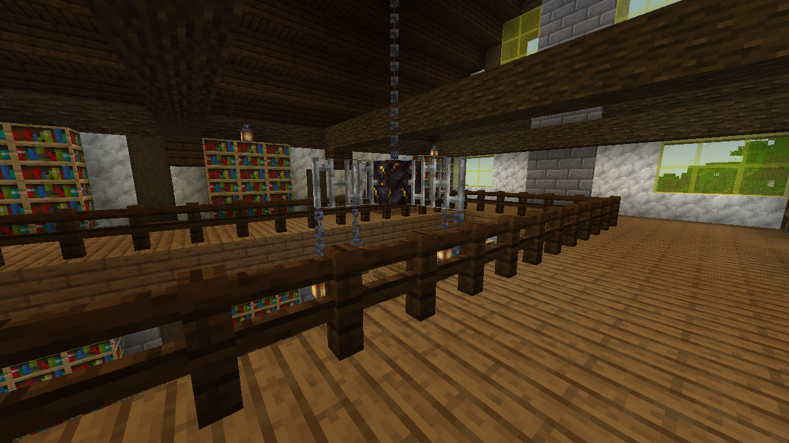
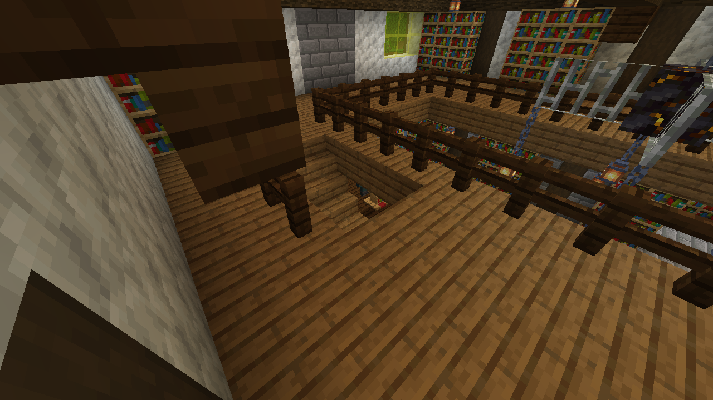
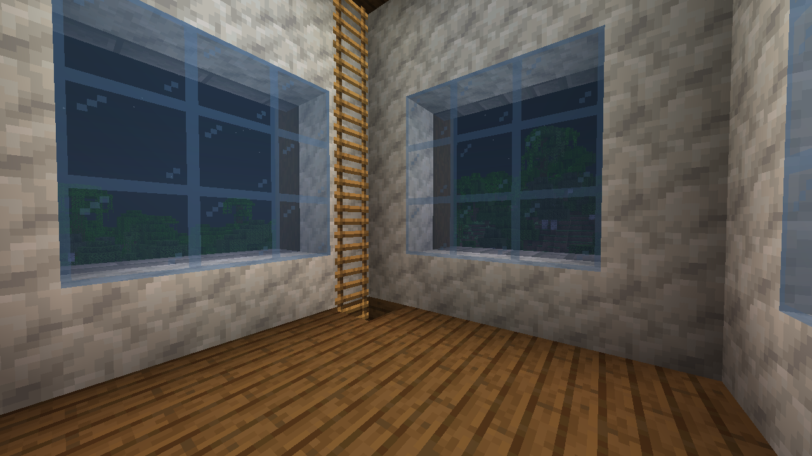
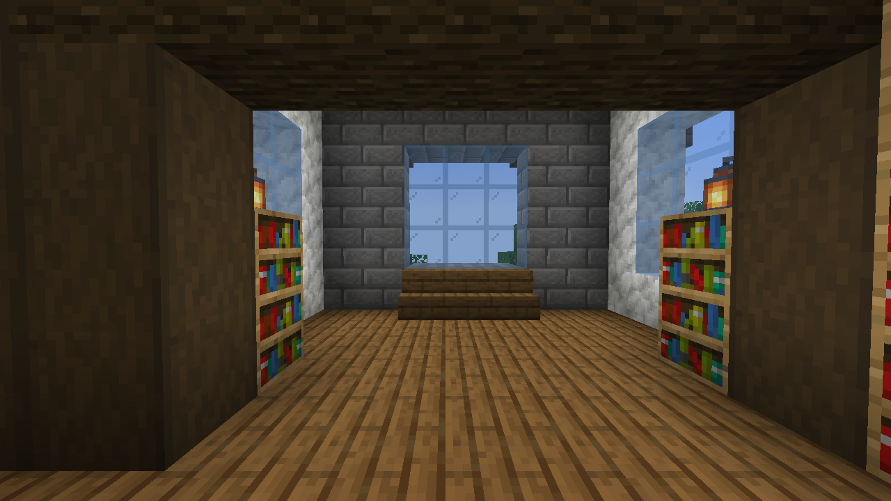
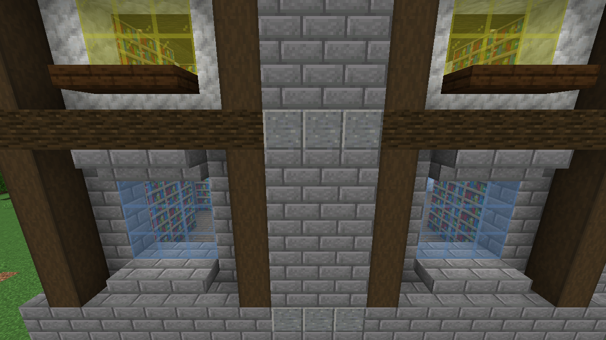
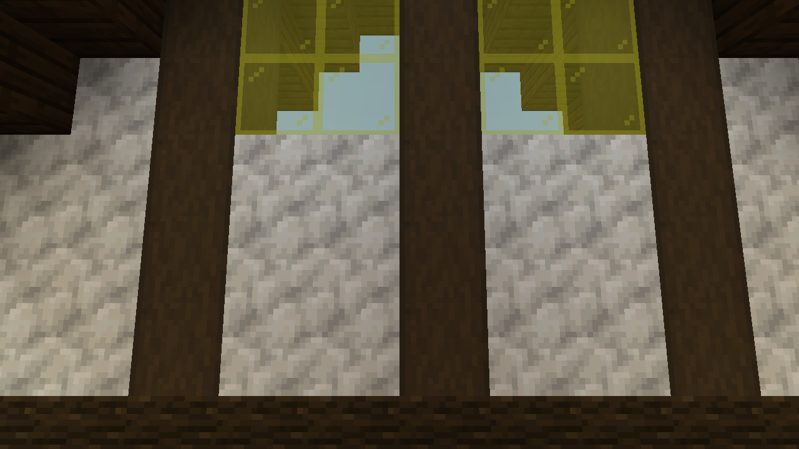
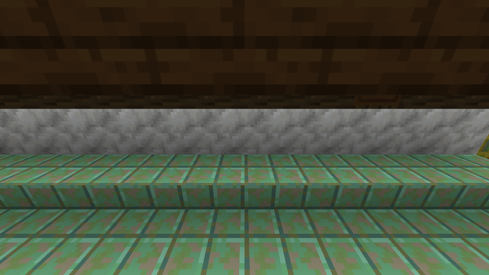
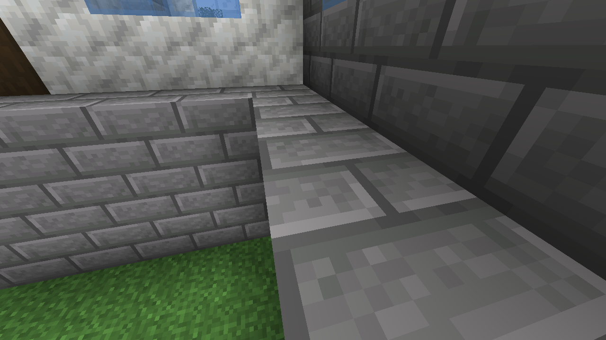

# Archive 1.24.3 — block context review

The NBT audit examined every cell in the 31×29×33 template: **29,667 cells and 6,209 non-air blocks**, with no errors. [Machine-readable report](context-audit.json). Run `python3 scripts/audit-mentor-archive.py` from the repository root to reproduce it.

| Review | Result |
| --- | --- |
| Block supports and attachments | Lamps anchored, ladder on opaque backing, fences on full floors, table tops on legs |
| Structure connectivity | Every non-air block connected to the grounded structure, including the supported roof cap |
| Window and room alignment | Mirrored front/rear elevations; bay window, bench and paired lights share the room axis |
| Foundation | Complete full-block plinths around the hall and bay |
| Enclosure | Six interior probes sealed on a half-block occupancy grid; stairs/slabs modelled and only the intentional entrance temporarily closed |
| Native placement | All blocks survive in all four rotations; placed block counts match the template |
| Standing-player clearance | All six stair steps, hall-to-bay passage, gallery corridors and both tower links pass in-game collision checks |
| Night lighting | All three tower floor centres remain lit |

The inspection used the real template and native renderer in a disposable review world. These detailed views complement the cell audit. Existing world buildings are not regenerated automatically.

## Chandelier below the trusses

The frame is entirely over the atrium, below the transverse beams, with continuous suspension and four hanging lights.

## Supported gallery railing and stairwell

The stairwell sits beside the atrium rail. The outer guard stands on a full floor; the flight has timber undersheathing, and the outside gallery route is clear.

## Tower ladder and upper room

The ladder follows an opaque corner pier. The cartography table is removed.

## Symmetrical bay

The three-wide window and bench are centred, with paired shelf lamps and matching bookcases.

## Rear window placement

The windows are centred between their frame posts, mirrored about the chimney.

## Closed front gable

The porch roof ends outside the main wall, leaving a continuous wall behind its steps.

## Closed copper-roof junction

The side roof meets the main wall; its slabs no longer replace full wall blocks.

## Continuous foundation

Whole masonry blocks replace interrupted strips and notches.

