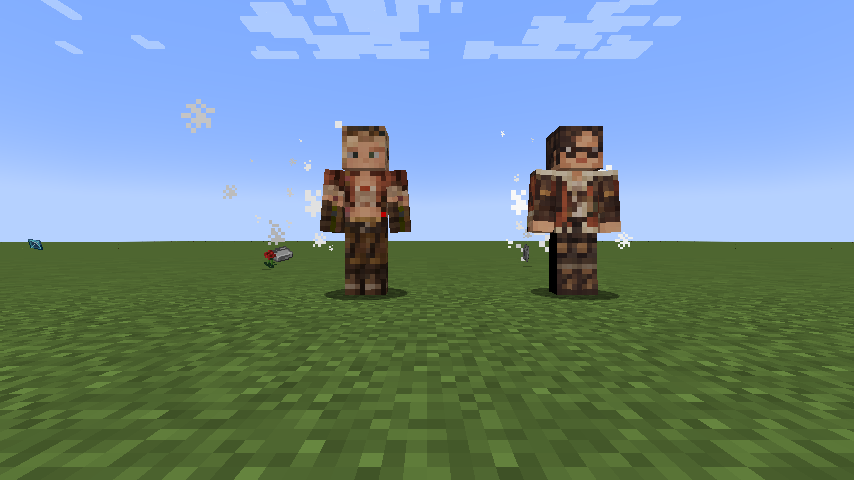

# Tensura: Wild Hunt Wiki

> Welcome to the unofficial addon wiki. **Minecraft 1.21.1 · NeoForge · Wild Hunt 0.7.2**

A field guide to four Monster Hunter Wilds inspired skill lines and a human hunter evolution branch for Tensura: Reincarnated.

## Explore the wiki

| Start here | Learn the systems | Reference |
| --- | --- | --- |
| [Getting started](pages/Getting-Started.md) | [Unique and Ultimate skills](pages/Skills.md) | [Commands](pages/Commands.md) |
| [Human evolution](pages/Evolution.md) | [Combat mechanics](pages/Mechanics.md) | [Version history](pages/Version-History.md) |

## Apex arts

| Inspiration | Unique Skill | Ultimate Skill | Combat identity |
| --- | --- | --- | --- |
| Rey Dau | [Storm Crown](pages/Storm-Crown.md) | [Raijin, Lord of Thunder](pages/Raijin.md) | Ricochet lightning / mobility |
| Uth Duna | [Scarlet Deluge](pages/Scarlet-Deluge.md) | [Varuna, Lord of Tides](pages/Varuna.md) | Moving tides / native barriers |
| Nu Udra | [Black Flame](pages/Black-Flame.md) | [Agni, Lord of the Black Flame](pages/Agni.md) | Tentacle pulls / burning ground |
| Jin Dahaad | [Frostbound Colossus](pages/Frostbound-Colossus.md) | [Ymir, Lord of Winter](pages/Ymir.md) | Avalanche impact / ice capture |

Each line has two active arts and a separate native toggleable passive; Ultimates add a third signature art. Passive stack counters and addon EP damage scaling are removed.

## Hunter evolution

**Human → [Awakened Hunter](pages/Awakened-Hunter.md) → [Apex Hunter](pages/Apex-Hunter.md) → [Sovereign Hunter](pages/Sovereign-Hunter.md)**

Grow through 100K / 400K / 2M base EP and 1 / 3 / 5 distinct boss types. Sovereign Hunter also requires mastery of an apex Unique. Every stage stays human-looking.

## About this wiki

Pages use skill/race infoboxes, acquisition sections, mode tables, progression links and mechanics notes inspired by the organization of the official Tensura wiki. All text here describes the addon and is original. This is not the official Tensura or Monster Hunter wiki.

Read these Markdown pages directly on GitHub, or **[download the styled wiki ZIP](../releases/wild-hunt-wiki-0.7.2.zip)**, extract it, and open `index.html` in your browser. The portable edition includes every article, original portraits, screenshots, and offline search. No server or login is required.

The visual edition uses a wiki.gg / MediaWiki inspired portal, grouped sidebar, article tabs, numbered contents, infoboxes, and related-page navigation. It adapts to phones with a collapsible navigation menu. GitHub displays HTML source rather than the styled page; use the ZIP to view the design, or open `wiki/index.html` after downloading the repository.

The official Tensura wiki returned HTTP 403 during this redesign, so this is an original approximation of its wiki-style organization rather than a verified copy of its current theme.

[Download the addon](../releases/tensura-wild-hunt-0.7.2.jar) · [Repository README](../README.md) · [Official Tensura wiki](https://tensura.wiki.gg/wiki/Tensura:_Reincarnated_Wiki)

## Aura skills and otherworlders

[Aura regeneration](pages/Aura-Regeneration.md) · [Alma](pages/Alma.md) · [Gemma](pages/Gemma.md)

0.7.0 introduced aura recovery, stronger hunter vitality, native otherworlder NPCs, quieter water/ice toggles, recovering barriers, a 10% damage adjustment, and the revised lightning movement and water visuals.

0.7.1 corrects Gemma’s black head patch and Alma’s hair wrapping. Faces and outfits are preserved.

0.7.2 fixes Alma’s front hairline, removing the large triangular forehead gap while preserving her glasses and lower face.
