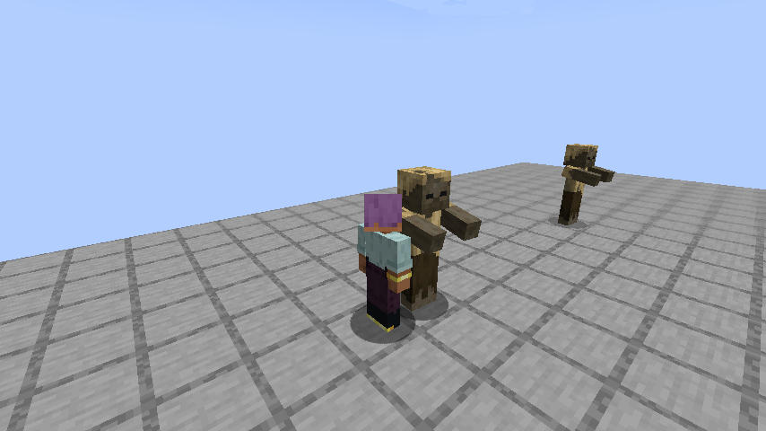

# Chained

[All wikis](https://github.com/Bithio999/MC/wiki/Home) · [TensuraAdditionalAdditions](https://github.com/Bithio999/MC/wiki/TensuraAdditionalAdditions)

The lineage’s Unique Skill trades magical growth and unrestricted learning for aura and physical combat.

| Skill data | Value |
| --- | --- |
| Tier | Unique |

## Always active while owned

- Later maximum-aura gains receive 5× growth; existing magicule capacity is retained but cannot grow. EP gains split 90% aura / 10% magicules; the blocked magicule share is not redirected.
- Retain up to 1 magicule per second and convert the remaining computed regeneration, including biome and sleep bonuses, into aura.
- Learn Battlewills, resistances/nullifications, reincarnation skills and their derived skills, and lineage recovery skills. Blocked skills remain visible but cannot finish learning. Resistances use their configured acquisition cost in current aura.

## Toggle: Martial Supremacy

Battlewill learning/mastery +9; resistance learning +19. Battlewill-sourced attacks deal 5× damage; other Physical hits deal 3×. These branches do not stack. Numeric Battlewill buffs receive 3× effectiveness; Aura Sword is excluded.

## Mastered: Broken Limit

Always active when mastered. Your hits ignore dodge and lower Nullification to Resistance, and Resistance to nothing.

## In slot: Unerring Body

10% damage reduction, 100% projectile dodge and 25% other dodge, subject to native bypass rules. Immune to Fear, Slowness, Burden and Haki effects.

## Severance Rush

**Damage type: Physical.**

Aim and teleport up to 16 blocks, including in the air; stop before the aimed enemy. Physical damage along a 3-block radius and at the 4-block arrival. Cost: 2% current aura. Cooldown: 1 second.

Base damage: path 1.5 × √A + W; arrival 3 × √A + W. A is the base aura payment; W is the held weapon contribution. Weapon enchantments and engravings apply.

## Related

[Unbound](https://github.com/Bithio999/MC/wiki/Additions-Unbound) · [Fettered Human](https://github.com/Bithio999/MC/wiki/Additions-Fettered-Human) · [Schema](https://github.com/Bithio999/MC/wiki/Additions-Schema) · [Inverted Spear of Heaven](https://github.com/Bithio999/MC/wiki/Additions-Inverted-Spear-of-Heaven)

## Pictures and video

