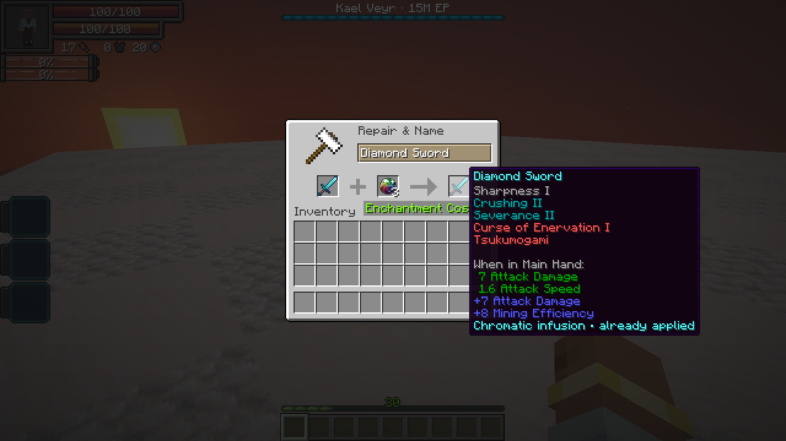

# Chromatic Orb

[All wikis](https://github.com/Bithio999/MC/wiki/Home) · [TensuraAdditionalAdditions](https://github.com/Bithio999/MC/wiki/TensuraAdditionalAdditions) · [Equipment](https://github.com/Bithio999/MC/wiki/Additions-Weapons)

A one-time equipment enhancement. In an **anvil**, combine equipment in the left slot with a Chromatic Orb in the right slot. Taking the result costs **one orb and one XP level**.

Every eligible engraving gains **one level**, including beyond its normal maximum. **Curses, blessings and ordinary enchantments are unchanged.** Equipment needs at least one eligible engraving.

An infused piece cannot use another orb. Its tooltip shows **Chromatic infusion · already applied**. Renaming, repairs, smithing and normal gear evolution preserve that history. A grindstone removes engravings normally and does not make the equipment eligible for another orb.

## Crafting

Combine **one of each** ingredient below in any arrangement in a crafting grid to make one orb.

| Ingredient | Source |
| --- | --- |
| **Bulwark Shard** | High Orcs, Armorsauruses and Horned Bears |
| **Sentinel Shard** | Dragonewts, Basilisks, Greater Daemons and Arch Daemons |
| **Skirmisher Shard** | Tempest Star Wolves, Blade Tigers and Knight Spiders |
| **Starless Core** | [Kael Veyr](https://github.com/Bithio999/MC/wiki/Additions-Kael-Veyr) · one guaranteed per defeat |

Shards have a **25% drop chance** from the matching unowned [High Realm](https://github.com/Bithio999/MC/wiki/Additions-The-High-Realm) elite. The kill must be credited to a player or their subordinate. Ordinary mobs and owned subordinates do not drop shards.
