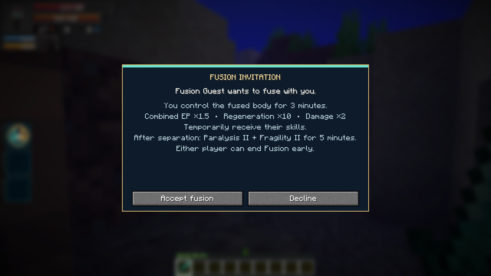
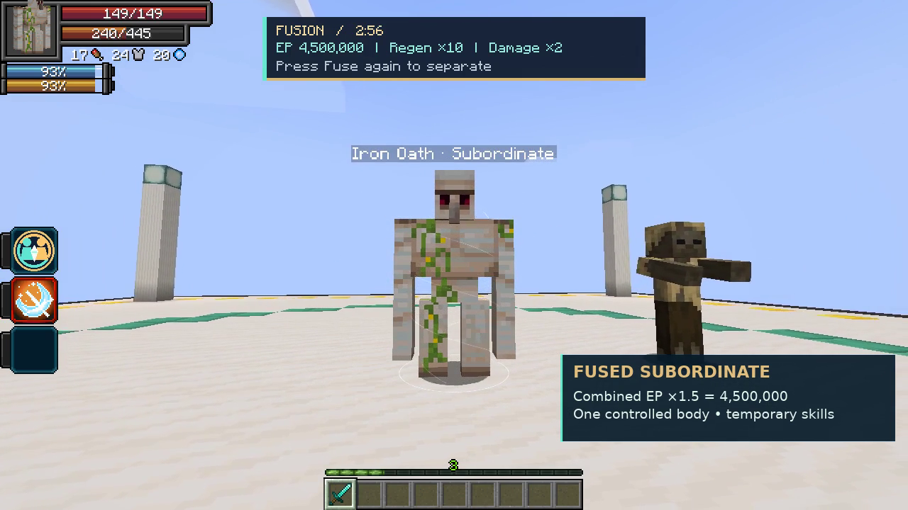

# Fusion

[All wikis](https://github.com/Bithio999/MC/wiki/Home) · [TensuraAdditionalAdditions](https://github.com/Bithio999/MC/wiki/TensuraAdditionalAdditions)

| Skill data | Value |
| --- | --- |
| Tier | Unique |
| Duration | 3 minutes |
| Range | 16 blocks |
| Cost | None |
| Additional cooldown | None |
| Damage type | None directly; boosted attacks retain their original type |

## Fuse · Active, Press

Aim at your subordinate or another player. Players must accept the invitation. You control a subordinate’s fused form; a receiving player controls their own body.

| Fused benefit | Effect |
| --- | --- |
| EP | **(Your actual max EP + target’s actual max EP) × 1.5** |
| Resource split | Combined aura and magicule capacities, each multiplied by 1.5 |
| Regeneration | **10×** aura and magicule regeneration, including normal biome bonuses |
| Damage | **2× final outgoing damage**, retaining Physical, magical or Spiritual type |
| Skills | Temporary skill sharing; existing learned skills are retained |

Press **Fuse** again or choose **Pause → Separate Fusion** to end early. The absorbed caster can also sneak to separate. Fusion cannot be nested.

## Separation

Both participants receive **Paralysis II and Fragility II for 5 minutes**, including after early separation. Original forms, EP and permanent skills return. Remaining resources are divided proportionally; Fusion does not provide a free refill. Borrowed skill storage and cooldowns return to their owner.

Death, disconnect, dimension changes and server shutdown end Fusion. Normal skill restrictions still apply.

## Obtaining

Can roll as a normal reincarnation Unique. Excluded from Fettered Human’s starting pool because it borrows target skills.

## Player invitation

## In-game preview

[Fusion — controlled subordinate form, EP, damage and separation](https://github.com/Bithio999/MC/raw/refs/heads/main/wiki/media/fusion.mp4)
