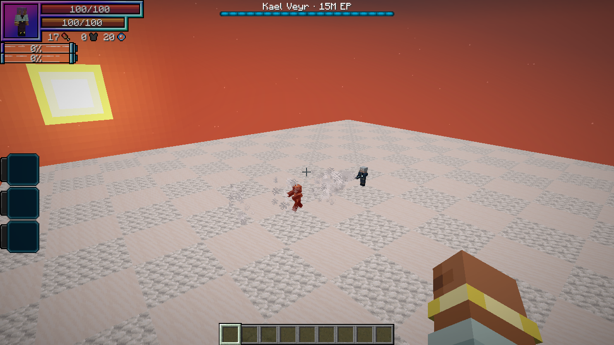

# Kael Veyr, the Starless Wayfarer

[All wikis](https://github.com/Bithio999/MC/wiki/Home) · [TensuraAdditionalAdditions](https://github.com/Bithio999/MC/wiki/TensuraAdditionalAdditions) · [The High Realm](https://github.com/Bithio999/MC/wiki/Additions-The-High-Realm)

An otherworlder who survived the loss of his own world. His silver hair, dark embroidered coat and Hihiirokane Sword mark a rare encounter among the realm’s elite monsters.

| Boss data | Default |
| --- | --- |
| Race / awakening | Human Saint · True Hero |
| Actual EP | **15,000,000** |
| HP / SHP | **9,900 / 34,100** with native race and support bonuses |
| Location | All three High Realm biomes |
| Weapon | Hihiirokane Sword |
| Health display | HP boss bar |

## Finding Kael

Kael is a **rare natural spawn**, independent of the ordinary elite pool. His biome weight is **1**, followed by an additional **2.5% acceptance roll**. Accepted spawns impose a **20-minute cooldown across the realm**. Another wild Kael cannot be within **512 blocks**, and he does not spawn within **192 blocks** of the return sanctum.

The cooldown allows future attempts; it is **not a guaranteed respawn timer**. He remains saved when his chunk unloads. Server options control whether he spawns, his acceptance chance and the cooldown. He can appear in existing High Realm terrain.

## Combat

Kael fights with his **owned Tensura abilities**. Damage, costs, cooldowns, casting time and effects follow the native skills and server configuration.

His mastered Uniques are **Martial Master**, **Mathematician** and **Seer**, equipped in his native preset. Support includes **Steel Strength**, **Strengthen Body**, **Infinite Regeneration**, **Universal Perception**, **Thought Acceleration**, **Chant Annulment**, **Mana Manipulation**, **Wind Domination** and battlewills.

Infinite Regeneration restores HP and SHP using magicules. Wind Domination boosts wind damage and degrades wind resistance. His native physical, magical, spiritual and elemental defenses remain active. Red hit feedback also indicates SHP damage.

| Native ability | Use | Damage type |
| --- | --- | --- |
| **Sword attacks** | Hihiirokane Sword melee. | Physical |
| **Aura Slash** | Native weapon-based ranged slash. | Physical · aura slash |
| **Martial Master** | Native dash when grounded with a safe destination near the target. | Physical |
| **Wind Domination** | Wind spheres at range and a held wind breath nearby. | Wind |
| **Wind Cutter** | Native wind-blade projectiles. | Wind + magic |
| **Tornado Blade** | Native wind tornado. | Wind + magic |
| **Aerial Blade** | Close-range wind magic with its native pull. | Wind |
| **Seer** | Future Vision when wounded; native cooldowns apply. | — |

## Rewards

- **4–8 Hihiirokane Ingots**
- **8–16 Magic Ore**
- **2–4 Echo Shards**
- **2–4 Netherite Scrap**
- Native otherworlder equipment and Unique-skill drop rules
- **A Star Finally Falls** defeat advancement

His **Kael Veyr Spawn Egg** is available in the creative spawn-egg tab. For testing, use `/summon heavenlyrestriction:kael_veyr`. Natural spawning remains restricted to The High Realm.
