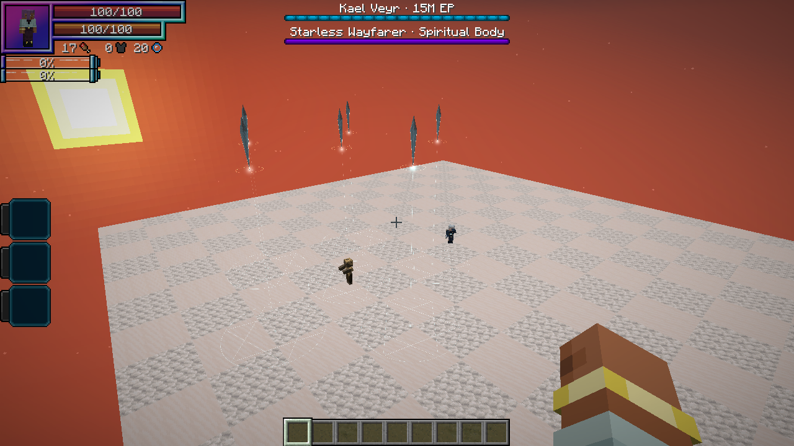
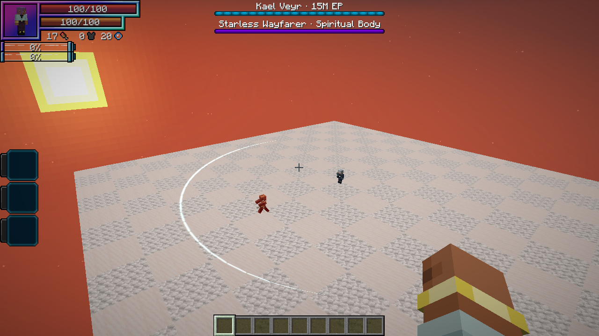
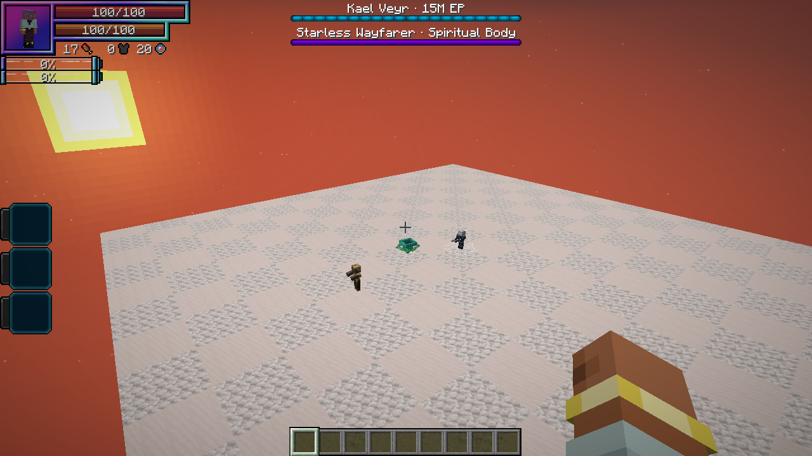

# Kael Veyr, the Starless Wayfarer

[All wikis](https://github.com/Bithio999/MC/wiki/Home) · [TensuraAdditionalAdditions](https://github.com/Bithio999/MC/wiki/TensuraAdditionalAdditions) · [The High Realm](https://github.com/Bithio999/MC/wiki/Additions-The-High-Realm)

An otherworlder who survived the loss of his own world. His silver hair, dark embroidered coat and Hihiirokane Sword mark a rare encounter among the realm’s elite monsters.

| Boss data | Default |
| --- | --- |
| Race / awakening | Human Saint · True Hero |
| Actual EP | **15,000,000** |
| HP / SHP | **9,900 / 34,100** with native race and support bonuses |
| Location | All three High Realm biomes |
| Weapon | Hihiirokane Sword |
| Health display | Separate HP and spiritual-body boss bars |

## Finding Kael

Kael is a **rare natural spawn**, independent of the ordinary elite pool. His biome weight is **1**, followed by an additional **2.5% acceptance roll**. Accepted spawns impose a **20-minute cooldown across the realm**. Another wild Kael cannot be within **512 blocks**, and he does not spawn within **192 blocks** of the return sanctum.

The cooldown allows future attempts; it is **not a guaranteed respawn timer**. He remains saved when his chunk unloads. Server options control whether he spawns, his acceptance chance and the cooldown. He can appear in existing High Realm terrain.

## Combat

His native Uniques are **Martial Master**, **Mathematician** and **Seer**, all mastered and equipped in his active preset. Support includes **Steel Strength**, **Strengthen Body**, **Ultraspeed Regeneration**, **Universal Perception**, **Thought Acceleration**, **Chant Annulment**, **Mana Manipulation**, **Wind Manipulation** and battlewills.

He has native physical, magical and spiritual resistance, several elemental resistances, and spatial, wind, poison, paralysis and pain nullifications. His regeneration uses native resources. Skill seals interrupt his signature moves. The spiritual-body bar and red hit flash make SHP damage visible.

| Technique | What happens | Damage type |
| --- | --- | --- |
| **Rift Draw** | A short warning, a blink to safe ground beside the target, then a sweeping sword strike. | Physical · aura slash |
| **Fallen Constellation** | Six sigils warn the targeted area before descending light lances strike each location. Move out of the marked circles. | Light |
| **Tempest Verse** | A wind-magic cast using native Tornado Blade or a close-range Aerial Blade. Native spell costs, cooldowns and defenses apply. | Wind + native magic |
| **Starless Waltz** | Three warned, traveling sword fronts sweep different angles. Added to his rotation below half HP. Move behind him or outside the fan edges. | Physical · aura slash |

## Rewards

- **4–8 Hihiirokane Ingots**
- **8–16 Magic Ore**
- **2–4 Echo Shards**
- **2–4 Netherite Scrap**
- Native otherworlder equipment and Unique-skill drop rules
- **A Star Finally Falls** defeat advancement

His **Kael Veyr Spawn Egg** is available in the creative spawn-egg tab. For testing, use `/summon heavenlyrestriction:kael_veyr`. Natural spawning remains restricted to The High Realm.
