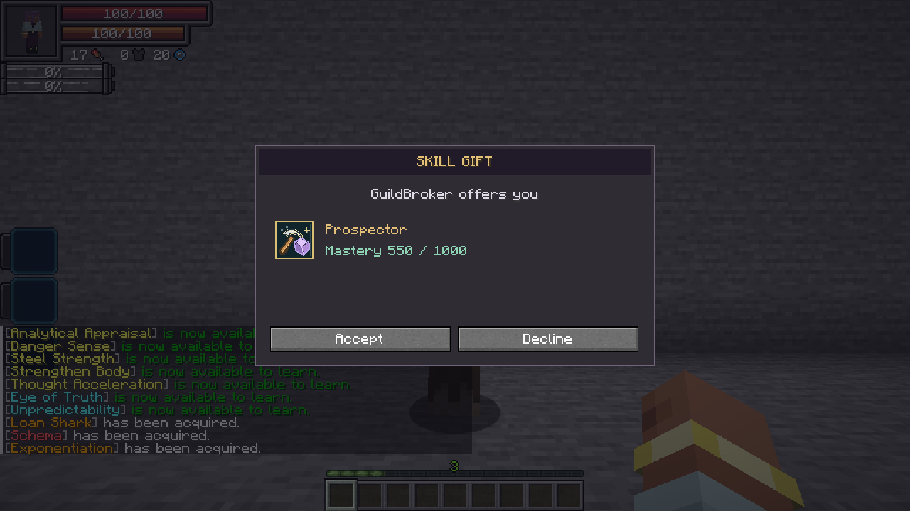
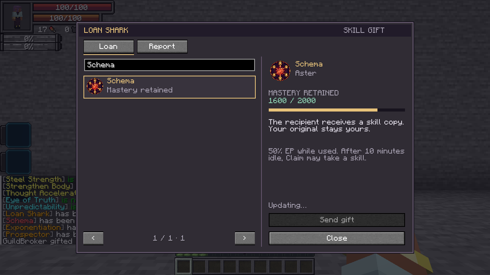
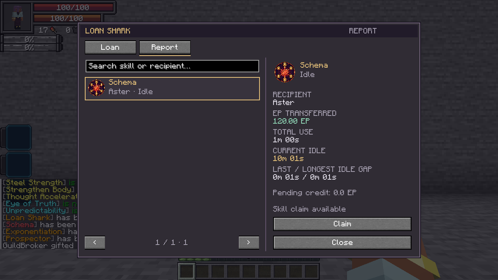

# Loan Shark

[All wikis](https://github.com/Bithio999/MC/wiki/Home) · [TensuraAdditionalAdditions](https://github.com/Bithio999/MC/wiki/TensuraAdditionalAdditions)

| Skill data | Value |
| --- | --- |
| Tier | Unique |
| Obtaining | Normal reincarnation Unique pool; excluded from Fettered Human rolls by the skill-stealing blacklist |
| Resource cost / cooldown | None |
| Damage type | None |

## Loan · Active, Press

Aim at your **subordinate or a player within 16 blocks**, then open Loan. Search your owned skills, select one and send the gift. **Players must accept**; subordinate gifts are immediate. The invitation shows the sender, offered skill and retained mastery. It does not display the EP-sharing or Claim terms. Offers expire after 30 seconds and are rechecked when accepted.

The recipient gets a separately marked skill copy with **retained mastery**, learned mode progress and current cooldowns. Your original stays yours. Stored inventories, appraisal banks and active effects are not duplicated. Already-owned skills cannot be overwritten; temporary skills, dependent sub-abilities and Loan Shark itself are not lendable. Native acquisition restrictions still apply.

While the gifted skill is **in use, half of all permanent EP gains** goes to you. It includes EP earned through other skills, items or permanent-stat gains during that use. Current aura/magicule recovery is not EP income. Multiple active loans share **one 50% cut**; they do not each remove another half. Transfer payments are not taxed or squared again. Offline lenders receive queued EP credit when available.

Casting/channeling and attributed hits count as use. Toggles count while enabled; native ticking passives count while ticking; detected in-slot combat passives and Exponentiation count while equipped. Resistances and native pure passives that cannot be slotted remain active while owned. Brief casts/hits count for a one-second window. Native ticking eligibility keeps ongoing passives active between callbacks. An equipped active-only skill is not automatically treated as permanently in use.

**Damage type:** None.

## Report · Active, Press

Open the searchable ledger of your gifts. Each record shows:

- Gifted skill and recipient.
- EP transferred, including any credit waiting for you.
- Total use time.
- Current uninterrupted idle time, plus the last and longest intervals between uses.

**Claim always recalls the gifted copy.** If it has been unused for **at least 10 minutes** and is **still idle**, Claim also removes a random eligible skill you do not own from the borrower and gives it to you, retaining mastery. **Chained and all Ultimate-classified skills are excluded from this theft pool**, including addon tiers implemented as Ultimate. The gifted copy itself can still be recalled regardless of its tier.

Claim sooner, or while the skill is in use, and it only recalls the copy. If no eligible skill can be acquired, nothing extra is taken. Claims are checked on the server; completed contracts cannot be reused. The borrower must be online or loaded to claim. An unrelated independently acquired instance is not removed as the gifted copy.

Usage and contracts persist across save/restart. Time uses running server ticks: an unloaded borrower's use time stops, while its idle interval continues as the server runs. Time while the server is stopped does not count. Screenshots use a prepared scenario with accelerated ledger time.

Fusion does not erase a loan: use and EP income follow the controlling fused body, and recalling removes its shared gifted copy too.

**Damage type:** None. **Cost / cooldown:** None.
