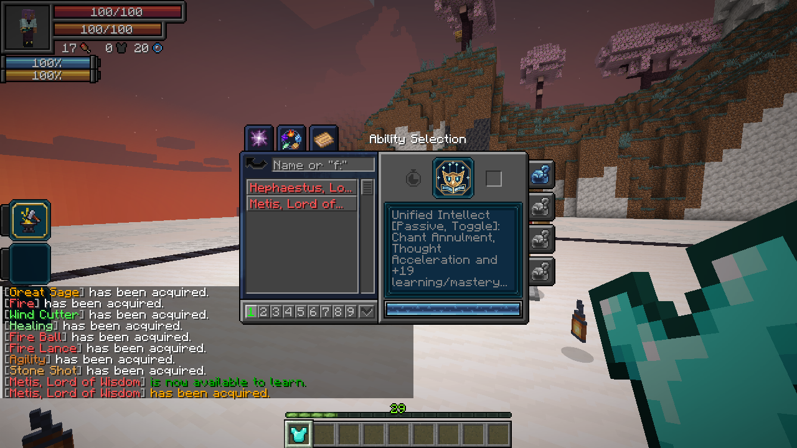
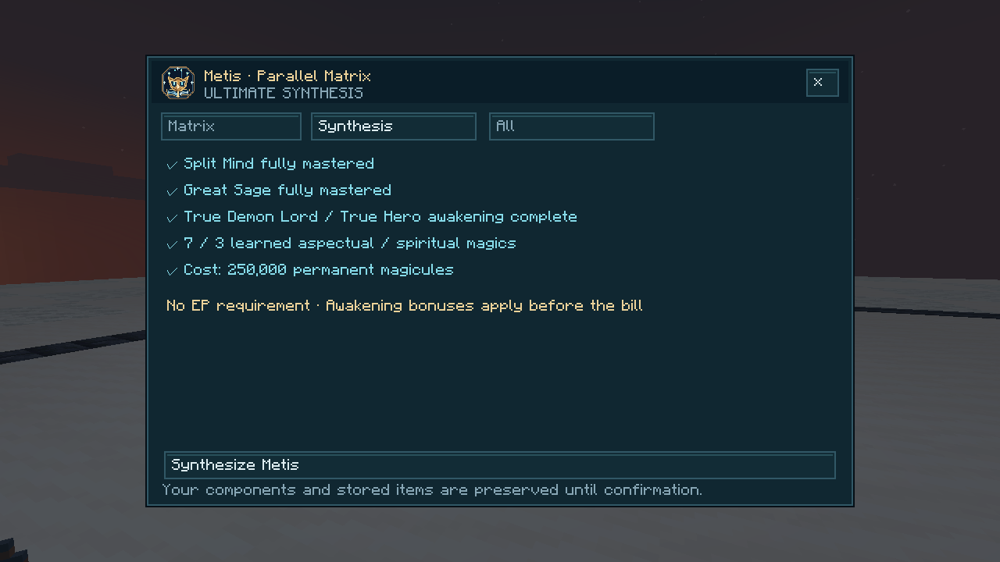
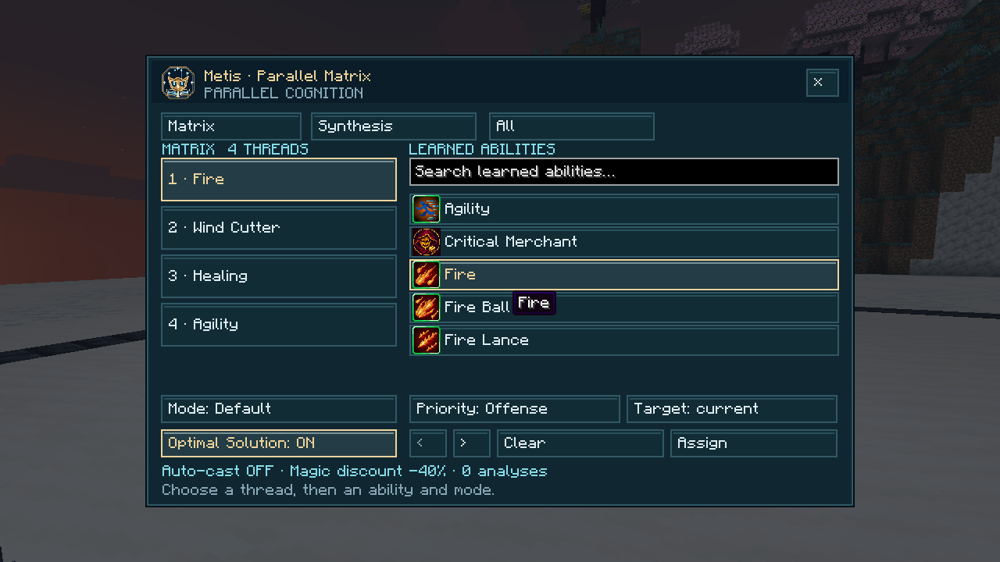

# Metis, Lord of Wisdom

[All wikis](https://github.com/Bithio999/MC/wiki/Home) · [TensuraAdditionalAdditions](https://github.com/Bithio999/MC/wiki/TensuraAdditionalAdditions) · [Skills](https://github.com/Bithio999/MC/wiki/Additions-Skills)

| Skill data | Value |
| --- | --- |
| Tier | Ultimate |
| Components | Fully mastered Split Mind + Great Sage |
| Awakening | True Demon Lord or True Hero; awakening must be complete |
| Achievement | Learn three distinct aspectual or spiritual magics |
| Acquisition | 250,000 permanent magicules by default; configurable and affected by Tensura’s skill-cost gamerule |
| EP requirement | None |

## Obtaining

Missing a component? The [Archivist](https://github.com/Bithio999/MC/wiki/Additions-Archive-of-Accord) offers one paid Unique Skill lesson per player. The taught component still needs to be mastered before synthesis.

Owning either component reveals the unfinished Metis entry in **Skills → Ultimate**. Activate it to open **Synthesis**, meet the requirements and confirm. Awakening bonuses apply before the acquisition cost. Both components are replaced by learned, unmastered Metis. Great Sage’s stored items, the Split Mind assignment and affected presets are retained. Autonomous Sage starts off so you can review the matrix first.

## Unified Intellect · Passive, Toggle

- **+19 learning and mastery points**, **Chant Annulment** and **Thought Acceleration**.
- Automatically analyze visible magic circles within **32 blocks** and learn eligible magic using Tensura’s normal copy and acquisition rules. Your own circles and already learned spells are skipped.
- Record the elemental defenses of combat opponents. Existing resistances and nullifications stay intact.

**Damage type:** none.

## Parallel Matrix · Active, Press

Open the matrix to assign **three learned aspectual/spiritual magics**, or **four when mastered**. Select a thread on the left, a spell on the right, then a learned mode. Each spell can occupy one thread. Search narrows the list; scroll within the list on small screens.

Choose a **Healing**, **Support** or **Offense** priority band, evaluated in that order. This controls scheduling; the spell’s native role controls its target. Offensive spells can favor your current combat target or the nearest enemy within 32 blocks. Self-healing and support remain self-directed regardless of the selected priority band.

**Damage type:** none directly.

## Autonomous Sage · Active, Toggle

Run the assigned spells independently while moving, fighting and casting manually. Offensive spells target hostile mobs or combat opponents, respecting alliances, PvP and line of sight. Healing is attempted below **90% HP**; curing checks for harmful effects. Support avoids reapplying an active buff from the same spell.

Background casting does not swing your arm. Direct automatic spells have independent hurt windows. Distinct native magic projectiles also land independently, including manually cast projectiles. Repeated pulses from one persistent source keep their native timing. Ordinary weapon damage and defensive invulnerability remain separate.

Automatic spells cost **30% fewer magicules**, increasing to **40% fewer when mastered**. Native aura costs, spell cooldowns, anti-magic and casting rules still apply. Manual use of a spell takes priority over automation of that same spell. Other threads continue independently.

**Damage type:** each assigned spell keeps its native damage type and effects.

## Optimal Solution · Passive, Toggle

Enable it in the matrix while Unified Intellect is on. Metis avoids assigned offensive spells covered by a target’s active nullifications and ranks otherwise available spells by elemental resistance or vulnerability within their priority band. It chooses among your assigned spells; it does not weaken defenses or bypass them.

**Damage type:** none.

## Inherited Great Sage utilities

**Analytical Appraisal** has analysis level **20**, or **40 when mastered**. It retains the native toggle, shift-press filtering and +15/+25 appraisal distance bonus.

**Analysis** guarantees a copy when an eligible, unowned skill is available and native copying/acquisition protections permit it. In addition to Great Sage’s intrinsic/common/extra pool, it can learn **resistances and nullifications**. The target keeps their skill. Unique and Ultimate skills, temporary skills and protected skills remain excluded. Living-target range is **10 blocks**; eligible magic-projectile range is **30 blocks**. Success cooldown: **5 seconds**, or **2 seconds when mastered**. An unavailable attempt has a **1-second** retry delay. Levels and success cooldowns are configurable.

**Refine / Craft** opens native repeat crafting; shift-press opens refining. Stored items remain in the same shared container.

**Damage type:** none directly.
