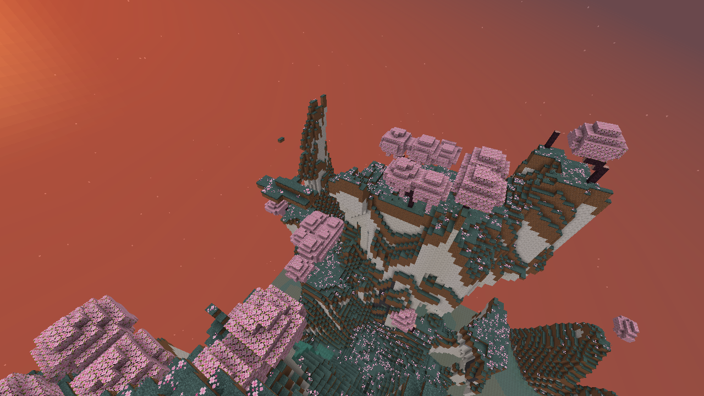
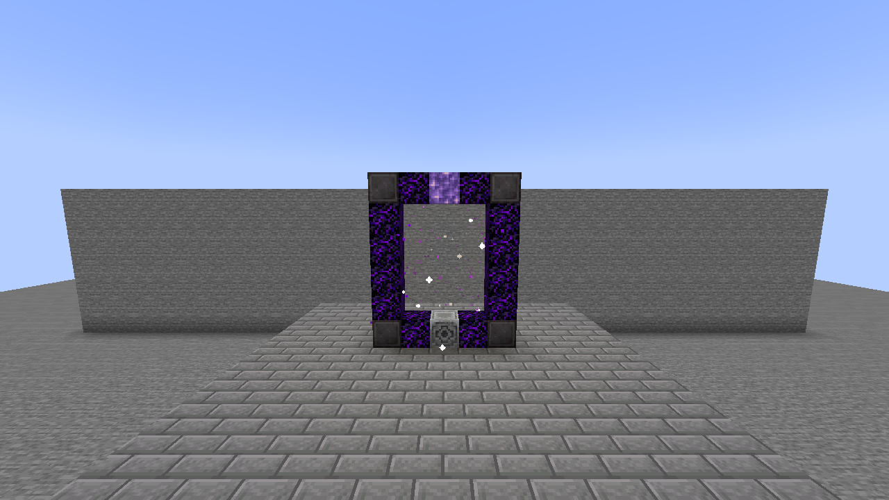
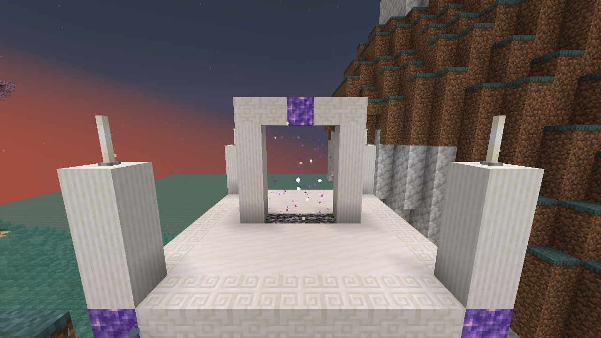

# The High Realm

[All wikis](https://github.com/Bithio999/MC/wiki/Home) · [TensuraAdditionalAdditions](https://github.com/Bithio999/MC/wiki/TensuraAdditionalAdditions)

A late-game dimension of pale ridges, cherry groves and misty basins. **5,000,000 actual maximum EP** is required to enter. EP is checked, not spent. Supports single-player and multiplayer.



## Gate

Build a vertical **5 × 6** frame in either direction. Its **3 × 4** opening must be empty, without fluids.

```text
N C A C N
C . . . C
C . . . C
C . . . C
C . . . C
N C L C N
```

| Symbol | Material | Count |
| --- | --- | ---: |
| N | Netherite Block | 4 |
| C | Crying Obsidian | 12 |
| A | Amethyst Block | 1 |
| L | Lodestone | 1 |
| . | Empty opening | — |

Use **one Nether Star** on the Lodestone to awaken the gate. In survival, the star is consumed once. Stand inside the awakened arch for **2 seconds**, or use its Lodestone, to enter. Every player must meet the EP requirement. Breaking the frame disables it.



## Landscape and enemies

The realm stays in twilight. Terrain uses existing Minecraft and Tensura blocks, with native magic ore, emeralds and rare diamonds in the calcite and basalt.

| Biome | Landscape | Elite inhabitants |
| --- | --- | --- |
| Ivory Crags | Calcite mountains with basalt bands | High Orcs, Armorsauruses, Horned Bears, Greater Daemons |
| Starwood Grove | Pale grass and cherry groves | Tempest Star Wolves, Blade Tigers, Knight Spiders |
| Mistglass Basin | Mossy basins, clay and turquoise water | Dragonewts, Basilisks, Arch Daemons |

The natural spawn pool is **entirely Tensura mobs**. **Bosses are excluded**, including the boss-class greater elemental spirits. Elites retain their models, animations and native combat behavior. They alert to nearby survival players, including players with higher EP. Owned mobs, summons and imports are not upgraded.

| Archetype | Members | Base EP | HP floor | SHP floor |
| --- | --- | ---: | ---: | ---: |
| High Bulwark | High Orc, Armorsaurus, Horned Bear | 2,500,000 | 1,024 | 5,000 |
| High Sentinel | Dragonewt, Basilisk, Greater/Arch Daemon | 1,750,000 | 850 | 3,200 |
| High Stalker | Tempest Star Wolf, Blade Tiger, Knight Spider | 1,250,000 | 700 | 2,400 |

Native skills can alter final stats. All elites gain **11–17 core mastered skills** in addition to their retained native abilities. Their toggles are enabled; skills that require a preset slot are equipped.

Natural spawning accepts **50% of otherwise valid attempts** and stops adding enemies when **16 living unowned elites are already within 64 blocks**. Existing mobs remain; spawning resumes as the area clears. Commands, summons and other dimensions retain their normal rules.

### Final forms

The pool uses the highest implemented non-boss forms of its existing creatures: **High Orc**, **Tempest Star Wolf**, and **Dragonewt**. Wolves receive their native evolution bonuses and final star variant; Dragonewts receive native flight, Dragon Eye, Dragon Ear, Dragon Mode and a native breath skill. Creatures without a further implemented mob evolution stay in their existing forms. Orc Lord and Orc Disaster remain excluded because they are bosses.

The daemon tiers are **Greater Daemon** in the crags and **Arch Daemon** in the basin. Their spell packages match each class’s native combat AI.

### Shared skills

Every elite receives **Physical Attack Resistance**, **Magic Resistance**, **Pain Resistance**, **Spiritual Attack Resistance**, **Magic Sense**, **Danger Sense**, and **Ultraspeed Regeneration**. Listed nullifications supply the higher defense; native lower-tier entries may remain. Regeneration uses native resources; these enemies do not receive Infinite Regeneration.

### Species specialties

Every species has a **mastered Unique Skill**. These supplement the shared skills. **Fighter is reserved for Horned Bears.**

Shadow Striker supplies the wolf’s acceleration and dodge; Oppressor gives the spider native arrow/fall immunity; Martial Master strengthens the Dragonewt’s physical attacks and dodge; Survivor protects the Basilisk from debilitating effects. Engorger enlarges Greater Daemons, boosts their combat attributes and provides native healing; Mathematician adds faster chanting, dodge and resistance degradation to Arch Daemons. These passives function automatically. Player-operated menus and active techniques are not driven by mob AI.

| Species | Added skills |
| --- | --- |
| High Orc | **Berserker**, Steel Strength, Strengthen Body, **Pain Nullification**, Flame Attack Resistance, Paralysis Resistance |
| Armorsaurus | **Survivor**, Body Armor, Scale Armor, Strength, **Physical Attack Nullification**, Pierce Resistance, Gravity Attack Resistance |
| Horned Bear | **Fighter**, Steel Strength, **Pain Nullification**, Cold Resistance, Paralysis Resistance |
| Tempest Star Wolf | **Shadow Striker**, Godwolf Sense, Black Lightning, Ultra Instinct, Shadow Motion, Steel Strength, **Electricity Nullification**, Paralysis Resistance, Wind Attack Resistance, Poison Resistance |
| Blade Tiger | **Seer**, Steel Strength, **Wind Attack Nullification**, Pierce Resistance, Paralysis Resistance |
| Knight Spider | **Oppressor**, Body Armor, Steel Strength, Poison, **Poison Nullification**, Paralysis Resistance, Pierce Resistance |
| Dragonewt | **Martial Master**, Scale Armor, Water Breathing, Steel Strength, **Water Attack Nullification**, Corrosion Resistance |
| Basilisk | **Survivor**, Scale Armor, Steel Strength, Poison, Paralysis, **Poison Nullification**, **Paralysis Nullification** |
| Greater Daemon | **Engorger**, Mana Manipulation, Flame/Water/Wind/Lightning/**Earth Manipulation**, **Flame Attack Nullification**, Water Attack Resistance |
| Arch Daemon | **Mathematician**, Mana Manipulation, Flame/Water/Wind/Lightning/**Earth Manipulation**, **Flame Attack Nullification**, **Electricity Nullification**, Darkness Attack Resistance |

### Combat magic

The daemon spells are actually used by their native combat AI, with native casting circles, attack animations, projectiles and magicule costs. Elemental manipulation skills strengthen their corresponding magic.

| Caster | Magics |
| --- | --- |
| Greater Daemon | Fire Lance, Acid Shell, Icicle Lance, Tornado Blade, Thunder Orb, Stone Shot, Sleep Mist |
| Arch Daemon | Fire Ball, Acid Shell, Ice Breaker, Tornado Blade, Water Jail, Mud Spears, Stone Shot, Thunder Orb |

### Rewards

Player or subordinate kills retain normal loot and EP and add **1–3 Amethyst Shards**, with a **20%** chance of native Magic Ore and a **2%** chance of Netherite Scrap.

## Rare otherworlder boss

**[Kael Veyr, the Starless Wayfarer](https://github.com/Bithio999/MC/wiki/Additions-Kael-Veyr)** is a **15 million EP** Human Saint / True Hero who can rarely appear in any of the realm’s three biomes. He uses a Hihiirokane Sword, native wind magic and warned celestial attacks.

He has a separate spawn rule from ordinary elites: **weight 1**, an additional **2.5% acceptance roll**, a **20-minute realm-wide spawn cooldown**, no other wild Kael within **512 blocks**, and no spawning within **192 blocks** of the return sanctum. An elapsed cooldown allows another roll; it does not guarantee a spawn.

## Returning

The **quartz return arch** in the arrival sanctum is the return gate. Walk through it or use its central bedrock base. **Leaving has no EP requirement.** Each player returns near their own entrance; obstructed exits use nearby safe ground or the Overworld spawn.

The small arrival sanctum is protected from normal block edits. Natural hostile spawns are suppressed within **48 blocks** of its center. The rest of the dimension can be mined and built in. **Beds do not work here.**



## Saves and settings

The dimension is added to existing saves. Its terrain, awakened gates and individual return points persist after a restart. [World Hop](https://github.com/Bithio999/MC/wiki/Additions-Parallel-World-Jumper) generates a fresh realm for a new seed; returning to a previously visited world restores that world's realm.

Existing eligible unowned elites receive applicable same-entity evolutions and loadouts when loaded, without refilling resources. Existing unowned elites also receive the halved EP balance once when loaded; current aura and magicules are capped to the new capacity. HP, SHP, damage and skill packages are unchanged. Owned mobs remain unchanged. Old daemon entities remain until normal despawning; new spawns use the upgraded types. Existing vanilla elites are left to despawn normally; no new vanilla elites spawn.

Server settings are in `serverconfig/tensura-additions-high-realm.toml`: `entryEP`, `gateChargeTicks`, `elitePower`, `eliteSpawns`, `eliteSpawnChance` (default `0.5`) and `eliteLocalCap` (default `16`). Kael uses `wayfarerSpawns`, `wayfarerSpawnChance` (default `0.025`) and `wayfarerSpawnCooldown` (default `24000` ticks). Changing elite strength affects new spawns. Up to **256 awakened gates** can be registered in one world.

Find this page under **Dimensions** in the searchable **F8 guide**.


The entry default is **5M EP**. On the first upgrade, existing worlds using the old **10M** setting move to **5M**. Other custom thresholds are retained; later manual changes are preserved.
