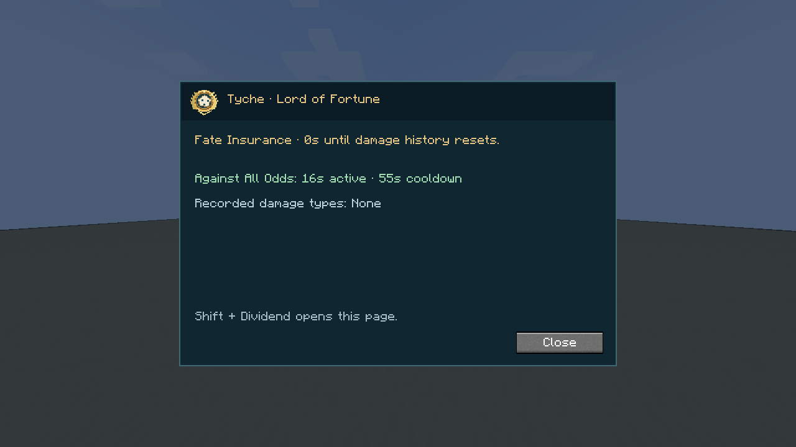

# Tyche, Lord of Fortune

[All wikis](https://github.com/Bithio999/MC/wiki/Home) · [TensuraAdditionalAdditions](https://github.com/Bithio999/MC/wiki/TensuraAdditionalAdditions) · [Skills](https://github.com/Bithio999/MC/wiki/Additions-Skills)

| Skill data | Value |
| --- | --- |
| Tier | Ultimate |
| Components | Fully mastered Critical Merchant + Tuner |
| Awakening | True Hero / True Demon Lord; awakening complete |
| Achievement | 50 landed compounded criticals and three distinct damage types survived with Tuner |
| Acquisition | 250,000 permanent magicules by default; configurable, affected by mpSkillCost |
| EP requirement | None |

Owning either component reveals Tyche in **Skills → Ultimate**. Open the unfinished entry, meet the requirements and confirm synthesis. Awakening bonuses apply before payment. Both parents are replaced by learned, unmastered Tyche. Existing guaranteed hits, their cooldown and Tuner’s current damage-history lockouts transfer. Affected presets point to Guaranteed Dividend.

## Loaded Dice · Passive, Toggle

Criticals begin at **×4**, then use Critical Merchant’s **50% doubling chain** with up to **100 additional successful doublings**. The first failed roll gets **one reroll per chain**. This improves the critical’s payout; it does not itself make every attack critical. Damage retains its original type and normal defenses apply.

## Against All Odds · Passive, Toggle

At **50% HP or SHP or lower**, automatically gain the **full buff for 20 seconds**. **Cooldown: 60 seconds from activation**. Healing does not reduce or cancel it. The bonuses are:

| Effect | Full bonus |
| --- | --- |
| Attack damage | +50% |
| Melee and projectile evasion | +25 percentage points each |
| Attack speed | 1.5× mastered Tuner’s bonus; +0.6 by default |
| Swim speed | 1.5× mastered Tuner’s bonus; +3 to the native multiplier by default |
| Movement speed | 1.1× mastered Tuner’s bonus; +0.088 by default |

Speed bonuses follow the server’s Tuner settings. Each category applies once: no extra Tuner flat attack-damage or evasion layer is added. Uses the same native toggle as Loaded Dice. Switching it off cancels the active buff but retains its cooldown; remaining at low HP/SHP can trigger it again when ready. Duration and cooldown are configurable. **Damage type:** none directly.

## Fate Insurance · Passive, True

An eligible fatal hit is prevented. Recover **full HP, SHP, magicules and aura**, remove harmful status effects and **reset all other native skill/ability cooldowns**. Capacities remain your current maximums.

The incoming damage type is recorded using Tuner’s native damage-message grouping. The first revival starts a **five-minute history window**. Each new type can trigger once during that window; an already recorded type cannot. Later revivals **do not extend the window**. When it expires, all recorded types become eligible again.

The reset preserves **Fate Insurance’s own timer and history**. Void, `/kill`, native level-three barrier-bypass attacks and Tuner’s self/owner-attack exclusions remain ineligible. **Damage type:** none.

## Guaranteed Dividend · Active, Press

**5,000 magicules · 20-second cooldown.** Your next **ten landed hits** are guaranteed criticals. Each rolls two Loaded Dice chains and uses the higher result, including when the passive is off. Recasting refreshes to ten; fully blocked, immune or failed hits do not spend a guarantee. Melee, owned projectiles and direct spiritual damage use the shared critical pipeline.

Shift-press opens synthesis, passive timers and your current insurance history. **Damage type:** the original attack’s type.

Configuration: `tensura-additions-tyche.toml` controls synthesis cost, achievements, Dividend cost, and Against All Odds duration/cooldown.
