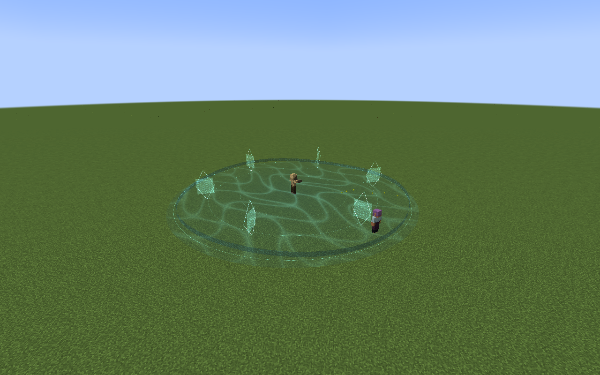
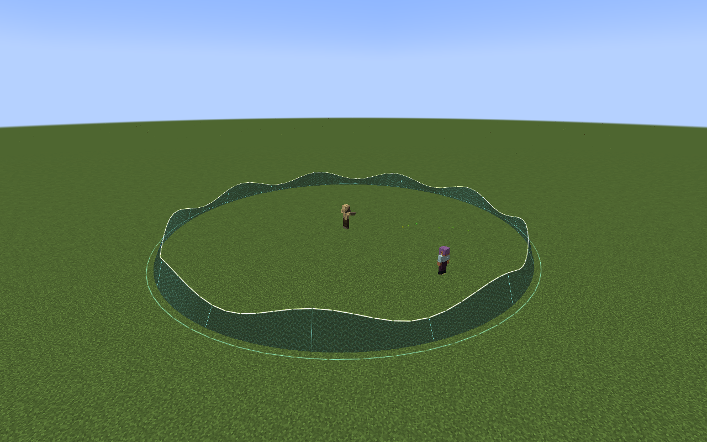

# Aegir, Lord of the Abyss

[Main Page](https://github.com/Bithio999/MC/wiki/Home) · [Ultimate Skills](https://github.com/Bithio999/MC/wiki/Ultimate-Skills) · [Ability index](https://github.com/Bithio999/MC/wiki/Abilities) · [Damage types](https://github.com/Bithio999/MC/wiki/Damage-Types)

**Aegir, Lord of the Abyss** is an Ultimate Skill for **water refraction, projectile redirection and an expanding tidal shock front**. Mirrorsea changes the origins and reach of its other arts.

| Skill data | Aegir, Lord of the Abyss |
| --- | --- |
| **Information** | |
| Type | Ultimate Skill |
| Combat role | Water artillery, projectile control and expanding area pressure |
| Active modes | 3 |
| Resource | Aura |
| Toggleable passive | Abyssal Majesty |
| Passive upkeep | 110 aura / second |
| Registry ID | `wildhunt:aegir` |
| **Obtaining** | |
| Method | Mastered Scarlet Deluge + Mirrorbound; 2M base EP |
| **Evolution** | |
| Evolution | Aion; Thoth with Rune Smith; Lugh with Threadweaver |

## Usage

### Passive

[Passive - Toggle] — **Abyssal Majesty**

| Ability information | Value |
| --- | --- |
| Damage type | None |
| Damage ID | — |
| Upkeep | 110 aura / second |

Gain **100% Water boost**, **75% Light boost** and **0.5 knockback resistance**. Ordinary elemental sources use their strongest contribution; Godly boosts remain separate. The toggle has no passive barrier or accumulating resource.

### Active

| Mode | Aura cost | Cooldown | Raw damage |
| --- | ---: | ---: | --- |
| 1. Refracted Harpoon | 7,000 | 5 s | 1,600; 2,200 with Mirrorsea |
| 2. Mirrorsea | 12,000 | 16 s | —; reflected shots keep their attack type |
| 3. Sovereign Breaker | 20,000 | 24 s | 2,100; 3,000 when empowered |

Mastery increases damage up to 1.5× before native handling. Art hits use native level-1 resistance penetration; native defenses, barriers and hit immunity remain relevant. EP does not multiply damage.

#### Refracted Harpoon

[Active - Press] — **Refracted Harpoon**

| Ability information | Value |
| --- | --- |
| Damage type | [Water elemental](https://github.com/Bithio999/MC/wiki/Damage-Types#water) |
| Damage ID | `tensura:water_elemental` |
| Aim range | 64 blocks |
| Target cap | 8 distinct enemies per cast |

Fire a caustic water spear along your aim. Solid blocks stop each ray; fluids do not. Its targeting width is 1.1 blocks.

While Mirrorsea exists, **two additional rays** fire from lenses six blocks to either side of its center, converging on the same endpoint. All rays share a single target set: an enemy intersecting several rays is hit **once**, for the empowered 2,200 raw damage. Glass collars, curling water strands and a travelling spearhead show the paths.

#### Mirrorsea

[Active - Press] — **Mirrorsea**

| Ability information | Value |
| --- | --- |
| Damage type | None — projectile redirection / setup |
| Damage ID | Reflected projectiles retain their own source behavior |
| Placement range | 48 blocks |
| Radius | 12 blocks |
| Duration | 10 seconds |

Create a stationary caustic basin surrounded by six hovering glass lenses. Incoming hostile and unowned projectiles inside it turn toward their sender, or reverse if unowned. Their owner becomes you so supported projectiles attribute subsequent hits correctly. Your own and allied shots are preserved. Up to twelve qualifying projectiles are considered per tick.

It grants no absorption hearts or personal barrier. Each projectile retains its own collision, lifetime and special behavior. Only one Mirrorsea is active per owner; recasting replaces it.

#### Sovereign Breaker

[Active - Press] — **Sovereign Breaker**

| Ability information | Value |
| --- | --- |
| Damage type | [Water elemental](https://github.com/Bithio999/MC/wiki/Damage-Types#water) |
| Damage ID | `tensura:water_elemental` |
| Normal reach | 18 blocks from the caster |
| Empowered reach | 26 blocks from Mirrorsea |

Launch a circular shock front that expands over **two seconds**, fading out over the following 0.4 seconds. Damage follows its **narrow moving rim**; the entire inner disk is not continuously damaging. Every enemy can be hit **once per cast**, taking 2,100 raw Water damage and an outward/upward push reduced by native knockback resistance.

If Mirrorsea is active, consume it and launch the wave **from its center**, increasing reach to 26 blocks and raw damage to 3,000. Targets more than five blocks above or below the center are excluded. Each tick considers at most twelve eligible enemies.

## Obtaining

Master [Scarlet Deluge](https://github.com/Bithio999/MC/wiki/Scarlet-Deluge) and [Mirrorbound](https://github.com/Bithio999/MC/wiki/Mirrorbound), reach **2M base EP**, then choose **Aegir** in **Skills → Ultimate → Synthesis**. Both ingredients are combined; native presets and remaining cooldowns carry over.

## Suggested combo

Place Mirrorsea behind an enemy formation → converge three Harpoon angles through it → consume the basin with Sovereign Breaker as enemies spread out.

## Limits

All damaging arts respect teams, pets, native collision/defense rules and server PvP protection. No art destroys blocks. Active formations and pending wave damage end on death, forgetting, relogging or dimension changes.

## Gallery

[Visual effects gallery](https://github.com/Bithio999/MC/wiki/Visual-Effects).

---

**Categories:** Tensura Myths · Skills · Ultimate
