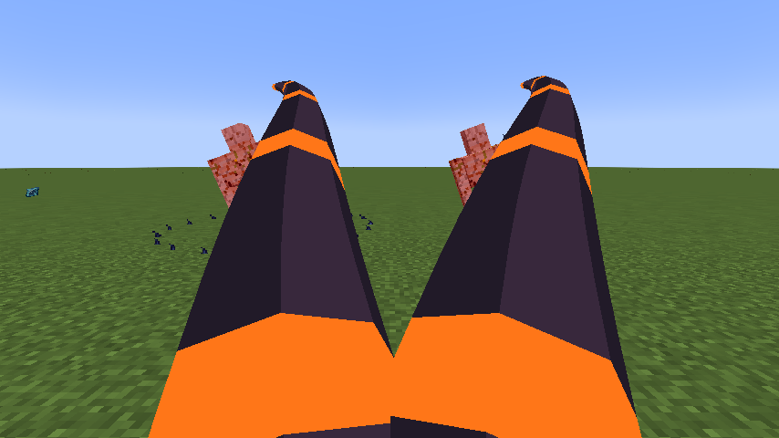

# Agni, Lord of the Black Flame

[Main Page](https://github.com/Bithio999/MC/wiki/Home) · [Skills](https://github.com/Bithio999/MC/wiki/Skills) · [Evolution](https://github.com/Bithio999/MC/wiki/Evolution) · [Mechanics](https://github.com/Bithio999/MC/wiki/Mechanics) · [Commands](https://github.com/Bithio999/MC/wiki/Commands)

**Agni, Lord of the Black Flame** is a Ultimate Skill inspired by **Nu Udra**. It uses visible oil tentacles to pull targets into burning ground.

| Skill data | Agni, Lord of the Black Flame |
| --- | --- |
| **Information** | |
| Type | Ultimate Skill |
| Inspiration | Nu Udra |
| Damage type | Fire elemental |
| Damage ID | `tensura:fire_elemental` |
| Combat role | Tentacle pulls / burning ground |
| Active modes | 3 |
| Toggleable passive | Furnace Mantle |
| Passive upkeep | 60 aura / second |
| Registry ID | `wildhunt:agni` |
| **Evolution** | |
| Previous | [Black Flame](https://github.com/Bithio999/MC/wiki/Black-Flame) |
| Evolution | — |
| **Obtaining** | |
| Method | Ascend the matching mastered Unique |

All damaging arts in this skill use **fire elemental damage**, including its area hits and pulses.

## Usage

### Passive

[Passive - Toggle] — **Furnace Mantle**

While toggled on, gain 18 armor, 100% melee attack and 100% flame boost. Fire-tagged damage is resisted while the passive is enabled, preserving its fire-protection utility without a lingering potion. Melee attacks do not coat targets or accumulate oil. This is an offensive passive, not an extra ignition step.

Enable or disable this through Tensura’s native **Ability Selection** skill toggle. It is separate from active mode cycling and has no fifteen/thirty-second duration. Upkeep is **60 aura per second**, with the first second paid on enabling. It turns off when aura is insufficient or activation requirements fail. Turning it off removes its own attribute modifiers immediately.

### Active

| Mode | Aura | Cooldown | Raw opening damage |
| --- | ---: | ---: | ---: |
| 1. Oil Lash | 640 | 2 s | 210 |
| 2. Blackflame Ignition | 3,200 | 7 s | 270 |
| 3. Black Sun Caldera | 6,000 | 60 s | See signature below |

**Damage calculation:** multiply the listed base values by **0.90**, then by the mastery multiplier (up to **1.50**). Ultimate table values already include their 3× base multiplier. Elemental boosts, defenses, barriers, and situational modifiers also apply. EP does not multiply damage.

#### Oil Lash

[Active - Press] — **Oil Lash**

Lash up to 6 enemies in a forward fan within 22 blocks and pull them toward you. Each lash has a synced three-dimensional tapered tentacle with a dark body and glowing orange bands. It extends, curls and recoils over sixteen ticks. A missed cast still shows a tentacle sweep. Leave a pool at the final victim’s location, or at the aim point about ten blocks away on a miss. Maintain up to 5 pools; the oldest is replaced first.

#### Blackflame Ignition

[Active - Press] — **Blackflame Ignition**

Ignite valid owned pools for six seconds. Each affects a 4-block radius; overlapping pools cannot damage one enemy twice in a pulse. Opening damage is immediate and fixed, with no oil-stack multiplier. Later pulses deal 72 raw damage once per second and apply native Black Burn. If no valid controllable pool exists, place a fallback pool at the aim point up to six blocks away.

#### Black Sun Caldera

[Active - Press] — **Black Sun Caldera**

Create five burning pools in a ring six blocks around the caster. The ten-second caldera pulses through those owned locations. Opening raw damage is 270; later pulses use 108, before mastery and native modifiers. Existing secondary pulses pause during the domain to avoid duplicate scheduling.

## Obtaining

Evolve [Black Flame](https://github.com/Bithio999/MC/wiki/Black-Flame) as Sovereign Hunter with 2,000,000 base EP and mastery of that Unique. Use `/wildhunt ascend nu_udra`. It replaces only the matching Unique; the Ultimate starts with its own mastery.

## Evolution

| Unique Skill | Ultimate Skill | Requirements |
| --- | --- | --- |
| [Black Flame](https://github.com/Bithio999/MC/wiki/Black-Flame) | Agni, Lord of the Black Flame | Sovereign Hunter; 2,000,000 base EP; matching Unique mastered |

Ascension replaces only the matching Unique. The Ultimate starts with its own mastery.

## Suggested combo

Use Oil Lash to pull a victim and place a pool → ignite the pool. Cover likely escape routes with separate pools instead of farming stacks or overlapping them for duplicate damage.

## Strengths and limitations

Pools are world locations, not status stacks on enemies. Unlit pools expire after fifteen seconds; ordinary ignition burns for six. Only your pools in the same dimension and within thirty-two blocks can be controlled. Native Black Burn and forced movement may be resisted.

## In-game preview

In-game example of the active art.

## Related pages

[Skills](https://github.com/Bithio999/MC/wiki/Skills) · [Mechanics](https://github.com/Bithio999/MC/wiki/Mechanics) · [Evolution](https://github.com/Bithio999/MC/wiki/Evolution) · [Commands](https://github.com/Bithio999/MC/wiki/Commands)

---

**Categories:** Tensura: Wild Hunt
