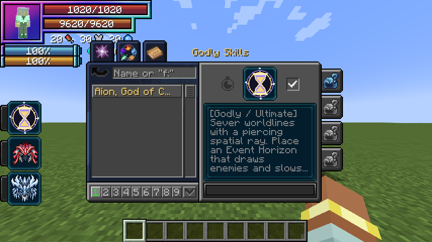

# Aion, God of Causality

[Main Page](https://github.com/Bithio999/MC/wiki/Home) · [Godly Skills](https://github.com/Bithio999/MC/wiki/Godly) · [Skills](https://github.com/Bithio999/MC/wiki/Skills) · [Mechanics](https://github.com/Bithio999/MC/wiki/Mechanics)

**Aion, God of Causality** is a Godly skill built around spatial precision, battlefield control and a limited personal rewind. Its active arts use aura and space elemental damage. Its power grows with mastery, without EP damage scaling.

| Skill data | Aion, God of Causality |
| --- | --- |
| **Information** | |
| Type | Godly / native Ultimate |
| Damage type | Space elemental |
| Damage ID | `tensura:space_elemental` |
| Active modes | 4 |
| Toggleable passive | Unbroken Continuum |
| Passive upkeep | 120 aura / second |
| Mastery cap | 50,000 |
| Registry ID | `wildhunt:aion` |
| **Evolution** | |
| Previous | Raijin, Varuna, Agni or Ymir |
| Evolution | — |
| **Obtaining** | |
| Method | Mastered Myths Ultimate, True Hero or True Demon Lord, 12M base EP |

## Usage

### Passive

[Passive - Toggle] — **Unbroken Continuum**

Adds **25 physical barrier**, **25 magic barrier**, **0.5 knockback resistance** and **600 native Multilayer Barrier** capacity. The latter uses Tensura’s existing barrier HUD. Its owned multilayer contribution rearms after **10 seconds without an incoming hit**, checked on the next upkeep tick. Upkeep does not repair it during combat. Turning the passive off removes its own contributions while preserving other barrier modifiers.

Enabling costs the first 120 aura, then 120 aura each second. It turns off when unfunded or suppressed. It emits no constant passive particle cloud.

### Active

| Mode | Aura per cast | Cooldown | Range / area | Base damage |
| --- | ---: | --- | --- | ---: |
| Worldline Sever | 2,500 | 6 seconds | 64-block ray, up to 5 targets | 360 per target |
| Event Horizon | 4,000 | 18 seconds | 40-block cursor placement, 7-block radius, 6 seconds | 36 per second |
| Causal Reversal | 1,800 | 2 seconds to recast; 40 seconds after return or expiry | Personal checkpoint, 12-second window | — |
| Genesis Verdict | 12,000 | 60 seconds | Existing Horizon center, 8-block radius | 3 × 140 |

[Active - Mode 1] — **Worldline Sever**

Fire a narrow gold and violet spatial beam through up to five enemies in a line. Blocks clip the beam. Damage is applied independently to each target instead of bouncing between them.

[Active - Mode 2] — **Event Horizon**

Place a visible orbital field at the aimed location. It pulls enemies toward the center, with knockback resistance reducing the pull, and deals space damage each second. Projectiles belonging to others lose 15% of their velocity each tick inside the sphere. The caster’s own projectiles are unaffected.

[Active - Mode 3] — **Causal Reversal**

The first press records position and HP. After the short recast delay, press again within twelve seconds to return and heal back toward the recorded HP, up to the current health cap. Both presses cost aura. The return clears momentum and requires an unobstructed destination within the same dimension and world border.

Reversal does not restore aura, magicules, items, cooldowns, SHP, buffs or lost lives. A blocked destination rejects the return without charging its cast cost. Death, relogging and dimension changes clear the checkpoint. Returning or allowing it to expire applies the full forty-second cooldown.

[Active - Mode 4] — **Genesis Verdict**

Collapse your active Event Horizon into three expanding clock-ring pulses at one-second intervals after a one-second warning. The field is consumed; Verdict cannot be cast without it. Enemies can leave the marked area. The cast does not target a second cursor location.

## Damage and interaction

The damage multiplier is **1 + 0.5 × mastery fraction**, capped at **1.5×**. All damaging modes use native `tensura:space_elemental` damage and remain subject to native defensive, authority and PvP rules. Team and owner protection follows the addon’s existing target checks. No mode destroys blocks or scales damage with EP.

## Obtaining

Use the [Godly ascension](https://github.com/Bithio999/MC/wiki/Godly#obtaining) menu to replace one mastered Myths Ultimate after reaching the awakening and EP requirements. Equip Aion from the new Godly category in Tensura’s normal ability menu.

## Gallery

