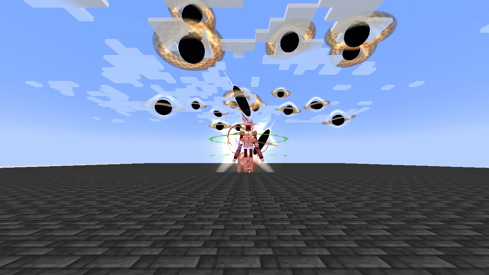
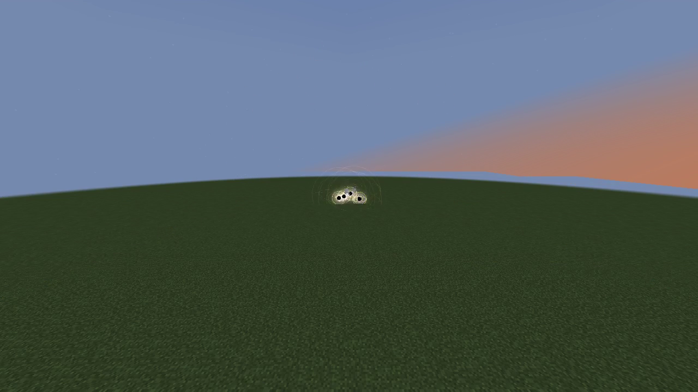

# Aion, God of Causality

[All wikis](https://github.com/Bithio999/MC/wiki/Home) · [Tensura Myths](https://github.com/Bithio999/MC/wiki/Tensura-Myths)

Aion, God of Causality is a Godly skill built around spatial precision, battlefield control and a personal HP/SHP/energy rewind with a safe recorded position. Its active arts use magicules and space elemental damage.

| Skill data | Value |
| --- | --- |
| Tier | Godly |
| Damage type | Space elemental |
| Passive upkeep | 180 magicules / second |
| Mastery cap | 50,000 |
| Obtaining | Mastered Myths Ultimate, True Hero or True Demon Lord, 12M total EP |

## Active abilities

| Ability | Damage type / base damage | Cost | Cooldown |
| --- | --- | --- | --- |
| Worldline Sever | Space elemental · 1,200 per 0.5 seconds | 2,400 magicules to start; 1,200 per additional 0.5 seconds | 4 seconds after channel ends |
| Event Horizon | Space elemental · 700 per second | 10,000 magicules | 16 seconds |
| Causal Reversal | None | 12,000 to record; free return | 1 second to recast; 25 seconds after manual or automatic return |
| Genesis Verdict | Space elemental · 480 / 600 per hole; 9,600 / 12,000 total | 28,000 magicules | 45 seconds |

## Passive

Damage type: None — defense / slowing

Adds 45 physical barrier, 45 magic barrier, 0.75 knockback resistance and 1,200 native Multilayer Barrier capacity. The latter uses Tensura’s existing barrier HUD.

Its multilayer barrier rearms after **10 seconds without a hit**. Enemies and hostile/unowned projectiles within **16 blocks** slow by **15–80%**, increasing toward the caster.

## Worldline Sever

- Damage type: Space elemental
- Range / duration: 80-block beam, up to 8 targets per pulse, 6-second maximum.
- Hold the assigned skill key to channel a gold-white spatial beam that follows the current crosshair direction. It pierces up to eight eligible enemies per pulse, passes through water and lava, and stops at solid block collision shapes (including solid waterlogged blocks).

## Event Horizon

- Damage type: Space elemental
- Range / duration: 64-block cursor placement; 24-block pull, 10-block damage radius; 10 seconds.
- Place a gravity domain with a dark core, counter-rotating accretion bands and Tensura’s native Gravity magic circle. Enemies within 24 blocks are pulled toward the core; only enemies within the 10-block inner radius take space damage each second.

## Causal Reversal

- Damage type: None — recovery / repositioning
- Range / duration: Personal checkpoint, 20-second window.
- The first press costs 12,000 magicules and places a visible clockwork checkpoint, recording position, HP, SHP, aura and magicules after paying that initial cast cost. Press again after the one-second recast delay to return for no cost, even with no magicules remaining.

Automatically returns after **20 seconds**. It never lowers HP, SHP, aura or magicules that are above their saved values, and never refunds the initial payment. Items, buffs, cooldowns and lost lives are not restored. A blocked timeout return heals in place.

## Genesis Verdict

- Damage type: Space elemental
- Range / duration: 64-block mob/player acquisition; 20 blasts, 3.75 / 4.5-block radius each.
- Summon twenty miniature black holes at scattered airborne positions around the mob or player under your crosshair, within 64 blocks. A valid, visible enemy is required.

Every hole homes toward the moving target and deals its own hit. An active Event Horizon is consumed to raise each hole from **480 damage / 3.75-block radius** to **600 / 4.5 blocks**. Invalid targeting spends nothing.

## Related

[Skill synthesis](https://github.com/Bithio999/MC/wiki/Skill-Synthesis) · [Godly Skills](https://github.com/Bithio999/MC/wiki/Godly)

## Pictures and video

[Watch aion singularity barrage](https://github.com/Bithio999/MC/raw/refs/heads/main/wiki/media/aion-singularity-barrage.mp4)

## Classification passives

Owning this skill grants the always-active [Godly classification passives](https://github.com/Bithio999/MC/wiki/Godly#classification-passives), independently of its toggle.
