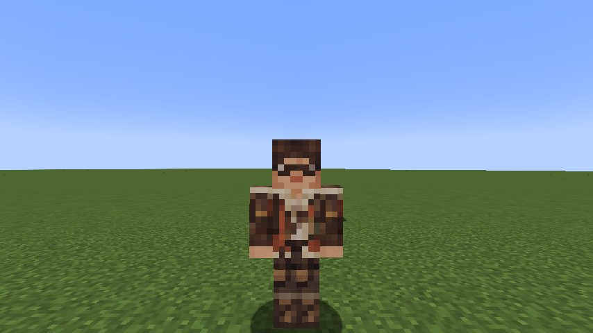
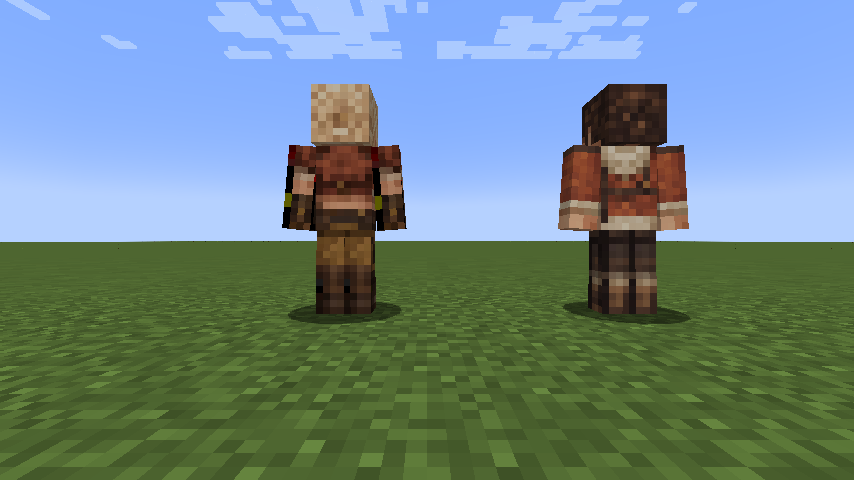

# Alma

[Main Page](https://github.com/Bithio999/MC/wiki/Home) · [Skills](https://github.com/Bithio999/MC/wiki/Skills) · [Evolution](https://github.com/Bithio999/MC/wiki/Evolution) · [Mechanics](https://github.com/Bithio999/MC/wiki/Mechanics) · [Commands](https://github.com/Bithio999/MC/wiki/Commands)

Alma is the expedition handler and researcher. Her skin follows the dark hair, round glasses, rust expedition coat and cream hood of her base appearance.

| NPC data | Alma |
| --- | --- |
| **Information** | |
| Origin | Monster Hunter Wilds |
| Race | [Awakened Hunter](https://github.com/Bithio999/MC/wiki/Awakened-Hunter) |
| **Spawning** | |
| Entity | `wildhunt:alma` |
| System | Native Tensura Otherworlder |
| Skin | Bundled original 64×64 classic Minecraft skin |

## Abilities

| Ability | Registry ID | Character fit |
| --- | --- | --- |
| Analyst | `tensura:analyst` | Field research and analysis |
| Observer | `tensura:observer` | Watch monster behavior and the environment |
| Analytical Appraisal | `tensura:analytical_appraisal` | Identify specimens and equipment |
| Thought Acceleration | `tensura:thought_acceleration` | Process findings quickly |
| Danger Sense | `tensura:danger_sense` | Warn the expedition |
| Magic Sense | `tensura:magic_sense` | Read unfamiliar energy |
| Multilayer Barrier | `tensura:multilayer_barrier` | Protect herself during fieldwork |

These are real Tensura abilities learned and toggled through native entity-existence data. They use Tensura's effects, passive logic and available NPC behavior. A native humanoid AI handles movement, hostility, melee and subordinate commands; a player-only UI or manual mode of a skill does not gain an invented autonomous AI here. The race also grants Hunter's Recovery as a separate racial Extra Skill.

## Spawning

Alma participates in Tensura's **otherworlder spawn distribution**, including its natural otherworlder replacement and summon selection. The eight regular native entries and these two hunters have equal 0.10 weights; the total remains 1. Special Shizu/Hinata rolls and the native overall spawn chance are unchanged. A datapack can override these distributions and loadouts.

Use `/summon wildhunt:alma` or `/give @s wildhunt:alma_spawn_egg` for a direct check. Native otherworlder ownership, inventory, home handling, interaction menus and configured Unique-skill drops are inherited. Races, skills and equipment persist through native saving; loading never reinitializes them. Their native entity data supplies 160,000 aura / 80,000 magicules before any applicable modifiers.

## Gallery

## Front hairline correction in 0.7.2

Alma's front hairline now uses a short, even fringe above a narrow forehead. The large triangular gap on the front is removed. This correction changes only the top four pixel rows of the front head face; her glasses, eyes, nose, mouth, other head faces and outfit are preserved.

## Skin correction in 0.7.1

The top, side and rear head textures now use a separate opaque atlas. This removes Gemma's black patch and gives Alma a coherent swept-back hairstyle. The existing front faces, clothing and equipment pixels are preserved.

## Visual reference and skin provenance

Appearance reference: [Monster Hunter Wilds Alma page](https://monsterhunterwilds.wiki.fextralife.com/Alma). Common skin libraries blocked automated downloads during development, so this is an **original generated and UV-packed interpretation**, not a downloaded community skin or a ripped game texture. The character reference images are not redistributed in this repository. Source art and reproducible nearest-neighbor UV packing are in `art/` and `scripts/prepare-skins.py`.

---

**Categories:** Tensura: Wild Hunt · Otherworlders · Version 0.7.2
