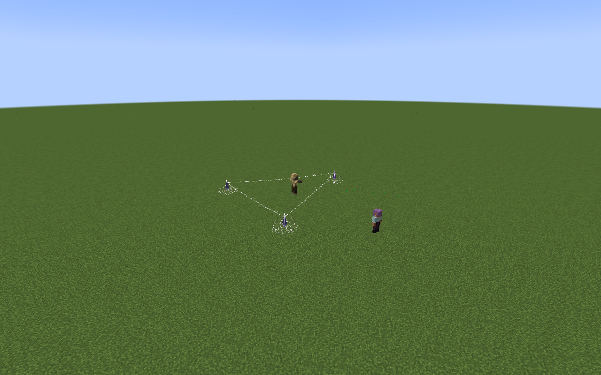
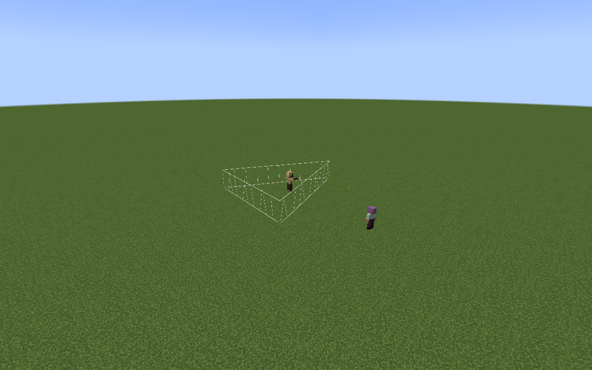

# Anansi, Lord of Schemes

[Main Page](https://github.com/Bithio999/MC/wiki/Home) · [Ultimate Skills](https://github.com/Bithio999/MC/wiki/Ultimate-Skills) · [Ability index](https://github.com/Bithio999/MC/wiki/Abilities) · [Damage types](https://github.com/Bithio999/MC/wiki/Damage-Types)

**Anansi, Lord of Schemes** is an Ultimate Skill built around **placing and traversing a runic thread network**. Its damage follows the threads and the shape you construct.

| Skill data | Anansi, Lord of Schemes |
| --- | --- |
| **Information** | |
| Type | Ultimate Skill |
| Combat role | Trap networks, anchor traversal and prepared area denial |
| Active modes | 3 |
| Resource | Aura |
| Toggleable passive | Schemer's Instinct |
| Passive upkeep | 100 aura / second |
| Registry ID | `wildhunt:anansi` |
| **Obtaining** | |
| Method | Mastered Threadweaver + Rune Smith; 2M base EP |
| **Evolution** | |
| Evolution | Aion; Thoth with Rune Smith; Lugh with Threadweaver |

## Usage

### Passive

[Passive - Toggle] — **Schemer's Instinct**

| Ability information | Value |
| --- | --- |
| Damage type | None |
| Damage ID | — |
| Upkeep | 100 aura / second |

Gain **100% Space boost**, **100% Earth boost** and **30% movement speed**. Only the strongest ordinary source applies per elemental attribute; Godly bonuses remain separate. The first upkeep second is charged when enabling. No passive stacks or barrier are generated.

### Active

| Mode | Aura cost | Cooldown | Raw damage |
| --- | ---: | ---: | --- |
| 1. Fate Stitch | 5,000 per anchor | 2 s | 1,300 per thread contact |
| 2. Puppet Passage | 3,500 | 5 s | — |
| 3. Checkmate Loom | 22,000 | 24 s | 2,800 Space, then 1,900 Earth |

Damage is before mastery, elemental boosts and native defenses. Mastery increases damage up to 1.5×. Ultimate art hits use native level-1 resistance penetration; native nullification rules, attribute defenses, barriers and hit immunity still matter. EP does not multiply damage.

#### Fate Stitch

[Active - Press] — **Fate Stitch**

| Ability information | Value |
| --- | --- |
| Damage type | [Space elemental](https://github.com/Bithio999/MC/wiki/Damage-Types#space) |
| Damage ID | `tensura:space_elemental` |
| Placement range | 40 blocks |
| Anchor lifetime | 20 seconds |
| Maximum anchors | 3 |

Place a hovering runic spider anchor at the aimed location. Each anchor arms after **0.6 seconds**. Two anchors form one thread; three form a triangle. A fourth placement replaces the oldest anchor. Every link must have a clear path through blocks.

An enemy crossing a thread's **1.1-block targeting width** takes 1,300 raw Space damage. The network can hit a given enemy **once per second**, including where several threads overlap. Each link considers at most eight eligible enemies. Its glowing strands and articulated anchor legs identify the actual network.

#### Puppet Passage

[Active - Press] — **Puppet Passage**

| Ability information | Value |
| --- | --- |
| Damage type | None — repositioning |
| Damage ID | — |
| Selection range | 48 blocks |

Aim along a visible anchor to travel to it. Your **current momentum is preserved**, and that anchor moves to your previous position, rebuilding its links and rearming after 0.6 seconds. When several anchors align, the closest matching anchor is selected.

The destination must be safe and unobstructed. Missing or blocked selections spend no aura and start no cooldown. Travel does not itself deal damage.

#### Checkmate Loom

[Active - Press] — **Checkmate Loom**

| Ability information | Value |
| --- | --- |
| Damage type | [Space elemental](https://github.com/Bithio999/MC/wiki/Damage-Types#space), then [Earth elemental](https://github.com/Bithio999/MC/wiki/Damage-Types#earth) |
| Damage ID | `tensura:space_elemental`; `tensura:earth_elemental` |
| Requirement | At least two active anchors |

Consume the current network and display its fixed closing lattice. After **1.2 seconds**, enemies inside the triangle or its narrow perimeter suffer **2,800 raw Space damage**. With two anchors, the affected region is a **3.5-block corridor** around their connecting segment. After another **0.8 seconds**, the same fixed shape erupts for **1,900 raw Earth damage**. Each phase targets up to eight visible enemies. The shape does not follow enemies that leave it.

## Obtaining

Master [Threadweaver](https://github.com/Bithio999/MC/wiki/Threadweaver) and [Rune Smith](https://github.com/Bithio999/MC/wiki/Rune-Smith), reach **2M base EP**, then open **Skills → Ultimate → Synthesis** and choose **Anansi**. Both ingredients are combined. Native presets and the longest remaining cooldown are preserved.

## Suggested combo

Construct a triangle across an approach → use Puppet Passage to pull one vertex behind an enemy formation → close the network with Checkmate Loom. Preparation and positioning determine the finisher's shape.

## Limits

The skill respects teams, owned pets, creative/spectator protection, line of sight and server PvP rules. Its effects do not edit terrain. Death, forgetting the skill, relogging or dimension changes cancel owned active constructs and pending attacks.

## Gallery

[Visual effects gallery](https://github.com/Bithio999/MC/wiki/Visual-Effects).

---

**Categories:** Tensura Myths · Skills · Ultimate
