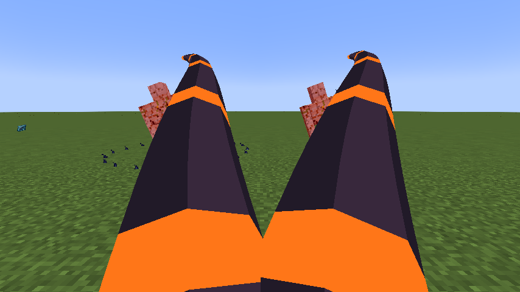

# Black Flame

[Main Page](https://github.com/Bithio999/MC/wiki/Home) · [Skills](https://github.com/Bithio999/MC/wiki/Skills) · [Ability index](https://github.com/Bithio999/MC/wiki/Abilities) · [Damage types](https://github.com/Bithio999/MC/wiki/Damage-Types)

**Black Flame** is a Unique Skill inspired by **Nu Udra**. It uses visible oil tentacles to pull targets into burning ground.

| Skill data | Black Flame |
| --- | --- |
| **Information** | |
| Type | Unique Skill |
| Inspiration | Nu Udra |
| Damage type | Fire elemental |
| Damage ID | `tensura:fire_elemental` |
| Additional status damage | Black Burn — `tensura:black_flame` |
| Combat role | Tentacle pulls / burning ground |
| Active modes | 2 |
| Toggleable passive | Furnace Mantle |
| Passive upkeep | 15 aura / second |
| Registry ID | `wildhunt:black_flame` |
| **Evolution** | |
| Previous | — |
| Evolution | [Vritra](https://github.com/Bithio999/MC/wiki/Vritra), with mastered Storm Crown |
| **Obtaining** | |
| Method | Reincarnation / starting skill roll |

All damaging arts in this skill use **fire elemental damage**, including its area hits and pulses.

## Usage

### Passive

[Passive - Toggle] — **Furnace Mantle**

| Ability information | Value |
| --- | --- |
| Damage type | None — support / defense |
| Damage ID | — |
| Effect | No direct damage; modifies the caster’s attributes or defenses. |

While toggled on, gain 8 armor, 50% melee attack and 50% flame boost. Fire-tagged damage is resisted while the passive is enabled, preserving its fire-protection utility without a lingering potion. Melee attacks do not coat targets or accumulate oil. This is an offensive passive, not an extra ignition step.

Elemental boosts use the [strongest ordinary source](https://github.com/Bithio999/MC/wiki/Mechanics#elemental-bonus-sources); Godly bonuses apply separately.

Enable or disable this through Tensura’s native **Ability Selection** skill toggle. It is separate from active mode cycling and has no fifteen/thirty-second duration. Upkeep is **15 aura per second**, with the first second paid on enabling. It turns off when aura is insufficient or activation requirements fail. Turning it off removes its own attribute modifiers immediately.

### Active

| Mode | Aura | Cooldown | Raw opening damage |
| --- | ---: | ---: | ---: |
| 1. Oil Lash | 160 | 3 s | 125 |
| 2. Blackflame Ignition | 800 | 7 s | 165 |

**Damage calculation:** multiply the listed base values by **0.90**, then by the mastery multiplier (up to **1.50**). Elemental boosts, defenses, barriers, and situational modifiers also apply. EP does not multiply damage.

#### Oil Lash

[Active - Press] — **Oil Lash**

| Ability information | Value |
| --- | --- |
| Damage type | [Fire elemental](https://github.com/Bithio999/MC/wiki/Damage-Types#fire) |
| Damage ID | `tensura:fire_elemental` |
| Additional status damage | Black Burn — `tensura:black_flame` |
| Effect | Direct hits use this native element. |

Lash up to 4 enemies in a forward fan within 14 blocks and pull them toward you. Each lash has a synced three-dimensional tapered tentacle with a dark body and glowing orange bands. It extends, curls and recoils over sixteen ticks. A missed cast still shows a tentacle sweep. Leave a pool at the final victim’s location, or at the aim point about ten blocks away on a miss. Maintain up to 3 pools; the oldest is replaced first.

#### Blackflame Ignition

[Active - Press] — **Blackflame Ignition**

| Ability information | Value |
| --- | --- |
| Damage type | [Fire elemental](https://github.com/Bithio999/MC/wiki/Damage-Types#fire) |
| Damage ID | `tensura:fire_elemental` |
| Additional status damage | Black Burn — `tensura:black_flame` |
| Effect | Direct hits use this native element. |
| Additional status damage | Black Burn: `tensura:black_flame` ([details](https://github.com/Bithio999/MC/wiki/Damage-Types#black-burn)) |

Ignite valid owned pools for six seconds. Each affects a 3-block radius; overlapping pools cannot damage one enemy twice in a pulse. Opening damage is immediate and fixed, with no oil-stack multiplier. Later pulses deal 42 raw damage once per second and apply native Black Burn. If no valid controllable pool exists, place a fallback pool at the aim point up to six blocks away.

## Obtaining

Roll through Tensura’s normal reincarnation system. These Uniques join the configured primary pool; no particular roll is guaranteed. There are no skill trials, boss-awarded skills or race requirements to roll.

## Evolution

Combine the mastered skill with a mastered **Storm Crown** at **2M base EP** to create [Vritra](https://github.com/Bithio999/MC/wiki/Vritra), using **Skills → Ultimate → Synthesis**. Both ingredients are replaced and presets/cooldowns carry over. No race requirement applies.

## Suggested combo

Use Oil Lash to pull a victim and place a pool → ignite the pool. Cover likely escape routes with separate pools instead of farming stacks or overlapping them for duplicate damage.

## Strengths and limitations

Pools are world locations, not status stacks on enemies. Unlit pools expire after fifteen seconds; ordinary ignition burns for six. Only your pools in the same dimension and within thirty-two blocks can be controlled. Native Black Burn and forced movement may be resisted.

## In-game preview

In-game example of the active art.

## Related pages

[Skills](https://github.com/Bithio999/MC/wiki/Skills) · [Mechanics](https://github.com/Bithio999/MC/wiki/Mechanics) · [Evolution](https://github.com/Bithio999/MC/wiki/Evolution) · [Commands](https://github.com/Bithio999/MC/wiki/Commands)

---

**Categories:** Tensura Myths · Skills
