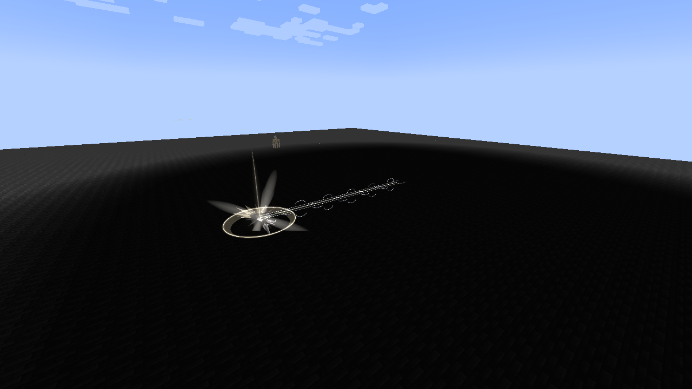

# Chained

[Main Page](https://github.com/Bithio999/MC/wiki/Home) · [Unique Skills](https://github.com/Bithio999/MC/wiki/Unique-Skills) · [Fettered Human](https://github.com/Bithio999/MC/wiki/Fettered-Human)

**Chained** is an original interpretation inspired by Heavenly Restriction in **Jujutsu Kaisen**, implemented as the race-exclusive Unique Skill of the Heavenly Restriction lineage. Its binding pact exchanges magical growth and unrestricted skill acquisition for exceptional aura capacity, Battlewill training and physical combat. The true passive follows ownership; the combat bonuses use Tensura’s normal skill toggle.


| Skill data | Chained |
| --- | --- |
| **Information** | |
| Skill tier | Unique |
| Acquisition | Guaranteed intrinsic skill of Fettered Human only; retained through evolution |
| Normal reincarnation Unique pool | No; other reincarnation skills still roll normally |
| Maximum mastery | 1,000 |
| Active mode | Severance Rush |
| Resource | Aura |
| Damage type | Aura slash, treated as Battlewill |
| Damage ID | `tensura:aura_slash` |
| Toggle upkeep | None |

## Usage

### Heavenly Restriction

[Passive - True] — **Heavenly Restriction**

| Ability information | Value |
| --- | --- |
| Damage type | None |
| Damage ID | None |
| Activation | Owning the learned skill; independent of toggle and slots |

Your **later maximum-aura gains are multiplied by 5**, including growth and capacity supplied by equipment, skills and other sources. Your actual starting aura roll is saved and **excluded from Chained’s multiplier**. A fresh Fettered Human rolls **1,500–2,000 aura** and **50–100 magicules**, for **1,550–2,100 starting EP** before separate reincarnation rewards.

With no other capacity multipliers, **maximum aura = starting aura + 5 × later aura-capacity gains**. For example, a starting roll of 1,800 aura followed by 100 raw aura growth gives 2,300 maximum aura. Other capacity multipliers retain their normal effects. The exemption persists through evolution, toggling and save/load; forgetting and relearning Chained does not recapture earned aura as a new starting pool. A new native reincarnation roll establishes a new starting pool. Native hard limits still apply. This expands capacity without repeatedly refilling current aura.

**Total EP**, shown in the native status menu, includes effective maximum aura and magicules, so Chained’s bonus capacity contributes. Myths progression gates use this **total EP**, including the bonus. **Base EP** still describes unmultiplied capacity for raw growth accounting. Without other modifiers or caps, 100 raw aura growth adds 100 base EP and 500 total EP while Chained is owned.

All five lineage stages allocate normal EP growth **90% to aura and 10% to magicules** before Chained blocks maximum-magicule increases; that blocked 10% is not redirected. A secondary race’s 10% growth bonus preserves this split. Convergent races retain their own growth profiles.

Your existing **maximum magicule capacity is preserved as a ceiling**. Future increases to the base value are blocked, and newly added capacity modifiers cannot raise the effective maximum beyond that ceiling. Current magicules remain usable, and native expenses or losses still apply. The pact does not redirect blocked magicule-capacity gains into aura.

Natural magicule regeneration instead **adds its actual regeneration amount to aura regeneration**. It uses the local area’s magicules, the native magicule-regeneration multiplier and applicable sleep recovery. The conversion also works when your magicule pool is full. It does not restore current magicules; native spiritual maintenance and excess-energy decay retain their own rules.

New abilities are restricted to:

- Battlewills.
- Resistance and Nullification skills.
- Skills genuinely granted by reincarnation, and skills subsequently granted through their native ability callbacks or inherited parent chain.
- Chained itself.
- The lineage’s racial aura-recovery grants: Hunter’s Recovery at Unshackled, Apex Renewal at Heavenly Restricted, and Sovereign Rebirth at Heavenbreaker. This exception does not open unrelated Extra Skills.

**Resistance and Nullification acquisition costs are paid from current aura**, using Tensura’s configured acquisition amount and acquisition-cost gamerule. They do not consume permanent magicule capacity. Native free reward grants remain free. This applies when a latent resistance finishes learning and when it upgrades to Nullification.

Myths synthesis and Godly ascension retain this exemption when all consumed ingredients descend from recorded reincarnation skills.

For example, a reincarnation-granted **Martial Master** can still grant **Heavenly Eye**. Ordinary unrelated Extra/Unique/Ultimate grants and copied magical abilities are blocked before the normal learning API can spend acquisition magicules. Skills already owned when Chained is acquired remain owned and usable under their normal rules.

### Martial Supremacy

[Passive - Toggle] — **Martial Supremacy**

| Ability information | Value |
| --- | --- |
| Damage type | None directly; strengthens native Battlewill damage |
| Damage ID | None |
| Resource cost | None |

Enable Chained through Tensura’s normal Ability Selection toggle to gain:

| Effect | Bonus |
| --- | --- |
| Battlewill learning points | +9 |
| Battlewill mastery points | +9 |
| Resistance/Nullification learning points | +19 |
| Battlewill damage | **5×** |
| Numeric Battlewill buff effectiveness | **3×** |
| Attack-damage attribute | **3×** |

Numeric buffs include native attribute bonuses, such as Diamond Path’s armor, and additional damage supplied by a Battlewill buff, such as Aura Sword. The bonus changes their numeric strength; buff duration, learning costs and resource-conversion rates keep their native values. Repeated refreshes do not multiply an already boosted buff again. Disabling Chained restores each tracked buff’s native amount.

Battlewill-enhanced melee can benefit from both the tripled attack attribute and the Battlewill multiplier. Ordinary melee without a Battlewill component receives the attack-attribute bonus. Native defenses, damage calculation and allowed inherited skills can further affect the result.

### Broken Limit

[Passive - Toggle - Mastered] — **Broken Limit**

| Ability information | Value |
| --- | --- |
| Damage type | None directly |
| Damage ID | None |
| Requirement | Chained mastered and toggled on |

Your own hits lower defensive skills by **one tier**: **Resistance → no resistance**, **Nullification → Resistance**. Numeric resistance attributes are bypassed for those hits. Attributable status effects use the corresponding lower-tier immunity rules. The target’s learned skills are retained. Native barriers, authority and other defenses continue to apply.

Your damage sources also **ignore dodge**, including projectiles attributed to you. This is a live toggle trait; turning it off removes the bypass from subsequent damage handling.

### Unerring Body

[Passive - In-slot] — **Unerring Body**

| Ability information | Value |
| --- | --- |
| Damage type | None |
| Damage ID | None |
| Requirement | Chained equipped in the active ability preset |

Gain **100% dodge chance against projectiles** and **25% against other incoming damage**. The latter includes non-projectile magic and environmental hits. This passive works with Chained’s combat toggle off. Explicit source-level dodge bypass and operator/void-style invulnerability bypass still take priority; another mastered, enabled Chained owner can bypass it.

### Severance Rush

[Active - Press] — **Severance Rush**

| Ability information | Value |
| --- | --- |
| Damage type | Aura slash / Battlewill |
| Damage ID | `tensura:aura_slash` |
| Resource cost | **2% of current aura**, paid once |
| Cooldown | **None** |
| Movement | Instant teleport up to **16 blocks** along your look direction |
| Path damage radius | **3 blocks** |
| Arrival damage radius | **4 blocks** |

Teleport instantly along your aim, like Martial Master’s movement art. The same activation resolves one hit along the route and an additional hit at the destination. A victim caught in both receives both hits, including inside the ordinary hurt cooldown. Each victim receives at most one path hit and one arrival hit.

The endpoint stops before solid body collisions, unloaded terrain, the world border or the build-height boundary. Looking upward or downward changes the teleport direction. If there is no usable movement or no aura, the cast spends no aura. The teleport is not a timed channel or a movement-over-time attack. There is no skill cooldown; each successive press spends 2% of the aura remaining at that moment.

Let **A** be the aura actually paid:

- **A = 0.02 × current aura**.
- **Path damage = 1.5 × √A**.
- **Arrival damage = 3 × √A**.

At **100,000 current aura**, the cast pays **2,000 aura** and has about **67.08 path damage** plus **134.16 arrival damage** before native handling. With Martial Supremacy enabled, those become about **335.41** and **670.82**. The formula uses actual aura spent, with no extra EP multiplier or mastery damage multiplier.

A brief chain separates into broken links along the route, with a pale pressure burst at arrival. The trail remains visible after the instantaneous teleport; it does not move the player over its lifetime.



## Obtaining and evolution

Select **Fettered Human** in the native reincarnation race menu. Only Fettered Human grants Chained. Normal evolution retains the existing skill and its mastery, but later stages do not grant or regrant it. Selecting a later stage directly does not award Chained. The lineage proceeds through four native-menu evolutions to [Heavenbreaker](https://github.com/Bithio999/MC/wiki/Heavenbreaker). Chained is separate from the ordinary reincarnation Unique roll.

## Existing saves and recorded inheritance

Automatic inheritance tracking starts with version 0.32.0, including reincarnation rolls made before the player chooses this race. Previously owned skills are retained. The addon cannot infer the original source of every historical skill grant in an older save.

An operator can certify a known, already-owned reincarnation root with:

```text
/myths chained inherit <player> <skill_id>
```

For example: `/myths chained inherit PlayerName tensura:martial_master`. This requires permission level 2 and does not grant the named skill. Future native derived grants can then inherit its exemption.

---

**Categories:** Tensura Myths · Skills · Unique
