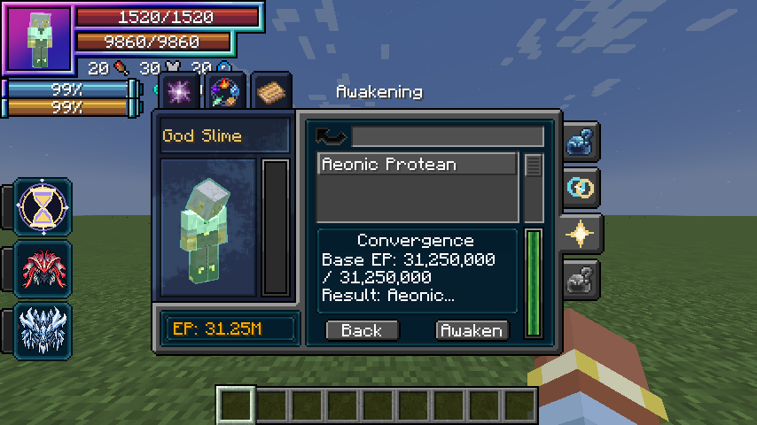

# Convergent Awakening

[Main Page](https://github.com/Bithio999/MC/wiki/Home) · [Races](https://github.com/Bithio999/MC/wiki/Races) · [Ability index](https://github.com/Bithio999/MC/wiki/Abilities) · [Damage types](https://github.com/Bithio999/MC/wiki/Damage-Types)

**Convergent Awakening** unites two fully evolved lineages into a single registered race. There are **105 unique pairs** among the fifteen supported ancestral families. Every pair has its own name, original pixel icon, registry ID and EP growth profile. Reversing the pair produces the same fused race.

## Obtaining

Open Tensura’s menu and select the **Convergent Awakening tab on the right**, below the Secondary Race tab. Both lineages must be at a final stage with no further native evolution. You must also be a **True Hero or True Demon Lord** and meet the **lineage-dependent base EP requirement** shown in that tab. A base or partially evolved secondary cannot awaken.

The primary becomes the actual fused native race. Its predecessor state and the secondary’s native state are saved for inherited reactions and ticks. The fusion has no next evolution. The independent secondary racial key stops operating; the normal racial key uses **Concordance Pulse** instead.

## EP requirement

By default, the requirement is **125% of the highest EP gate leading up to the awakening**, with a **10,000,000 base EP minimum**. This includes native EP requirements along both current lineage paths and the added cumulative EP gate of the last completed secondary evolution. It uses required EP, not the amount you happened to have when evolving; earning more EP does not move the goalposts.

`Required base EP = max(10,000,000, ceil(highest preceding evolution EP gate × 1.25))`

For example, selecting Slime at 20M EP and completing its two evolutions at the added 22.5M and 25M gates gives a **31.25M EP awakening requirement**, provided neither native lineage has a higher gate. A native evolution requiring 40M raises awakening to **50M** instead. Both races must still reach their final evolution, and the true awakening requirement remains.

Server owners can configure the minimum with `convergenceEP` and the multiplier with `convergenceEvolutionEPFactor`. The menu and server checks use the same calculated threshold. Previously completed Convergent Awakenings remain complete.

## Awakening rewards

- A one-time **25% increase to each base aura and magicule cap**, preserving their existing proportions.
- Full HP, SHP and energy recovery on the successful awakening.
- A new intrinsic list drawn from both native final ancestral races, subject to native learning rules, with previously learned skills retained.
- Native race tags drawn from both final ancestral races.
- A fused attribute profile derived from 65% of both native final stages, plus 80 HP, 1,500 SHP and a pair-dependent attack bonus; the total racial HP bonus is capped at 1,000.
- A distinct future EP growth profile with the inherited **10% EP gain bonus**.

**Damage type:** None — Concordance Pulse heals and applies knockback without an attack damage call.

Shared racial action: **Concordance Pulse** heals 10% maximum HP up to 80 and pushes nearby enemies. It costs 1,500 aura, has a 30-second cooldown and renders the pair's ancestral colors. The 105 races share this action; they do not each add a separate combat kit.

Native final-stage attributes depend on Tensura’s server race configuration. These bonuses replace the former primary and secondary race modifiers. They are not stacked on top indefinitely. Appearance retains the player's skin; these are not custom monster models.

## Race catalog

Weights multiply the same baseline used by native aura/magicule gain attributes. Every unboosted profile totals six, twice the default single-race growth budget of three. The inherited 10% bonus multiplies both weights by 1.1 without changing their ratio. This does not bypass native EP caps. The individual pages show an example at a baseline of three, including that bonus.

| Ancestral pair | Convergent race | Aura weight | Magicule weight |
| --- | --- | ---: | ---: |
| Beastfolk + Harpy | [Gryphon Sovereign](https://github.com/Bithio999/MC/wiki/Fusion-beastfolk-harpy) | 3.74 | 2.26 |
| Beastfolk + Ogre | [Rakshasa](https://github.com/Bithio999/MC/wiki/Fusion-beastfolk-ogre) | 3.745 | 2.255 |
| Beastfolk + Goblin | [Briar Monarch](https://github.com/Bithio999/MC/wiki/Fusion-beastfolk-goblin) | 3.75 | 2.25 |
| Beastfolk + Giant | [Fenrir Colossus](https://github.com/Bithio999/MC/wiki/Fusion-beastfolk-giant) | 3.755 | 2.245 |
| Beastfolk + Orc | [Calydonian King](https://github.com/Bithio999/MC/wiki/Fusion-beastfolk-orc) | 3.76 | 2.24 |
| Beastfolk + Lizardman | [Chimera Wyrm](https://github.com/Bithio999/MC/wiki/Fusion-beastfolk-lizardman) | 3.765 | 2.235 |
| Beastfolk + Merfolk | [Leviathan Beast](https://github.com/Bithio999/MC/wiki/Fusion-beastfolk-merfolk) | 3.77 | 2.23 |
| Beastfolk + Elf | [Sylvan Sphinx](https://github.com/Bithio999/MC/wiki/Fusion-beastfolk-elf) | 3.775 | 2.225 |
| Beastfolk + Human | [Primal Paragon](https://github.com/Bithio999/MC/wiki/Fusion-beastfolk-human) | 3.78 | 2.22 |
| Beastfolk + Dwarf | [Adamant Manticore](https://github.com/Bithio999/MC/wiki/Fusion-beastfolk-dwarf) | 3.785 | 2.215 |
| Beastfolk + Slime | [Amorphous Behemoth](https://github.com/Bithio999/MC/wiki/Fusion-beastfolk-slime) | 2.79 | 3.21 |
| Beastfolk + Vampire | [Bloodmoon Lycan](https://github.com/Bithio999/MC/wiki/Fusion-beastfolk-vampire) | 2.795 | 3.205 |
| Beastfolk + Wight | [Ossuary Fenrir](https://github.com/Bithio999/MC/wiki/Fusion-beastfolk-wight) | 2.8 | 3.2 |
| Beastfolk + Daemon | [Abyssal Chimera](https://github.com/Bithio999/MC/wiki/Fusion-beastfolk-daemon) | 2.805 | 3.195 |
| Harpy + Ogre | [Garuda Oni](https://github.com/Bithio999/MC/wiki/Fusion-harpy-ogre) | 3.81 | 2.19 |
| Harpy + Goblin | [Thornwing Archon](https://github.com/Bithio999/MC/wiki/Fusion-goblin-harpy) | 3.815 | 2.185 |
| Harpy + Giant | [Storm Titan](https://github.com/Bithio999/MC/wiki/Fusion-giant-harpy) | 3.82 | 2.18 |
| Harpy + Orc | [Tempest Juggernaut](https://github.com/Bithio999/MC/wiki/Fusion-harpy-orc) | 3.825 | 2.175 |
| Harpy + Lizardman | [Quetzal Sovereign](https://github.com/Bithio999/MC/wiki/Fusion-harpy-lizardman) | 3.83 | 2.17 |
| Harpy + Merfolk | [Siren Seraph](https://github.com/Bithio999/MC/wiki/Fusion-harpy-merfolk) | 3.835 | 2.165 |
| Harpy + Elf | [Zephyr Oracle](https://github.com/Bithio999/MC/wiki/Fusion-elf-harpy) | 3.84 | 2.16 |
| Harpy + Human | [Celestial Valkyrie](https://github.com/Bithio999/MC/wiki/Fusion-harpy-human) | 3.845 | 2.155 |
| Harpy + Dwarf | [Runewing Artisan](https://github.com/Bithio999/MC/wiki/Fusion-dwarf-harpy) | 3.85 | 2.15 |
| Harpy + Slime | [Cloudborn Protean](https://github.com/Bithio999/MC/wiki/Fusion-harpy-slime) | 2.855 | 3.145 |
| Harpy + Vampire | [Nocturne Strix](https://github.com/Bithio999/MC/wiki/Fusion-harpy-vampire) | 2.86 | 3.14 |
| Harpy + Wight | [Pale Thunderbird](https://github.com/Bithio999/MC/wiki/Fusion-harpy-wight) | 2.865 | 3.135 |
| Harpy + Daemon | [Fallen Simurgh](https://github.com/Bithio999/MC/wiki/Fusion-daemon-harpy) | 2.87 | 3.13 |
| Ogre + Goblin | [Thorncrown Asura](https://github.com/Bithio999/MC/wiki/Fusion-goblin-ogre) | 3.875 | 2.125 |
| Ogre + Giant | [Indra Colossus](https://github.com/Bithio999/MC/wiki/Fusion-giant-ogre) | 3.88 | 2.12 |
| Ogre + Orc | [Warborn Ravager](https://github.com/Bithio999/MC/wiki/Fusion-ogre-orc) | 3.885 | 2.115 |
| Ogre + Lizardman | [Ryuujin](https://github.com/Bithio999/MC/wiki/Fusion-lizardman-ogre) | 3.89 | 2.11 |
| Ogre + Merfolk | [Tidal Susanoo](https://github.com/Bithio999/MC/wiki/Fusion-merfolk-ogre) | 3.895 | 2.105 |
| Ogre + Elf | [Moonlit Kensei](https://github.com/Bithio999/MC/wiki/Fusion-elf-ogre) | 3.9 | 2.1 |
| Ogre + Human | [Heavenly Asura](https://github.com/Bithio999/MC/wiki/Fusion-human-ogre) | 3.905 | 2.095 |
| Ogre + Dwarf | [Vajra Forgemaster](https://github.com/Bithio999/MC/wiki/Fusion-dwarf-ogre) | 3.91 | 2.09 |
| Ogre + Slime | [Protean Kishin](https://github.com/Bithio999/MC/wiki/Fusion-ogre-slime) | 2.915 | 3.085 |
| Ogre + Vampire | [Crimson Yaksha](https://github.com/Bithio999/MC/wiki/Fusion-ogre-vampire) | 2.92 | 3.08 |
| Ogre + Wight | [Gravebound Kishin](https://github.com/Bithio999/MC/wiki/Fusion-ogre-wight) | 2.925 | 3.075 |
| Ogre + Daemon | [Abyssal Rakshasa](https://github.com/Bithio999/MC/wiki/Fusion-daemon-ogre) | 2.93 | 3.07 |
| Goblin + Giant | [Bramble Titan](https://github.com/Bithio999/MC/wiki/Fusion-giant-goblin) | 3.935 | 2.065 |
| Goblin + Orc | [Verdant Warlord](https://github.com/Bithio999/MC/wiki/Fusion-goblin-orc) | 3.94 | 2.06 |
| Goblin + Lizardman | [Basilisk Regent](https://github.com/Bithio999/MC/wiki/Fusion-goblin-lizardman) | 3.945 | 2.055 |
| Goblin + Merfolk | [Reef Trickster](https://github.com/Bithio999/MC/wiki/Fusion-goblin-merfolk) | 3.95 | 2.05 |
| Goblin + Elf | [Thornsong Sovereign](https://github.com/Bithio999/MC/wiki/Fusion-elf-goblin) | 3.955 | 2.045 |
| Goblin + Human | [Emerald Exemplar](https://github.com/Bithio999/MC/wiki/Fusion-goblin-human) | 3.96 | 2.04 |
| Goblin + Dwarf | [Gremlin Artificer](https://github.com/Bithio999/MC/wiki/Fusion-dwarf-goblin) | 3.965 | 2.035 |
| Goblin + Slime | [Briar Protean](https://github.com/Bithio999/MC/wiki/Fusion-goblin-slime) | 2.97 | 3.03 |
| Goblin + Vampire | [Sanguine Puck](https://github.com/Bithio999/MC/wiki/Fusion-goblin-vampire) | 2.975 | 3.025 |
| Goblin + Wight | [Ossuary Trickster](https://github.com/Bithio999/MC/wiki/Fusion-goblin-wight) | 2.98 | 3.02 |
| Goblin + Daemon | [Infernal Goblin King](https://github.com/Bithio999/MC/wiki/Fusion-daemon-goblin) | 2.985 | 3.015 |
| Giant + Orc | [Worldbreaker](https://github.com/Bithio999/MC/wiki/Fusion-giant-orc) | 3.99 | 2.01 |
| Giant + Lizardman | [Jormungandr](https://github.com/Bithio999/MC/wiki/Fusion-giant-lizardman) | 3.995 | 2.005 |
| Giant + Merfolk | [Oceanus](https://github.com/Bithio999/MC/wiki/Fusion-giant-merfolk) | 4 | 2 |
| Giant + Elf | [Yggdrasil Guardian](https://github.com/Bithio999/MC/wiki/Fusion-elf-giant) | 4.005 | 1.995 |
| Giant + Human | [Atlas Ascendant](https://github.com/Bithio999/MC/wiki/Fusion-giant-human) | 4.01 | 1.99 |
| Giant + Dwarf | [Hecatoncheir](https://github.com/Bithio999/MC/wiki/Fusion-dwarf-giant) | 4.015 | 1.985 |
| Giant + Slime | [Primordial Colossus](https://github.com/Bithio999/MC/wiki/Fusion-giant-slime) | 3.02 | 2.98 |
| Giant + Vampire | [Bloodforge Titan](https://github.com/Bithio999/MC/wiki/Fusion-giant-vampire) | 3.025 | 2.975 |
| Giant + Wight | [Ossuary Colossus](https://github.com/Bithio999/MC/wiki/Fusion-giant-wight) | 3.03 | 2.97 |
| Giant + Daemon | [Typhon](https://github.com/Bithio999/MC/wiki/Fusion-daemon-giant) | 3.035 | 2.965 |
| Orc + Lizardman | [Ironhide Wyrm](https://github.com/Bithio999/MC/wiki/Fusion-lizardman-orc) | 4.04 | 1.96 |
| Orc + Merfolk | [Abyssal Cetus](https://github.com/Bithio999/MC/wiki/Fusion-merfolk-orc) | 4.045 | 1.955 |
| Orc + Elf | [Verdant Juggernaut](https://github.com/Bithio999/MC/wiki/Fusion-elf-orc) | 4.05 | 1.95 |
| Orc + Human | [Adamant Warlord](https://github.com/Bithio999/MC/wiki/Fusion-human-orc) | 4.055 | 1.945 |
| Orc + Dwarf | [Vulcan Behemoth](https://github.com/Bithio999/MC/wiki/Fusion-dwarf-orc) | 4.06 | 1.94 |
| Orc + Slime | [Voracious Protean](https://github.com/Bithio999/MC/wiki/Fusion-orc-slime) | 3.065 | 2.935 |
| Orc + Vampire | [Sanguine Behemoth](https://github.com/Bithio999/MC/wiki/Fusion-orc-vampire) | 3.07 | 2.93 |
| Orc + Wight | [Gravehide Colossus](https://github.com/Bithio999/MC/wiki/Fusion-orc-wight) | 3.075 | 2.925 |
| Orc + Daemon | [Maw of Tartarus](https://github.com/Bithio999/MC/wiki/Fusion-daemon-orc) | 3.08 | 2.92 |
| Lizardman + Merfolk | [Azure Leviathan](https://github.com/Bithio999/MC/wiki/Fusion-lizardman-merfolk) | 4.085 | 1.915 |
| Lizardman + Elf | [Elder Starwyrm](https://github.com/Bithio999/MC/wiki/Fusion-elf-lizardman) | 4.09 | 1.91 |
| Lizardman + Human | [Dragonheart Exemplar](https://github.com/Bithio999/MC/wiki/Fusion-human-lizardman) | 4.095 | 1.905 |
| Lizardman + Dwarf | [Runebound Fafnir](https://github.com/Bithio999/MC/wiki/Fusion-dwarf-lizardman) | 4.1 | 1.9 |
| Lizardman + Slime | [Mercurial Ouroboros](https://github.com/Bithio999/MC/wiki/Fusion-lizardman-slime) | 3.105 | 2.895 |
| Lizardman + Vampire | [Sanguine Wyrm](https://github.com/Bithio999/MC/wiki/Fusion-lizardman-vampire) | 3.11 | 2.89 |
| Lizardman + Wight | [Ossuary Dragon](https://github.com/Bithio999/MC/wiki/Fusion-lizardman-wight) | 3.115 | 2.885 |
| Lizardman + Daemon | [Tiamat Scion](https://github.com/Bithio999/MC/wiki/Fusion-daemon-lizardman) | 3.12 | 2.88 |
| Merfolk + Elf | [Nereid Oracle](https://github.com/Bithio999/MC/wiki/Fusion-elf-merfolk) | 4.125 | 1.875 |
| Merfolk + Human | [Thalassic Exemplar](https://github.com/Bithio999/MC/wiki/Fusion-human-merfolk) | 4.13 | 1.87 |
| Merfolk + Dwarf | [Runic Triton](https://github.com/Bithio999/MC/wiki/Fusion-dwarf-merfolk) | 4.135 | 1.865 |
| Merfolk + Slime | [Abyssal Undine](https://github.com/Bithio999/MC/wiki/Fusion-merfolk-slime) | 3.14 | 2.86 |
| Merfolk + Vampire | [Sanguine Siren](https://github.com/Bithio999/MC/wiki/Fusion-merfolk-vampire) | 3.145 | 2.855 |
| Merfolk + Wight | [Ossuary Mariner](https://github.com/Bithio999/MC/wiki/Fusion-merfolk-wight) | 3.15 | 2.85 |
| Merfolk + Daemon | [Abyssal Scylla](https://github.com/Bithio999/MC/wiki/Fusion-daemon-merfolk) | 3.155 | 2.845 |
| Elf + Human | [Astral Exemplar](https://github.com/Bithio999/MC/wiki/Fusion-elf-human) | 4.16 | 1.84 |
| Elf + Dwarf | [Aetherforged Oracle](https://github.com/Bithio999/MC/wiki/Fusion-dwarf-elf) | 4.165 | 1.835 |
| Elf + Slime | [Sylvan Protean](https://github.com/Bithio999/MC/wiki/Fusion-elf-slime) | 3.17 | 2.83 |
| Elf + Vampire | [Crimson Sidhe](https://github.com/Bithio999/MC/wiki/Fusion-elf-vampire) | 3.175 | 2.825 |
| Elf + Wight | [Pale Star Oracle](https://github.com/Bithio999/MC/wiki/Fusion-elf-wight) | 3.18 | 2.82 |
| Elf + Daemon | [Twilight Seraph](https://github.com/Bithio999/MC/wiki/Fusion-daemon-elf) | 3.185 | 2.815 |
| Human + Dwarf | [Runic Exemplar](https://github.com/Bithio999/MC/wiki/Fusion-dwarf-human) | 4.19 | 1.81 |
| Human + Slime | [Aeonic Protean](https://github.com/Bithio999/MC/wiki/Fusion-human-slime) | 3.195 | 2.805 |
| Human + Vampire | [Eclipse Sovereign](https://github.com/Bithio999/MC/wiki/Fusion-human-vampire) | 3.2 | 2.8 |
| Human + Wight | [Deathless Exemplar](https://github.com/Bithio999/MC/wiki/Fusion-human-wight) | 3.205 | 2.795 |
| Human + Daemon | [Empyrean Adversary](https://github.com/Bithio999/MC/wiki/Fusion-daemon-human) | 3.21 | 2.79 |
| Dwarf + Slime | [Quicksilver Artificer](https://github.com/Bithio999/MC/wiki/Fusion-dwarf-slime) | 3.215 | 2.785 |
| Dwarf + Vampire | [Bloodrune Patriarch](https://github.com/Bithio999/MC/wiki/Fusion-dwarf-vampire) | 3.22 | 2.78 |
| Dwarf + Wight | [Ossuary Runesmith](https://github.com/Bithio999/MC/wiki/Fusion-dwarf-wight) | 3.225 | 2.775 |
| Dwarf + Daemon | [Infernal Forgemaster](https://github.com/Bithio999/MC/wiki/Fusion-daemon-dwarf) | 3.23 | 2.77 |
| Slime + Vampire | [Sanguine Protean](https://github.com/Bithio999/MC/wiki/Fusion-slime-vampire) | 2.235 | 3.765 |
| Slime + Wight | [Ossuary Protean](https://github.com/Bithio999/MC/wiki/Fusion-slime-wight) | 2.24 | 3.76 |
| Slime + Daemon | [Abyssal Progenitor](https://github.com/Bithio999/MC/wiki/Fusion-daemon-slime) | 2.245 | 3.755 |
| Vampire + Wight | [Nocturne Revenant](https://github.com/Bithio999/MC/wiki/Fusion-vampire-wight) | 2.25 | 3.75 |
| Vampire + Daemon | [Sanguine Archfiend](https://github.com/Bithio999/MC/wiki/Fusion-daemon-vampire) | 2.255 | 3.745 |
| Wight + Daemon | [Erebus Sovereign](https://github.com/Bithio999/MC/wiki/Fusion-daemon-wight) | 2.26 | 3.74 |

## Gallery

## Configuration

The world’s `serverconfig/tensura-myths-server.toml` controls `secondaryRaceEP` (5M), `secondaryEvolutionEPStep` (2.5M new EP per stage), `convergenceEP` (10M), `godlyEP` (12M) and `convergenceEnergyMultiplier` (1.25). Server requirements are checked again when a request arrives. Client button state is not authoritative.

Ordinary death and relogging retain the fused race and ancestry data. Reincarnation or an external replacement of the primary race resets the previous Duo life. There is no normal menu action to swap an existing secondary or repeatedly claim the awakening bonus.

---

**Categories:** Tensura Myths · Races
