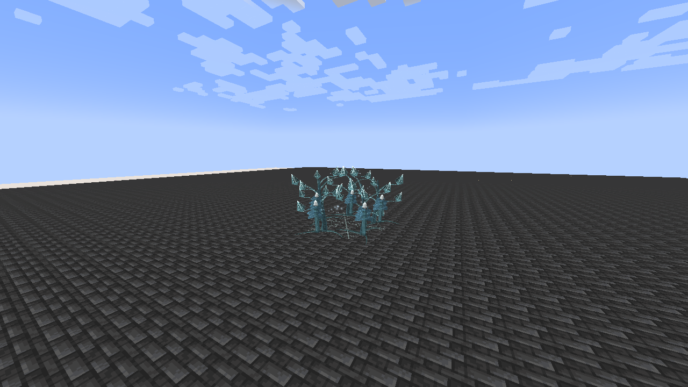

# Demeter, Lady of Sanctuary

[All wikis](https://github.com/Bithio999/MC/wiki/Home) · [Tensura Myths](https://github.com/Bithio999/MC/wiki/Tensura-Myths)

Demeter, Lady of Sanctuary is an Ultimate Skill focused on ice orchard, one-use allied rescue seeds and delayed crystal blooms.

| Skill data | Value |
| --- | --- |
| Tier | Ultimate |
| Resource | Aura |
| Passive upkeep | 110 aura / second |
| Obtaining | Synthesis: master both ingredients; 2M total EP |

## Active abilities

| Ability | Damage type / base damage | Cost | Cooldown |
| --- | --- | --- | --- |
| Winter Orchard | Ice elemental against enemies; allied healing has no damage type · 500 per enemy pulse | 12,000 aura | 20 s |
| Perennial Seed | None | 10,000 aura | 24 s |
| Winter Harvest | Ice elemental · 1,400; 2,200 when consuming a live orchard | 20,000 aura | 24 s |

## Passive

- Damage type: None — support / defense
- Upkeep: 110 aura / second
- Gain 200% increased natural SHP regeneration, 100% Water boost and 0.6 knockback resistance. Water boost also strengthens native Ice attacks where they use the shared Water/Ice attribute.

## Winter Orchard

- Damage type: Ice elemental against enemies; allied healing has no damage type
- Resource cost: 12,000 aura
- Cooldown: 20 seconds
- Raw damage: 500 per enemy pulse
- Plant a twelve-block-radius crystal orchard within 32 blocks for twelve seconds. Each second, heal up to eight allies for 10% maximum HP and 10% maximum SHP, and strike up to eight visible enemies for ice damage with native Chill II for two seconds.

## Perennial Seed

- Damage type: None — recovery / cleanse
- Resource cost: 10,000 aura
- Cooldown: 24 seconds
- Duration: 12 seconds or until triggered
- Plant one rescue seed on yourself and eligible allies within sixteen blocks, up to eight recipients total. Placing a seed cleanses ordinary Poison, Wither, Chill and Webbed effects.

## Winter Harvest

- Damage type: Ice elemental
- Resource cost: 20,000 aura
- Cooldown: 24 seconds
- Raw damage: 1,400; 2,200 when consuming a live orchard
- Select up to six enemy positions within twelve blocks of your orchard, or an aimed location within 32 blocks if no orchard is active. Consume the live orchard to empower the blooms and immediately restore eligible allies within twelve blocks for 20% maximum HP and SHP.

## Related

[Skill synthesis](https://github.com/Bithio999/MC/wiki/Skill-Synthesis) · [Godly Skills](https://github.com/Bithio999/MC/wiki/Godly)

## Pictures and video

