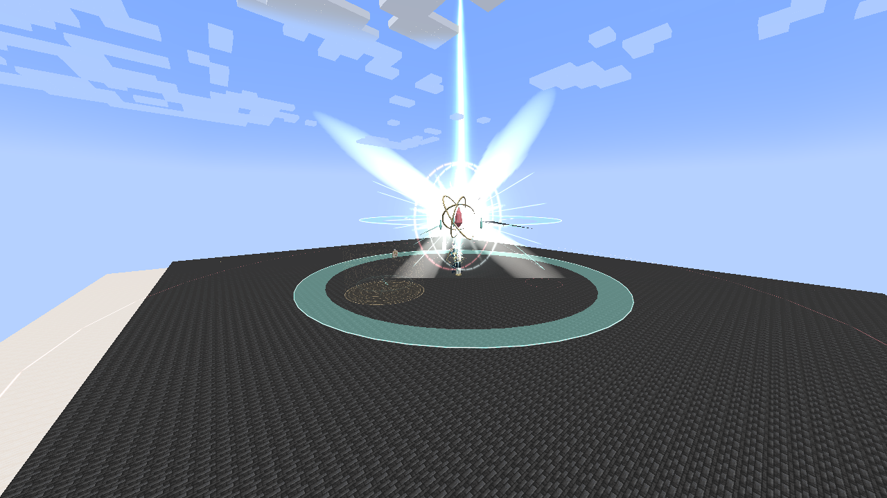

# Demiurge, God of Genesis

[All wikis](https://github.com/Bithio999/MC/wiki/Home) · [Tensura Myths](https://github.com/Bithio999/MC/wiki/Tensura-Myths)

**Demiurge, God of Genesis** belongs to [Eschaton](https://github.com/Bithio999/MC/wiki/Eschaton). It cannot be rolled, synthesized or equipped by players. Listed values are before defenses and other modifiers.

| Ability | Damage type / raw damage | Cost | Cooldown |
| --- | --- | --- | --- |
| Crownless Edge | Physical aura slash · 14,000 per fan | 400,000 aura | 6 seconds |
| Astral Loom | Light elemental · 6,500 per pulse; at most once per victim per pulse | 900,000 magicules | 12 seconds |
| Sevenfold Genesis | Fire, Water, Lightning, Earth, Wind, Light, Space · 18,000 per star | 1,800,000 magicules | 14 seconds |
| Null Testament | Space elemental · 28,000; once per victim | 4,000,000 magicules | 18 seconds |
| Primordial Exchange | None — resource conversion | 20,000,000 aura, paid on activation | 24 seconds |
| Thronefall | Earth elemental · 36,000; once per victim | 2,000,000 aura | 16 seconds |
| The End of All Myths | Space elemental · 120,000; once per victim | 25,000,000 magicules | 42 seconds |

## Crownless Edge

**Warning / strikes:** 24 ticks; strikes at ticks 24, 40 and 56.

**Geometry:** 65° half-angle fans; radial bands 0–18, 12–32 and 24–46 blocks; vertical distance up to 9 blocks.

An execution blade winds up, cuts forward, reverses behind Eschaton and finishes with a long forward cleave. The middle fan faces the opposite direction. Moving through the open angles or changing radial bands avoids the sequence; standing behind him for all three strikes is unsafe.

## Astral Loom

**Warning / active window:** 32 ticks; pulses every 10 ticks until tick 112.

**Geometry:** Four / six / eight rotating rays in forms I / II / III; 46-block reach; 1.1-block hit tolerance.

A stellar armature assembles around Eschaton and projects rotating pearl-white rays. The gaps remain safe; orbit with the pattern rather than crossing the light repeatedly. A victim intersecting multiple rays in one pulse is hit once.

## Sevenfold Genesis

**Warning / cadence:** Each warning locks 32 ticks before its impact; new stars every 14 ticks.

**Geometry:** Seven separate 4.5-block impact spheres.

Each star snapshots the current target's position **when its warning appears**. Earlier warnings stay in place while later stars follow the target's new location. Flame tongues, water ribbons, lightning forks, earth facets, wind helices, light rays and spatial slashes distinguish the seven stars. Keep moving away from locked warnings.

## Null Testament

**Warning:** 38 ticks.

**Geometry:** Three parallel 72-block segments, spaced 12 blocks apart; target hitboxes expanded 2.4 horizontally and 8 vertically.

**Additional effect:** 60 ticks of native Magic Interference II, attributed to Godly Demiurge.

Three tall scripture slabs open into spatial corridors. Move between the marked lanes before they cut. The disruption is applied after a successful hit and retains native status protections. Its Godly source can pass classification immunity to **non-Godly** interference; it does not guarantee every status application.

## Primordial Exchange

**Channel:** 48 ticks before payout.

**Completion:** +8,000,000 current magicules, capped at current maximum.

Two counter-flowing helixes feed a suspended genesis vessel. The AI favors this move when its magicules are below 15%. The payout happens once. Cancelling or interrupting the channel loses the initial aura payment without granting magicules. It does not directly heal HP or SHP, and cannot run when the magicule pool lacks room for its full payout.

## Thronefall

**Warning:** 36 ticks.

**Geometry:** Collision-safe short ascent; locked landing four blocks from the target's activation position; 9-block impact sphere.

Eschaton rises toward an apex six blocks above his starting position while a landing crest marks the ground. He descends onto the locked point in a burst of concentric impact frames. The landing stops following the target after activation. A blocked destination prevents activation; a destination obstructed during the warning cancels the actual landing and hit without refunding the cast.

## The End of All Myths

**Warning:** **200 ticks / ten seconds**.

**Geometry:** 56-block damage sphere centered on the saved casting origin.

Creation seals feed a growing black world seed above Eschaton. A vast canopy, broad converging ribbons, saturated light plumes and rising fragments surround the lensed seed. The formation compresses before its final expanding nova and pressure front, making its buildup visible across the arena. Break a seal for a seven-block horizontal, ten-block vertical refuge and a large drain of current reserves. Break all three to cancel the nova and create an eight-second opening. See [creation seals](https://github.com/Bithio999/MC/wiki/Eschaton#creation-seals) for exact resource drains and placement rules.

## Pictures and video

[Watch Eschaton’s arts](https://github.com/Bithio999/MC/raw/refs/heads/main/wiki/media/eschaton-aion-anime-preview.mp4)
