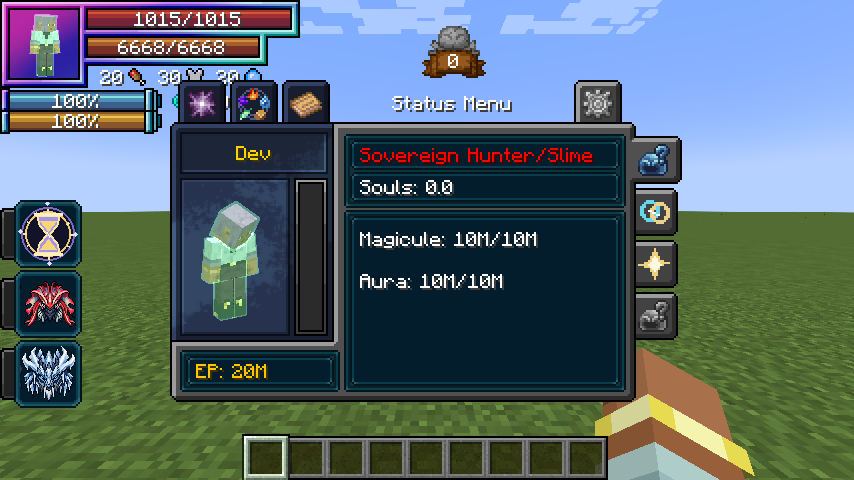
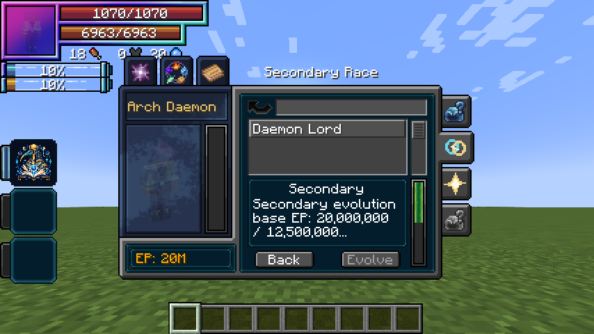

# Duo Races

> **Discontinued archive:** Tensura Myths ended at 0.36.1. No further updates are planned.

[All wikis](https://github.com/Bithio999/MC/wiki/Home) · [Tensura Myths](https://github.com/Bithio999/MC/wiki/Tensura-Myths)

Duo Races let an awakened player develop a second ancestral race alongside their primary race. The primary race retains the body, size and normal racial key.

## Unlock

Finish your primary race, become a True Hero or True Demon Lord, and reach 5M total EP. Choose a different ancestry in the right-side Secondary Race tab. Confirm carefully: the choice is permanent for this life.

## Develop the secondary

The added EP gates are fixed: 7.5M, 10M, 12.5M, 15M for the first four evolutions. Meet the native requirements shown in the menu too.

The secondary gives half-strength racial attributes and +10% native EP gain. Its racial action can be bound separately in Controls. The primary keeps your body and ordinary racial key.

## Daemon naming

Being named means receiving your own name through Tensura. Naming other mobs, mass naming, name tags and nicknames do not satisfy it.

## Next step

Finish both lineages to unlock their Convergent Awakening. The right-side tabs show current eligibility.

## Related

[Convergent Awakening](https://github.com/Bithio999/MC/wiki/Convergent-Awakening)

## Pictures and video

