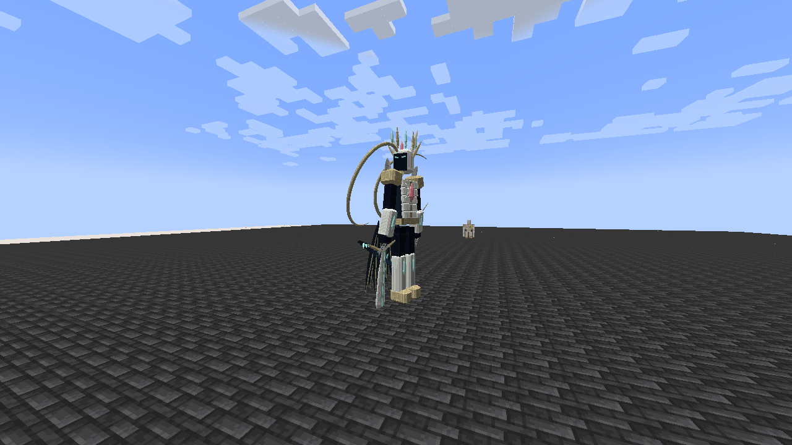
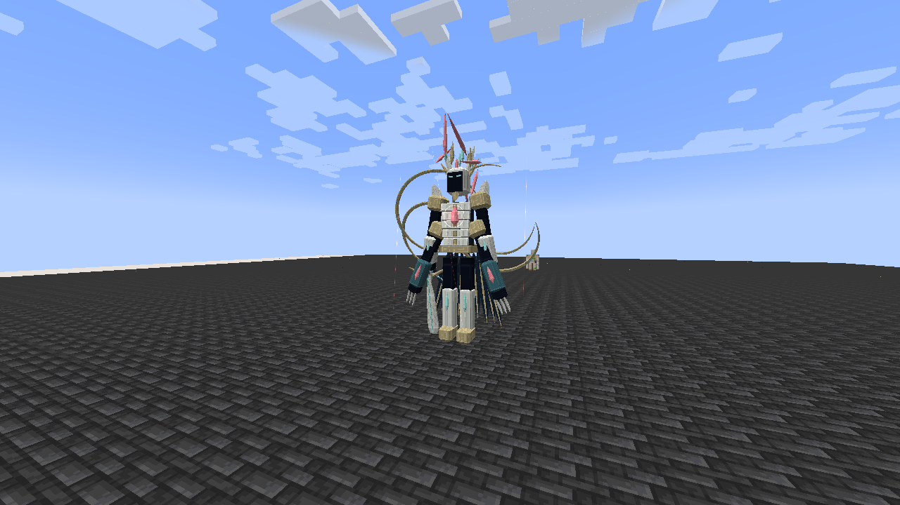

# Eschaton, the Last Myth

> **Discontinued archive:** Tensura Myths ended at 0.36.1. No further updates are planned.

[All wikis](https://github.com/Bithio999/MC/wiki/Home) · [Tensura Myths](https://github.com/Bithio999/MC/wiki/Tensura-Myths)

**Eschaton** is the final Myth boss: an Origin Sovereign with **one billion EP**, [Demiurge](https://github.com/Bithio999/MC/wiki/Demiurge), [Aion](https://github.com/Bithio999/MC/wiki/Aion), [Thoth](https://github.com/Bithio999/MC/wiki/Thoth), Infinite Regeneration and all native resistance/nullification skills.

| Boss data | Value |
| --- | --- |
| Race | Origin Sovereign |
| Classification | Final Myth; native True Demon Lord |
| Base / maximum EP | 1,000,000,000 |
| Aura / magicules | 500,000,000 / 500,000,000 |
| Maximum HP / SHP | 1,000,000 / 4,000,000 |
| Armor / toughness | 100 / 60 |
| Base melee damage | 2,600; native mob attack |
| Entity size | 2.6 blocks wide; 6.2 blocks tall |

## Summoning

Craft **Last Convergence**:

| | | |
| --- | --- | --- |
| Beacon | Nether Star | Beacon |
| Dragon's Breath | Dawn Testament | Dragon's Breath |
| Beacon | Nether Star | Beacon |

The Dawn Testament is obtained from [Ananke](https://github.com/Bithio999/MC/wiki/Ananke). Use the invitation on a beacon on Easy, Normal or Hard, with seven clear blocks above it and sufficient width. The invitation is consumed only after a successful summon; creative players retain it. The ritual fails if another living Eschaton is within 256 blocks. There is no player EP gate.

Prepare a broad, open arena, preferably more than 120 blocks across.

## Forms

- I — Origin Sovereign · Entry: Initial summon · Combat changes: Crownless Edge, Astral Loom, Sevenfold Genesis, Thronefall, exchange and apocalypse
- II — Crown of Ruin · Entry: First fatal defeat that regeneration cannot prevent · Combat changes: Two additional arms and crescent mantle unfold; Null Testament and World-Eater's Wake join the rotation; Thoth auxiliary casts
- III — The Last Myth · Entry: Second fatal defeat that regeneration cannot prevent · Combat changes: Seven crown blades awaken; fastest decisions; Aion auxiliary casts join Thoth
- Infinite Regeneration takes priority. Funded native regeneration can prevent death without spending a form.
- The form change clears outstanding owned attacks and seals. It is triggered by fatal defeat, rather than a health percentage or elapsed time.

Each form transition refills HP, SHP, aura and magicules. Infinite Regeneration spends magicules first; Eschaton has no passive aura/magicule regeneration. Expect to exhaust his reserves three times.

## Combat

- Crownless Edge · Damage type: Physical Aura Slash · Pattern / counterplay: Three timed fans; the middle reverses direction
- Astral Loom · Damage type: Light elemental · Pattern / counterplay: Rotating rays with gaps between them
- Sevenfold Genesis · Damage type: Fire, Water, Lightning, Earth, Wind, Light, Space · Pattern / counterplay: Seven individually warned and locked impact locations
- Null Testament · Damage type: Space elemental · Pattern / counterplay: Three parallel spatial corridors; successful hits can apply Godly Magic Interference
- World-Eater's Wake · Damage type: Darkness elemental · Pattern / counterplay: Three expanding hollow fronts; two opposing golden gaps in each
- Primordial Exchange · Damage type: None · Pattern / counterplay: Paid aura-to-magicule conversion; interrupted channels lose their payment
- Thronefall · Damage type: Earth elemental · Pattern / counterplay: Short ascent and a locked, warned landing zone
- The End of All Myths · Damage type: Space elemental · Pattern / counterplay: Ten-second apocalypse; break seals to open refuges or interrupt it
- Four bossbars at the upper right show HP, SHP, magicules and aura. Confirmed HP or SHP loss gives the model a red damage flash even with Pain Nullification.
- Eschaton flies, pursues valid targets, uses paid collision-safe spatial movement and attacks at close range. Targets must remain within 112 blocks of his anchor.

## Rewards

- Crown of the Last Myth: One guaranteed; use once per player for 25,000,000 base EP and permanent +20% maximum HP and SHP modifiers
- Origin Fragment: 6–12; four plus a Nether Star craft Last Convergence; four plus a Ghast Tear and Dragon's Breath craft a Dawn Testament
- Nether Star: 12–24
- The Last Myth advancement: Challenge advancement; 5,000 XP
- A player-credited final kill drops:
- The crown preserves the player's native primary or convergent aura/magicule allocation ratio. Its permanent HP/SHP modifiers obey the player's normal native attribute limits.

## Related

[In-game guide](https://github.com/Bithio999/MC/wiki/In-Game-Guide)

## Pictures and video

[Watch eschaton aion anime preview](https://github.com/Bithio999/MC/raw/refs/heads/main/wiki/media/eschaton-aion-anime-preview.mp4)

## Creation seals

During **The End of All Myths**, up to three Genesis Seals appear, each with **120,000 HP**. Break one to drain **50M magicules and 25M aura** from Eschaton and open a golden refuge (7 blocks horizontally, 10 vertically).

Break all three to cancel the apocalypse and stagger him for **8 seconds**, taking **25% more damage**. Otherwise, shelter in a broken seal’s refuge or leave the **56-block** damage sphere. Seals do not grant normal boss loot/progression.
