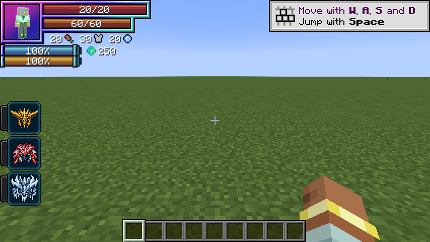

# Hunter lineage

> **Discontinued archive:** Tensura Myths ended at 0.36.1. No further updates are planned.

[All wikis](https://github.com/Bithio999/MC/wiki/Home) · [Tensura Myths](https://github.com/Bithio999/MC/wiki/Tensura-Myths)

An alternate Human branch: Awakened Hunter → Apex Hunter → Sovereign Hunter.

## Requirements

- Awakened Hunter: 100,000 total EP and 1 distinct boss type.
- Apex Hunter: 400,000 total EP and 3 distinct boss types.
- Sovereign Hunter: 2,000,000 total EP, 5 distinct boss types and one mastered Myths Unique.

## Rewards

HP / SHP bonuses: +100 / +400; +500 / +3,200; +1,000 / +6,600. The new stage replaces the old racial bonuses. Each stage grants the corresponding aura recovery skill.

## Boss credit

Repeated kills of one boss type give one entry. Player-attributed kills while Human or a hunter count. Wither, Ender Dragon and supported boss-tagged mobs qualify.

## Related

[Aura regeneration](https://github.com/Bithio999/MC/wiki/Aura-Regeneration) · [Storm Crown](https://github.com/Bithio999/MC/wiki/Storm-Crown)

## Pictures and video

