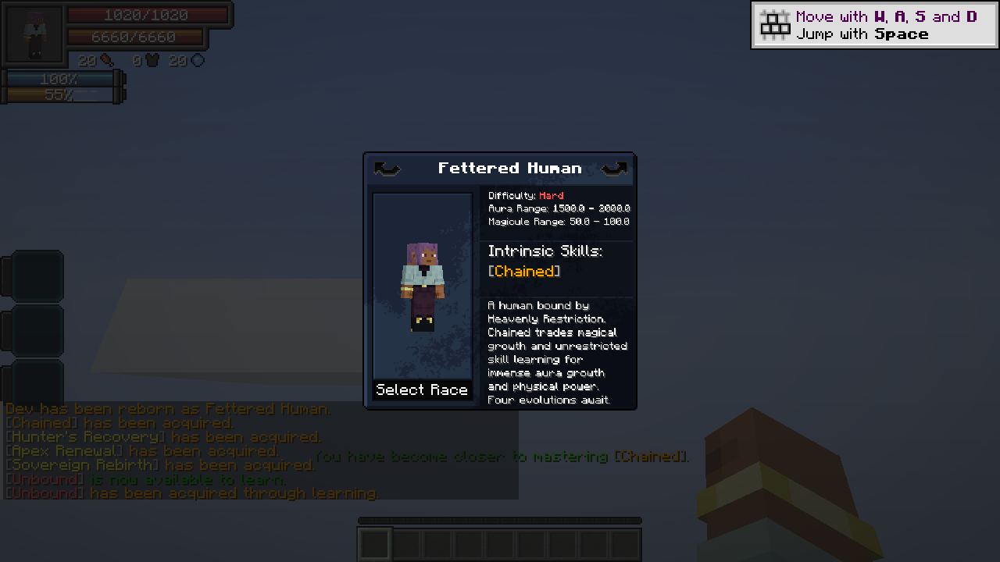

# Heavenly Restriction lineage

> **Discontinued archive:** Tensura Myths ended at 0.36.1. No further updates are planned.

[All wikis](https://github.com/Bithio999/MC/wiki/Home) · [Tensura Myths](https://github.com/Bithio999/MC/wiki/Tensura-Myths)

Choose Fettered Human at reincarnation. Difficulty: Hard. The lineage keeps your human appearance.

## Starting resources

1,500–2,000 aura and 50–100 magicules. Chained is granted at birth and retained through evolution; starting aura is not multiplied.

## Evolution requirements

- Tempered Vessel: 100,000 total EP; 1 mastered Battlewills; Chained 20%.
- Unshackled: 500,000 total EP; 2 mastered Battlewills; Chained 40%.
- Heavenly Restricted: 2,000,000 total EP; 3 mastered Battlewills; Chained 60%.
- Heavenbreaker: 8,000,000 total EP; 4 mastered Battlewills; Chained 100%.

## Progression

Use Tensura’s race evolution menu. EP requirements check the total shown in Status. Hunter’s Recovery is granted at Unshackled; Apex Renewal at Heavenly Restricted; Sovereign Rebirth at Heavenbreaker.

## Racial health bonuses

Tempered Vessel: +100 HP / +400 SHP. Unshackled: +300 HP / +1,600 SHP.

Heavenly Restricted: +600 HP / +3,600 SHP. Heavenbreaker: +1,000 HP / +6,600 SHP. Each stage replaces the old racial bonuses.

## Starting skill rolls

Skills with magicule-cost abilities or target-skill stealing/copying are excluded from Fettered Human’s starting rolls. Pride is exempt; Creator and recorded derived skills remain allowed.

## Related

[Chained](https://github.com/Bithio999/MC/wiki/Chained) · [Unbound](https://github.com/Bithio999/MC/wiki/Unbound) · [Aura regeneration](https://github.com/Bithio999/MC/wiki/Aura-Regeneration) · [Air Walk](https://github.com/Bithio999/MC/wiki/Air-Walk)

## Pictures and video

