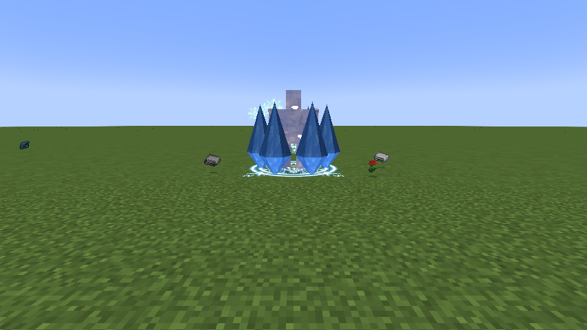
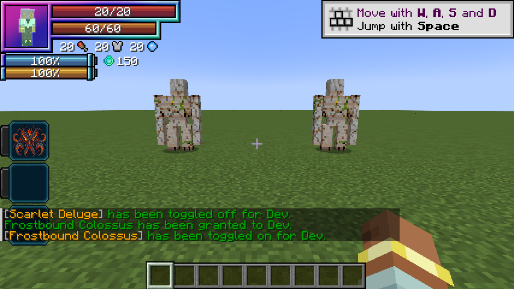

# Frostbound Colossus

[Main Page](https://github.com/Bithio999/MC/wiki/Home) · [Skills](https://github.com/Bithio999/MC/wiki/Skills) · [Ability index](https://github.com/Bithio999/MC/wiki/Abilities) · [Damage types](https://github.com/Bithio999/MC/wiki/Damage-Types)

**Frostbound Colossus** is a Unique Skill inspired by **Jin Dahaad**. It combines avalanche impacts, ice capture, and a defensive carapace.

| Skill data | Frostbound Colossus |
| --- | --- |
| **Information** | |
| Type | Unique Skill |
| Inspiration | Jin Dahaad |
| Damage type | Ice elemental |
| Damage ID | `tensura:ice_elemental` |
| Combat role | Avalanche impact / capture / ice siege |
| Active modes | 2 |
| Toggleable passive | Colossus Carapace |
| Passive upkeep | 20 aura / second |
| Registry ID | `wildhunt:frostbound_colossus` |
| **Evolution** | |
| Previous | — |
| Evolution | [Ymir, Lord of Winter](https://github.com/Bithio999/MC/wiki/Ymir) |
| **Obtaining** | |
| Method | Reincarnation / starting skill roll |

All damaging arts in this skill use **ice elemental damage**, including its area hits and pulses.

## Usage

### Passive

[Passive - Toggle] — **Colossus Carapace**

| Ability information | Value |
| --- | --- |
| Damage type | None — support / defense |
| Damage ID | — |
| Effect | No direct damage; modifies the caster’s attributes or defenses. |

While toggled on, gain 20 armor, 36 physical barrier, 13.5 magic barrier, one knockback resistance and 50% water-element boost. Tensura classifies ice under water for this boost. This uses the native barrier layer and damage rules, not absorption or the former projectile-deletion ward.

The passive also arms a **150-capacity native Multilayer Barrier**, which appears in Tensura’s shield HUD counter when its Barrier decoration is enabled. The counter is a per-hit blocking capacity, not absorption hearts or a custom health bar. Native rules spend magicules on blocked damage and can break the barrier on overflow, insufficient magicules or stronger attacks. While still toggled on, a broken barrier automatically rearms on the first paid upkeep after **ten seconds without an incoming hit**. Any new hit restarts the delay, including hits completely blocked by a surviving shield. Retoggling does not bypass the delay. Surviving shields persist across relogs.

Enable or disable this through Tensura’s native **Ability Selection** skill toggle. It is separate from active mode cycling and has no fifteen/thirty-second duration. Upkeep is **20 aura per second**, with the first second paid on enabling. It turns off when aura is insufficient or activation requirements fail. Turning it off removes its own attribute modifiers immediately.

The toggle uses native barrier rendering and the shield HUD.

### Active

| Mode | Aura | Cooldown | Raw opening damage |
| --- | ---: | ---: | ---: |
| 1. Avalanche Crash | 200 | 4 s | 100 |
| 2. Glacial Prison | 650 | 8 s | 55 |

**Damage calculation:** multiply the listed base values by **0.90**, then by the mastery multiplier (up to **1.50**). Ultimate table values already include their 3× base multiplier. Elemental boosts, defenses, barriers, and situational modifiers also apply. EP does not multiply damage.

#### Avalanche Crash

[Active - Press] — **Avalanche Crash**

| Ability information | Value |
| --- | --- |
| Damage type | [Ice elemental](https://github.com/Bithio999/MC/wiki/Damage-Types#ice) |
| Damage ID | `tensura:ice_elemental` |
| Effect | Direct hits use this native element. |

Aim at a visible enemy up to 16 blocks away, or at the endpoint if no enemy is selected. Erupt eight rendered ice spires around the impact. Damage enemies in a 4-block radius and launch them upward and outward, respecting knockback resistance.

#### Glacial Prison

[Active - Press] — **Glacial Prison**

| Ability information | Value |
| --- | --- |
| Damage type | [Ice elemental](https://github.com/Bithio999/MC/wiki/Damage-Types#ice) |
| Damage ID | `tensura:ice_elemental` |
| Effect | Direct hits use this native element. |

Aim at one visible hostile within 20 blocks. Deal the listed hit damage, then apply Tensura’s native Frost effect for up to 4 seconds, subject to its rank and resistance checks. Six rendered spires and an Ice magic circle mark the prison. The visual cage places no blocks and adds no separate collision wall. There is no projectile-interception budget.

## Obtaining

Roll through Tensura’s normal reincarnation system. These Uniques join the configured primary pool; no particular roll is guaranteed. There are no skill trials, boss-awarded skills or race requirements to roll.

## Evolution

| Unique Skill | Ultimate Skill | Requirements |
| --- | --- | --- |
| Frostbound Colossus | [Ymir, Lord of Winter](https://github.com/Bithio999/MC/wiki/Ymir) | Sovereign Hunter; 2,000,000 base EP; matching Unique mastered |

Ascension replaces only the matching Unique. The Ultimate starts with its own mastery.

## Suggested combo

Capture an enemy with Glacial Prison → aim Avalanche Crash at the captive and nearby foes. As Ymir, use the prison to hold a target within Heavenfall Glacier’s warning circles.

## Strengths and limitations

Prison uses native Frost, so immunity, skill rank and stronger defensive effects can affect it. The cage mesh is visual. Icefall marks stay where they were placed and can be dodged. Neither spires nor falling ice change terrain. There are no rime stacks, shatter preparation, finite projectile wards or expanding frostfronts.

## In-game preview

In-game example of the active art.

## Native barrier HUD

The Unique passive’s native shield counter. Its Ultimate uses a higher capacity.

## Related pages

[Skills](https://github.com/Bithio999/MC/wiki/Skills) · [Mechanics](https://github.com/Bithio999/MC/wiki/Mechanics) · [Evolution](https://github.com/Bithio999/MC/wiki/Evolution) · [Commands](https://github.com/Bithio999/MC/wiki/Commands)

---

**Categories:** Tensura Myths · Skills
